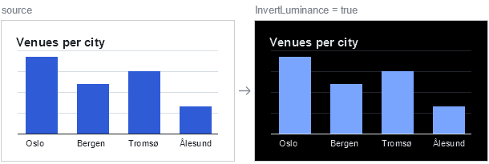

# Data Modelling & Querying with Relatude.DB

**A practical manual**

Relatude.DB is an open-source, C#-native object-oriented graph database with integrated full-text
(BM25) search, vector/semantic search, file storage, faceting and a built-in admin UI. It runs
in-process or server-hosted, and targets .NET 10+.

This manual shows how to shape your data, write it and get it back out, and covers the tools and
services around the engine. It uses **one running example domain**, a venue-and-events platform, so
each concept builds on the last.

> Relatude.DB is pre-1.0, so the API may still change. The source is at
> [github.com/Relatude/Relatude.DB](https://github.com/Relatude/Relatude.DB).

---

## Table of contents

**Part I — Data modelling**

1. [The mental model](#1-the-mental-model)
2. [Your first node type — and why interfaces win](#2-your-first-node-type)
3. [Scalar properties and their attributes](#3-scalar-properties-and-their-attributes) · [3.1 overriding attributes](#31-overriding-attributes)
4. [Marker properties](#4-marker-properties)
5. [Geo coordinates](#5-geo-coordinates)
6. [Files](#6-files) · [6.1 file analysis](#61-file-analysis)
7. [Embedded data](#7-embedded-data)
8. [References — lightweight pointers](#8-references--lightweight-pointers)
9. [Relations — the graph edges](#9-relations--the-graph-edges) · [9.1 ordered relation lists](#91-relation-lists-are-ordered)
10. [Choosing between relation, reference and embedded](#10-choosing-between-relation-reference-and-embedded)
11. [The complete example model](#11-the-complete-example-model) · [11.1 with facet interfaces](#111-the-same-model-with-facet-interfaces)
12. [Registering the model & the admin UI](#12-registering-the-model--the-admin-ui) · [12.1 every relatude.db.json setting](#121-every-setting-in-relatudedbjson) · [12.2 source control, deployment and appsettings](#122-what-goes-where-source-control-deployment-and-appsettings)

**Part II — Writing data**

13. [Create, insert, update, delete](#13-create-insert-update-delete)
14. [Relating nodes](#14-relating-nodes)
15. [Transactions](#15-transactions)
16. [Older versions of a node](#16-older-versions-of-a-node) · [16.1 reverting the database](#161-reverting-the-database-to-an-earlier-point)
17. [Uploading files](#17-uploading-files)
18. [URLs and the URL manager](#18-urls-and-the-url-manager) · [18.1 asset URLs](#181-asset-urls-files-variants-and-deeplinks) · [18.2 links inside HTML](#182-links-inside-html-and-markdown)

**Part III — Querying**

19. [Query anatomy](#19-query-anatomy)
20. [Filtering with Where](#20-filtering-with-where)
21. [Text and semantic search](#21-text-and-semantic-search)
22. [Geo queries](#22-geo-queries)
23. [Relation filters](#23-relation-filters)
24. [Eager loading: Include and Preload](#24-eager-loading-include-and-preload)
25. [Graph traversal and shortest path](#25-graph-traversal-and-shortest-path)
26. [Sorting, paging and result sets](#26-sorting-paging-and-result-sets)
27. [Aggregates](#27-aggregates)
28. [Faceted search](#28-faceted-search) · [28.1 pivot tables](#281-pivot-tables) · [28.2 GroupBy](#282-groupby)
29. [Cultures, visibility and scoped stores](#29-cultures-visibility-and-scoped-stores)
30. [Pitfalls and gotchas](#30-pitfalls-and-gotchas)

**Part IV — Tooling**

31. [The command line tool](#31-the-command-line-tool)
32. [Logs — recording what the application does](#32-logs--recording-what-the-application-does) · [32.4 HyperLogLog](#324-estimated-unique-counts-hyperloglog) · [32.8 Positions](#328-positions)

**Part V — APIs**

33. [GraphQL endpoints](#33-graphql-endpoints) · [33.2 the definition file](#332-the-definition-file) · [33.4 querying](#334-querying) · [33.6 mutations](#336-mutations) · [33.9 code-first](#339-code-first-mapping-an-endpoint-in-programcs)
34. [AI services](#34-ai-services) · [34.1 text](#341-text-embeddings-and-completions) · [34.2 images](#342-images) · [34.3 files to text](#343-files-to-text) · [34.4 translation](#344-translation) · [34.5 prices and errors](#345-prices-answers-kept-and-errors)
35. [Relatude Services](#35-relatude-services) · [35.1 a license is not needed](#351-a-license-is-not-needed) · [35.2 a provider of your own](#352-a-provider-of-your-own) · [35.3 the account](#353-the-account-at-servicesrelatudecom) · [35.4 connecting an installation](#354-connecting-an-installation)

**Part VI — Background work**

36. [Background tasks and the scheduler](#36-background-tasks-and-the-scheduler) · [36.1 jobs](#361-jobs) · [36.2 schedules](#362-schedules) · [36.3 the Scheduler page](#363-the-scheduler-page)

---
---

# Part I — Data modelling

## 1. The mental model

Everything in Relatude.DB is a **node**. A node has:

| Ingredient | What it is |
|---|---|
| `Guid Id` | The public identity. The engine also keeps an internal `int` id (`__Id`) for its indexes. |
| `NodeMeta Meta` | Metadata the system manages: timestamps, culture, revision, access, display name, address. |
| **Scalar properties** | `string`, `int`, `decimal`, `DateTime`, `bool`, `Guid`, `GeoCoordinate`, `FileValue`, `PasswordValue`, arrays… |
| **Embedded data** | Sub-objects stored inside the node: `Embedded<T>`, `EmbeddedMap<TKey,TValue>`. |
| **References** | A stored `Guid` (or `Guid[]`) pointing at other nodes. One-directional, with no reverse index. |
| **Relations** | Graph edges, declared as classes of their own. Bidirectional, indexed and traversable. |

There is no separate schema language: your C# types *are* the schema. Point the engine at a
namespace and it builds the datamodel from your interfaces and classes.

### Interfaces are the model

A node type can be an interface, a class, a record or a struct. No attribute is needed: every type
in a namespace you register becomes a node type unless it is marked `[Exclude]`. `[Node]` only tunes
a type (see [stable type ids](#optional-stable-type-ids) below), so most types in this manual do
without it.

Interfaces are the recommended default, and this manual uses them almost everywhere. An interface on
its own is a complete node type. `db.Create<IVenue>()` returns a generated proxy that implements it,
tracks your changes and loads relations lazily. You never write a class.

Interfaces also give you multiple inheritance: every interface a node type implements becomes a
*parent node type*, and a C# type can implement many interfaces but inherit only one class.
[§2](#2-your-first-node-type) shows how to use this.

---

## 2. Your first node type

The three namespaces a model file usually imports:

```csharp
using Relatude.DB.Common;       // FileValue, GeoCoordinate, NodeKey
using Relatude.DB.Datamodels;   // NodeMeta, RevisionType
using Relatude.DB.Nodes;        // attributes, relation bases, Reference, References, EmbeddedMap
```

Here is `IOrganizer`, a company that runs events. **The interface is the whole node type.** There is
no class, and none is needed:

```csharp
namespace VenueApp.Models;

public interface IOrganizer {
    Guid Id { get; set; }

    [StringProperty(Indexed = true, IndexedByWords = true, MaxLength = 200, DisplayName = true)]
    string Name { get; set; }

    [StringProperty(UniqueValues = true, MaxLength = 254)]
    string ContactEmail { get; set; }

    [StringProperty(Indexed = true, UniqueValues = true, RegularExpression = @"^[a-z0-9-]+$")]
    string Slug { get; set; }

    [CreatedUtcProperty]
    DateTime CreatedUtc { get; }    // filled in by the store

    NodeMeta Meta { get; }          // read-only on the interface
}
```

Create, store and query it:

```csharp
var org = db.Create<IOrganizer>();      // a generated proxy that implements IOrganizer
org.Name = "Nordic Live AS";
org.Slug = "nordic-live";               // required: the pattern does not match an empty value
org.ContactEmail = "hello@nordiclive.no";
db.Insert(org);

var again = db.Get<IOrganizer>(org.Id);
var all   = db.Query<IOrganizer>().Where(o => o.Name.StartsWith("Nordic")).Execute();
```

Three rules for interface node types:

1. **`Meta` is get-only**, and so are relation, reference and embedded properties and the marker
   members (`[CreatedUtcProperty]`, `[AddressProperty]` and the like, [§4](#4-marker-properties)).
   The store provides them, and you never assign them. Scalar properties are `{ get; set; }`.
2. **Leave `Id` as `Guid.Empty`** and the store assigns one on insert, or set it yourself first.
3. **Put attributes on the interface.** A property is defined by the type that first declares it, so
   attributes on a class member that implements it are ignored. The one exception is
   `[PropertyOverride]` ([§3.1](#31-overriding-attributes)).

`[Exclude]` leaves a type or a property out of the datamodel.

### Why interfaces are the better default

| | Interface | Class |
|---|---|---|
| Multiple inheritance | **yes**, many interfaces per type | no, one base class |
| Instantiation | `db.Create<T>()` returns a proxy | `new T()` or `db.Create<T>()` |
| Change tracking | the proxy tracks property writes | you manage state yourself |
| Default values | handled by the proxy | you initialise every reference type |
| Parameterless constructor | not needed | **required**, or the model builder throws |
| Querying | the same | the same |

An interface model is shorter, has no initialisation to forget and, most important, composes.

### Multiple inheritance with interfaces

The engine records every interface a type implements as a parent node type. So you can define small,
focused facet interfaces:

```csharp
// A thing that sits somewhere on the map.
public interface ILocatable {
    [GeoCoordinateProperty(Indexed = true)]
    GeoCoordinate Location { get; set; }

    [StringProperty(Indexed = true, MaxLength = 2)]
    string CountryCode { get; set; }
}

// A thing with an identity, a name and a slug.
public interface INamedNode {
    Guid Id { get; set; }
    NodeMeta Meta { get; }

    [StringProperty(Indexed = true, IndexedByWords = true, PrefixSearch = true, DisplayName = true)]
    string Title { get; set; }

    [AddressProperty]
    string Slug { get; }          // the node's address, set with db.UpdateAddress
}

// A thing with a searchable rich-text body.
public interface IDescribed {
    [HtmlProperty(IndexedByWords = true, IndexedBySemantic = true)]
    string Description { get; set; }
}

// A thing that can be tagged.
public interface ITagged {
    [StringArrayProperty(Indexed = true)]
    string[] Tags { get; set; }
}
```

Then compose them per type:

```csharp
public interface IVenue    : INamedNode, IDescribed, ILocatable, ITagged { /* venue-only    */ }
public interface IEvent    : INamedNode, IDescribed,              ITagged { /* event-only    */ }
public interface IAttendee : INamedNode,              ILocatable          { /* attendee-only */ }
```

Each facet's properties are declared once, with their indexing and validation, and every type that
implements the facet gets them. A new type that belongs on the map needs one more interface and
nothing else. With classes, `Venue` could inherit only one base class, so you would copy properties
between types and keep their attributes in sync by hand.

### Querying across the hierarchy

**`Query<T>()` matches `T` and every type that inherits from it.** So you can query a facet interface
directly and get mixed results:

```csharp
var oslo = new GeoCoordinate(59.9139, 10.7522);

// Every locatable node within 5 km: venues and attendees together
var nearby = db.Query<ILocatable>()
               .Where(x => x.Location.IsWithin(oslo, 5_000))
               .Execute();

foreach (var x in nearby) {
    Console.WriteLine(x switch {
        IVenue v    => $"Venue: {v.Title}",
        IAttendee a => $"Attendee: {a.Title}",
        _           => "Something else"
    });
}

// One search box over everything that has a title
var hits = db.Query<INamedNode>()
             .WhereSearch("outdoor jazz", semanticRatio: 0.5)
             .Execute();

// One tag cloud over everything taggable
var tagCloud = db.Query<ITagged>().Facets().AddValueFacet(x => x.Tags).Execute();

// Narrowed back to specific types when you want that
var venuesOnly = db.Query<ILocatable>()
                   .WhereTypes(new[] { typeof(IVenue) }, includeDescendants: true)
                   .Where(x => x.CountryCode == "NO")
                   .Execute();
```

A site-wide search, a "recently changed" feed or a map of everything with coordinates is then one
indexed query, not one query per type merged in memory.

> The example model in [§11](#11-the-complete-example-model) declares every property directly on each
> type, so that each type reads on its own. [§11.1](#111-the-same-model-with-facet-interfaces) shows
> the same model built from facet interfaces. That is the shape to use in a real project.

### Two constraints to design around

The model builder refuses anything ambiguous. It checks these two rules when it builds the model, so
you find out at startup:

1. **Two parent interfaces may not declare the same property name.** If `ILocatable` and `ITagged`
   both declared `CountryCode`, any type implementing both would fail to build. Keep facets disjoint,
   or move the shared member into a base interface that both extend.
2. **A property cannot be declared again further down.** It is defined once, on the type that first
   declares it. To change some of its attributes for a derived type, use `[PropertyOverride]`
   ([§3.1](#31-overriding-attributes)).

### When you do want a class

Classes are fully supported. Reach for one when you want to create nodes with `new` without a store
(seed data, tests, an import job), want behaviour on the type, or deserialise straight into it from
an external feed. A class can also implement an interface: the interface is the queryable contract,
and the class a form you can create. A class has four extra obligations:

```csharp
public class Organizer : IOrganizer {
    public Guid Id { get; set; }

    // The attributes are on IOrganizer: repeating them here has no effect.
    public string Name { get; set; } = string.Empty;
    public string ContactEmail { get; set; } = string.Empty;
    public string Slug { get; set; } = string.Empty;
    public DateTime CreatedUtc { get; set; }

    public NodeMeta Meta { get; set; } = NodeMeta.Empty;   // get and set on a class
}
```

1. **A parameterless constructor is required.** The model builder throws without one.
2. **Initialise every reference-typed member**: `string.Empty`, `FileValue.Empty`, `NodeMeta.Empty`,
   `[]` for embedded maps, `new()` for relation and reference properties. Interfaces need none of
   this.
3. **`Meta` has a setter.** Still never build one: start with `NodeMeta.Empty`.
4. **Attributes go on the interface** when the class implements one.

Records and structs work too. A record needs the `record Foo() { … }` form to have a parameterless
constructor. Structs are supported but rarely worth it.

### Optional: stable type ids

Without an id, the engine derives one from the type's **full name**. Renaming the type or moving it
to another namespace then gives it a new identity, and the engine sees a new type with no data. Pin
`[Node(Id = …)]` once, at the start of the project, and the type can be renamed and moved safely. The
same goes for `[Relation(Id = …)]`.

```csharp
[Node(
    Id = "6a1d9f2e-0b41-4c8a-9d7b-3f2c5e8a1b40",
    TextIndex = BoolValue.True,        // include in the BM25 index
    SemanticIndex = BoolValue.False    // skip the vector index
)]
public interface IOrganizer { /* ... */ }
```

A property's id is derived from its declaring type's id and its own name, so a pinned type id keeps
the property ids too. To rename a property, pin its id with the `Id` of its attribute.

`BoolValue` has three values: `Default` (take it from the base types, else the database default),
`True` and `False`. `TextIndex`, `SemanticIndex` and `InstantTextIndexing` are inherited by derived
types ([§3.1](#31-overriding-attributes)). `MinNoInstances` and `MaxNoInstances` limit how many nodes
of the type may exist (see [Validation happens on write](#validation-happens-on-write)).

### Optional: an icon for the type

`[Node(Icon = …)]` sets the icon a type is shown with, in the admin UI and in applications built on
the model, such as a CMS. Use a name from the icon library the server carries, written `set:name`, or
the source of an SVG image:

```csharp
[Node(Icon = "lucide:calendar")]            // monochrome: drawn in the colour of the text around it
public interface IEvent { /* ... */ }

[Node(Icon = "fluent-color:building-24")]   // in colour
public interface IVenue { /* ... */ }
```

A type without an icon shows the icon of the closest type it inherits from that has one. The library
holds about 22,000 icons from seven open sets, named as Iconify names them: `lucide`, `tabler` and
`mdi` in monochrome, and `fluent-color`, `flat-color-icons`, `icon-park` and `fluent-emoji-flat` in
colour. The datamodel editor's **Icon** field has a picker over them and also takes pasted SVG. For a
type from compiled code, the editor saves the icon as an override ([§3.1](#31-overriding-attributes)).

An application that shows types gets the SVG of either kind from `IconLibrary.ToSvg(icon)` (namespace
`Relatude.DB.NodeServer.Icons`). It refuses SVG that could run script, so what it returns is safe to
show. An icon only changes how a type is shown: changing it rebuilds no state and no index.

### Optional: a title and a description

`[Node(Title = …, Description = …)]` says what people call the type and what it is for. Applications
built on the model show them: the Relatude CMS, for example, when an editor chooses what kind of
content to create.

```csharp
[Node(Title = "Article", Description = "A story with a picture, an intro and a body.")]
public interface IArticle : INamedNode, IDescribed { /* ... */ }
```

Both belong to the type alone and are not inherited. Without a title, an application makes one from
the type name (`IArticlePage` reads "Article page"). `NameProperty = nameof(Title)` names the property
that holds a node's name, which an editor such as the CMS shows at the top of a node's form; a type
without one takes its base type's. Like an icon, these only change how a type is shown, and the
datamodel editor saves them as overrides on a type from compiled code.

---

## 3. Scalar properties and their attributes

A property needs no attribute: the engine infers a sensible property model from its CLR type. Add an
attribute when you want **indexing**, **validation**, **faceting** or **search**.

The most important flag is `Indexed`. **A property must be indexed to be filtered and sorted
efficiently, and to be a facet.** Without an index, the engine scans.

### The attribute catalogue

| CLR type | Attribute |
|---|---|
| `string` | `[StringProperty]` |
| `string` (rich text) | `[HtmlProperty]` — a `[StringProperty]` pre-set to `StringType = HTML` |
| `int` / `enum` | `[IntegerProperty]` |
| `long` | `[LongProperty]` |
| `double` | `[DoubleProperty]` |
| `float` | `[FloatProperty]` |
| `decimal` | `[DecimalProperty]` |
| `bool` | `[BooleanProperty]` |
| `Guid` | `[GuidProperty]` |
| `DateTime` | `[DateTimeProperty]` |
| `DateTimeOffset` | `[DateTimeOffsetProperty]` |
| `TimeSpan` | `[TimeSpanProperty]` |
| `GeoCoordinate` | `[GeoCoordinateProperty]` |
| `byte[]` | `[ByteArrayProperty]` |
| `float[]` | `[FloatArrayProperty]` |
| `string[]` | `[StringArrayProperty]` |
| `Guid[]` | `[GuidArrayProperty]` |
| `TEnum[]` | `[EnumArrayProperty]` |
| `FileValue` | `[FileProperty]` |
| `PasswordValue` | `[PasswordProperty]` |

All of them inherit these options from `PropertyAttribute`:

```csharp
public abstract class PropertyAttribute : Attribute {
    public string? Id { get; set; }              // a pinned property id, so it can be renamed
    public string? ReadAccess { get; set; }      // the user group that may read the value
    public string? WriteAccess { get; set; }     // the user group that may write it
    public bool ExcludeFromTextIndex { get; set; }
    public int TextIndexBoost { get; set; }      // extra times the value goes into the text index
    public bool DisplayName { get; set; }        // part of the node's display name
    public TitleLayout TitleLayout { get; set; } // where an editor puts the title: Default, Left, Above or None
    public string? Unit { get; set; }            // shown by an editor right of the control: "kg"
    public string? Height { get; set; }          // how tall an editor makes the control: "300px", "50%"
    public string? Width { get; set; }           // how wide an editor makes the field: "50%", "300px"
    public string? Title { get; set; }           // what an editor labels the field: "Main picture"
}
```

`TitleLayout`, `Unit`, `Height`, `Width` and `Title` only say how an editing interface, such as the
Relatude CMS, shows the property. `TitleLayout` puts its title to the `Left` of the control on one
line, `Above` it, or `None` (the control alone). `Default`, which is also what you get when you leave
it out, lets the editor choose what suits the control: the CMS puts the title above a text area, a
code editor, an HTML field, embedded nodes and a list of related or referenced nodes, and to the left
of any other control, a single related or referenced node among them. `Unit` is shown to the right of
the control. `Height` is a CSS length for a control that has a height to give, such as a text area or
an HTML field; the CMS reads a number alone as pixels and a percentage as a share of the height its
form has in view. `Width` is how wide the field is: a percentage is a share of the form's row, which
fields share while they fit, so two fields of `50%` sit side by side; a CSS length such as `300px` is a
field of that width, at most the row's. Left out, the field takes the whole row. `Title` is the label;
left out, the editor makes one from the member's name. Each may be left empty. The store ignores them
all, so changing them rebuilds nothing. Read them from `PropertyModel.TitleLayout` (null for
`Default`), `PropertyModel.Unit`, `PropertyModel.Height`, `PropertyModel.Width` and
`PropertyModel.Title`.

```csharp
using Relatude.DB.Datamodels.Properties;   // TitleLayout

[DecimalProperty(TitleLayout = TitleLayout.Left, Unit = "kg")]
decimal Weight { get; set; }

[HtmlProperty(Height = "400px")]
string Body { get; set; }

[StringProperty(Title = "First name", Width = "50%")]
string FirstName { get; set; }

[StringProperty(Title = "Last name", Width = "50%")]
string LastName { get; set; }
```

### Strings

`[StringProperty]` has the most options. Here they all are on one property:

```csharp
[StringProperty(
    Indexed = true,                       // value index: equality, ranges, sorting, facets
    IndexedByWords = true,                // full-text (BM25) index
    IndexedBySemantic = true,             // vector index for semantic search
    PrefixSearch = true,                  // "starts with" search in the word index
    InfixSearch = false,                  // "contains" search in the word index; costs space
    MinWordLength = 3, MaxWordLength = 30,  // words outside these lengths are not indexed
    MinLength = 0, MaxLength = 4000,
    Trim = true,                          // strip white space at both ends, before the rules
    CaseTransform = CaseTransform.ToLowerCase, // or NoTransform, ToUpperCase; after Trim
    LegalCharacters = "abcdefghijklmnopqrstuvwxyz0123456789-",
    RegularExpression = @"^[a-z0-9-]+$",
    RegularExpressionMessage = "Use lower case letters, digits and dashes",
    UniqueValues = true,
    CaseSensitive = false,                // the default: "Ole" and "ole" clash under UniqueValues
    IgnoreDuplicateEmptyValues = true,    // many nodes may be empty under UniqueValues
    NotFacet = false,                     // true keeps an indexed property out of facets
    DefaultValue = ""
)]
public string Slug { get; set; } = string.Empty;
```

`LegalValues = new[] { "draft", "published" }` limits the value to a list. `StringType` says what the
text is: `AnyString` (the default), `SingleLineText`, `MultiLineText`, `Code`, `HTML`, `Markdown`,
`JSON`, `JavaScript`, `TypeScript`, `CSharp` or `CSS`. `StringValueType` and `CaseTransform` are in
`Relatude.DB.Datamodels.Properties`.

`SingleLineText` and `MultiLineText` are plain text that an editing interface shows as a text box or
as a text area. `Code` is source code in any language, shown in a code editor; `JSON`, `JavaScript`,
`TypeScript`, `CSharp` and `CSS` are code in one language. With `AnyString` the editor chooses; the
CMS goes by the property's name. The store keeps and indexes `AnyString`, `SingleLineText`,
`MultiLineText` and `Code` the same way, so moving between them rebuilds nothing. The datamodel
editor shows `StringType` as **Content**, right under the property's name. `TextLines` says how many
lines a text area or a code editor shows:

```csharp
[StringProperty(StringType = StringValueType.SingleLineText)]
public string Headline { get; set; } = string.Empty;

[StringProperty(StringType = StringValueType.MultiLineText, TextLines = 6)]
public string Summary { get; set; } = string.Empty;

[StringProperty(StringType = StringValueType.Code, TextLines = 8)]
public string Sample { get; set; } = string.Empty;

public string Language { get; set; } = "csharp";   // the CMS highlights Sample in this language
```

Use `[HtmlProperty]` for rich text. It sets `StringType = HTML`, so links to nodes and files inside
the value keep working when their targets move ([§18.2](#182-links-inside-html-and-markdown)):

```csharp
[HtmlProperty(IndexedByWords = true, IndexedBySemantic = true)]
public string Description { get; set; } = string.Empty;
```

### Numbers

Numeric attributes share `MinValue`, `MaxValue`, `DefaultValue`, `Indexed` and `NotFacet`.
`FacetRangePowerBase` and `FacetRangeCount` control how the engine splits the values into buckets
when you ask for a range facet:

```csharp
[IntegerProperty(MinValue = 0, MaxValue = 100000, Indexed = true)]
public int Capacity { get; set; }

[DoubleProperty(Indexed = true, FacetRangePowerBase = 2.0, FacetRangeCount = 8)]
public double AverageRating { get; set; }
```

**`decimal`, `DateTime`, `DateTimeOffset`, `TimeSpan` and `Guid` cannot be C# attribute arguments**,
so their bounds and defaults are strings in a fixed format:

```csharp
// decimal: invariant culture
[DecimalProperty(MinValue = "0", MaxValue = "100000", DefaultValue = "0", Indexed = true)]
public decimal Price { get; set; }

// DateTime / DateTimeOffset: round-trip ("O") format
[DateTimeProperty(MinValue = "2000-01-01T00:00:00.0000000Z", Indexed = true)]
public DateTime StartsUtc { get; set; }

// TimeSpan: constant ("c") format
[TimeSpanProperty(MaxValue = "1.00:00:00", Indexed = true)]
public TimeSpan Duration { get; set; }

// Guid: plain string form
[GuidProperty(Indexed = true, UniqueValues = true)]
public Guid ExternalRef { get; set; }
```

### Enums

Declare the property as your enum type. The engine stores it as an integer and fills in the enum's
names (`FullEnumTypeName`, `LegalValues`, `LegalValueNames`), so the admin UI and facets show names
rather than numbers:

```csharp
public enum EventStatus { Draft = 0, Published = 1, SoldOut = 2, Cancelled = 3 }

[IntegerProperty(Indexed = true)]
public EventStatus Status { get; set; }
```

Arrays of enums use `[EnumArrayProperty]`, which gets the same names:

```csharp
public enum AccessibilityFeature { StepFree, HearingLoop, AccessibleToilet }

[EnumArrayProperty(Indexed = true)]
public AccessibilityFeature[] Accessibility { get; set; } = [];
```

### Validation happens on write

The engine checks `LegalValues`, `LegalCharacters`, `RegularExpression`, `MinValue`/`MaxValue`,
`MinLength`/`MaxLength`, `UniqueValues` and `MinNoInstances`/`MaxNoInstances` every time a node is
written. A write that breaks a rule fails, and its whole transaction is rolled back. Stored values are
not checked again. If you tighten a rule, the database still opens, but a node that breaks the new
rule cannot be saved until its value is fixed.

A refused value throws a `ValueConstraintException`. Its `PropertyId` names the property, and its
message is written for the person who typed the value, for example
`PostCode "12" is not valid: Enter four digits.`

- **`Trim` and `CaseTransform`** change the value first: white space is removed from both ends, then
  the case is changed (invariant culture). The rules check the changed value, and the changed value
  is stored. So with `CaseTransform = ToLowerCase`, a unique email is unique however it is typed.
  Queries are not transformed: a query for `"Ole@Example.com"` on a lower-cased property finds
  nothing.
- **`RegularExpression`** must match every value written, the empty value too. A pattern like
  `^[a-z0-9-]+$` therefore makes the value required. For an optional value, allow empty in the
  pattern: `^([a-z0-9-]+)?$`. Without `^` and `$`, the pattern may match anywhere in the value. Set
  **`RegularExpressionMessage`** to say what a valid value looks like; without it, the message shows
  the pattern.
- **`LegalCharacters`** lists the characters a value may contain. The empty value is always allowed.
- **`UniqueValues`** on a string ignores case unless you set **`CaseSensitive = true`**. By default,
  no node can have `"OLE"` when another has `"Ole"`. Only the check ignores case: the value is stored,
  sorted and queried as written.
- **`LegalValues`** on a string is compared ordinally. The empty value is always allowed, so add
  `MinLength = 1` to require a value.
- **`LegalValues`** on an integer limits a plain `int` to the listed values. An enum property is not
  limited to its members: a `[Flags]` combination, or a member a newer version of your code adds, is
  accepted.
- **`MinNoInstances` / `MaxNoInstances`** on `[Node]` count the nodes of the type and of every type
  that inherits from it, including nodes that are unpublished, hidden or marked as deleted. The check
  is on what the whole transaction leaves, so deleting a node and inserting its replacement passes at
  the limit. A transaction that adds nodes is refused above the maximum, and one that removes nodes
  below the minimum, with a `NodeTypeConstraintException`. So with `MinNoInstances = 1` you can
  always insert the first node, but never delete the last.

### 3.1 Overriding attributes

An override changes an attribute without editing its declaration. Use one when the type comes from an
assembly you do not build, when the property is declared on a base type that other types share, or
when one installation needs another value without a rebuild. Three layers decide what a type ends up
with, and a later layer wins:

1. **Declared**: the attributes on the type or the property, as described above.
2. **Overridden in code**: a derived type sets its own value for a switch or a property attribute it
   inherits.
3. **Overridden in the database**: values set in the admin UI's datamodel editor, or by hand in JSON.
   They are applied when the database opens, as if the source said so.

**Text index switches are inherited.** `TextIndex`, `SemanticIndex` and `InstantTextIndexing` on
`[Node]` apply to the type they are set on and to the types that inherit from it. A type that does
not set one takes it from its closest base type that does, and then from the database default
(`EnableTextIndexByDefault` and friends, [§12.1](#121-every-setting-in-relatudedbjson)).

```csharp
[Node(TextIndex = BoolValue.True)]
public interface IContent { /* ... */ }            // every IContent type is text indexed...

[Node(TextIndex = BoolValue.False)]
public class InternalNote : IContent { /* ... */ } // ...except this one
```

If two unrelated base types disagree, the type gets the database default, and the database logs a
warning naming both. Set the switch on the type itself to choose. Semantic indexing needs the text
index, so a type that is semantically indexed stays text indexed whatever its `TextIndex` says.

**Inherited properties: `[PropertyOverride]`.** A derived type can set six things for a property it
inherits:

| On `[PropertyOverride]` | What it does for the type |
|---|---|
| `DefaultValue` | The value a new node starts with, and what a stored node reads while it has no value |
| `ExcludeFromTextIndex` | `BoolValue.True` leaves the property out of the type's text index; `False` puts it back |
| `TextIndexBoost` | Extra times the value goes into the type's text index; `0` cancels an inherited boost |
| `DisplayName` | `BoolValue.True` makes the property part of the type's display name; `False` takes it out |
| `Indexed` | `BoolValue.True` asks for the property's value index, to filter, sort and facet on it |
| `NotFacet` | `BoolValue.False` asks for a facet where the declaration says `NotFacet` |

Anything you leave out comes from the base types. In this example, news articles get their own
defaults and an index on `Status`, and support tickets keep their body out of search:

```csharp
public enum ContentStatus { Draft = 0, Published = 1, Archived = 2 }

[Node(TextIndex = BoolValue.True)]
public interface IContent {
    Guid Id { get; set; }
    [StringProperty(DefaultValue = "Untitled", DisplayName = true)] string Title { get; set; }
    [HtmlProperty] string Body { get; set; }
    [IntegerProperty] ContentStatus Status { get; set; }
}

[PropertyOverride(nameof(IContent.Title), DefaultValue = "Untitled news", TextIndexBoost = 2)]
[PropertyOverride(nameof(IContent.Status), DefaultValue = ContentStatus.Published, Indexed = BoolValue.True)]
public class NewsArticle : IContent { /* ... */ }

// The body holds customer details, so it stays out of search.
[PropertyOverride(nameof(IContent.Body), ExcludeFromTextIndex = BoolValue.True)]
public class SupportTicket : IContent { /* ... */ }
```

`db.Create<NewsArticle>()` starts with the title "Untitled news" and the status `Published`. Other
`IContent` types keep "Untitled" and `Draft`. A news title goes into the text index two extra times,
so it weighs more in search. `new NewsArticle()` is plain C#, so it starts with the property
initialisers instead.

A few more rules:

- **On a member.** A class member that implements an interface property can carry the attribute
  without the name: `[PropertyOverride(TextIndexBoost = 2)] public string Title { get; set; }`. It is
  the only property attribute such a member can carry.
- **Down a class chain.** An override reaches every type that inherits from the type it is set on,
  and a more specific type can override it again. Interfaces can carry overrides too.
- **Decimals, dates, durations and guids** are strings, in the formats of the property attributes
  ([Numbers](#numbers)), for example `DefaultValue = "25"`. An enum default is the enum value.
- **Unrelated base types that disagree** cancel out: the type gets what the declaration says, and the
  database logs a warning.

**The index and the facet are shared.** A property has one value index and one set of facet counts,
whichever types have it. `Indexed = BoolValue.True` on `NewsArticle` gives the property its index,
and that index holds the status of every `IContent` node, not only of news articles. A property is
indexed when its declaration says so or any type asks. `BoolValue.False` only takes back a type's own
request: to drop an index that the declaration has, override `Indexed` on the declaring type. Facets
work the same way. A facet counts the values in the value index, so it needs an index: ask for both
when the base type has neither. Everything else about a property, such as its other index settings
and its rules, is one setting wherever the property is used.

**Mistakes stop the build.** A `[PropertyOverride]` that cannot apply fails the model build at
startup, with a message naming the type and the property. It fails when the attribute:

- names a property the type declares itself (set that property's own attribute instead);
- names no member of the type (use `nameof` to avoid typos), or a member marked `[Exclude]`;
- names a system member: the id, `NodeMeta`, the created or changed date, or the display-name or
  address marker;
- gives a `DefaultValue` that does not convert to the property's type, or gives a default to a
  property that has none (arrays, files, references and the like);
- sits on a type without naming a property, or sits on a member and names another property;
- names a property that another `[PropertyOverride]` on the same type also names. Combine them.

**What can be overridden.** In code, `[PropertyOverride]` takes the six attributes above. In the
database you can override these:

| What | Attributes |
|---|---|
| Node type, inherited by derived types | `TextIndex`, `SemanticIndex`, `InstantTextIndexing`, `Icon`, `NameProperty` |
| Node type, that type only | `Hidden`, `Title`, `Description`, `DefaultReadAccess`, `DefaultEditViewAccess`, `DefaultEditAccess`, `DefaultPublishAccess`, `MinNoInstances`, `MaxNoInstances`, `TextIndexBoost` |
| Property, per type | `DefaultValue`, `ExcludeFromTextIndex`, `IndexBoost` (`TextIndexBoost` on the attributes), `DisplayName` |
| Property, asked for by any type | `Indexed`, `NotFacet` |
| Property, on the declaring type only | `IndexType`, `IndexedByWords`, `TextIndexType`, `CultureSensitive`, `MinLength`, `MaxLength`, `RegularExpression`, `RegularExpressionMessage`, `LegalCharacters`, `Trim`, `CaseTransform`, `MinValue`, `MaxValue`, `FacetRangePowerBase`, `FacetRangeCount`, `Facet`, `TextIndexRelatedContent`, `TextIndexRelatedDisplayName`, `TextIndexRecursiveLevelLimit`, `Display` and `AllowInlineEditing` ([§10](#how-an-editor-shows-them-display)), `TitleLayout`, `Unit`, `Height`, `Width`, `Title`, `TextLines`, `StringType`, `UniqueValues`, `CaseSensitive`, `IgnoreDuplicateEmptyValues`, `PrefixSearch`, `InfixSearch`, `IndexedBySemantic`, `PropertyIdForEmbeddings`, `MinWordLength`, `MaxWordLength`, `LegalValues`, `LegalValueNames`, `ReadAccess`, `WriteAccess`, `IncludeTypes`, `PrependOnAdd`, `FileStorageProviderId`, `AiImageAnalysis`, `FileTextIndexing`, `VideoAndAudioFileTextIndexing`, and a password's `AllowHashed`, `AllowEncrypted`, `AllowPlainText`, `RequireUppercase`, `RequireLowercase`, `RequireDigit`, `RequireSymbol` |

What the compiled code depends on cannot be overridden: ids and names, the property type, what a type
inherits, the shape of a member (`ReferenceValueType`, `RelationValueType`, `EmbeddedValueType`), the
relation a property is an end of, the types a reference or an embedded property points at, an
embedded map's key, and enum metadata. `CultureSpecific` cannot be overridden either. A rule such as
`UniqueValues` is checked as values are written; values already stored are left as they are.
`[Node]` also has a `TextIndexBoost`, which the engine does not use yet.

**In the database: the datamodel editor.** The admin UI's **Models** page writes a change into the
source that defines the type when it can. Where it cannot, as for compiled classes or types added in
`OnDatamodelInit`, it saves what you set as an override. Each field shows where its value comes from,
and you can remove an override there. Activating saves the overrides and reopens the database.

A database keeps its overrides in two files, the same way it keeps its settings in `relatude.db.json`
and `relatude.db.overrides.json` ([§12](#12-registering-the-model--the-admin-ui)):

| | File | What it is |
|---|---|---|
| SHARED | `relatude.settings/datamodel.json`, or `relatude.settings/<ShortName>/datamodel.json` | Part of the application: commit it and deploy it with the code |
| THIS SERVER | `overrides/datamodel.overrides.json` in the database's storage (`relatude.data/overrides/` by default) | What the editor changed on this installation: survives a redeploy, not in source control |

When the database opens, THIS SERVER is merged over SHARED. A value in THIS SERVER replaces the SHARED
value, and `null` removes it, so the attribute follows the source again on this installation.
Activating writes only the THIS SERVER file, and only what differs from SHARED. Both files are keyed
by ids, with names beside them for people to read:

```jsonc
// relatude.data/overrides/datamodel.overrides.json (THIS SERVER)
{
  "NodeTypes": {
    "3ad77060-788d-21b2-31c1-4305dcae3437": {
      "Name": "Shop.Models.Product",
      "TextIndex": null,                  // SHARED says false; here the source decides
      "Properties": {
        "8b1aa6c4-205e-740c-73ca-26d1e39111dc": { "Name": "Price", "Indexed": true, "DefaultValue": 0 }
      }
    }
  }
}
```

The SHARED file has the same shape, without the `null`s. **Move to shared**, at the top right of the
editor, moves the overrides you select from THIS SERVER into SHARED, as on the settings pages. Do it
in the Development environment, where `relatude.settings` is the folder in your project, and commit
the file. On a deployed server the next deployment would replace it. The SHARED file is found by the
database's short name, so set the short name in `relatude.db.json`.

An override in the database that cannot apply is skipped with a warning in the log and the editor:
its type or property is gone, its value does not parse, or the attribute cannot be overridden. It
never stops the database from opening. From code, set `Datamodel.Overrides` before the store is
created.

Before you change a value on a running installation:

- **A default is late bound.** A node with no stored value reads the current default, so a new default
  reaches nodes that never had a value. Stored values are never touched. If the property is indexed,
  queries may not see the new default for those nodes until the indexes are rebuilt.
- **Rules apply to new writes.** A tighter `MaxLength` or `MinValue` does not check stored values.
- **Index changes rebuild.** Turning on `Indexed` or `IndexedByWords`, or asking for an index from a
  derived type, changes the model. The database then rebuilds its state and indexes from the log at
  the next open. When text indexing changes for a type, its nodes are queued for text indexing.
  Settings that only change how a type is shown (`Icon`, `Title`, `Description`, `NameProperty`,
  `Display`, `TitleLayout`, `Unit`, `Height`, `TextLines`) rebuild nothing.

### Passwords

A `PasswordValue` property holds a password. By default the store keeps it as an Argon2id hash,
which can be verified but never read back. A property can also allow a password encrypted with the
database's key (AES-256-GCM), which can be read back, or kept as plain text. The code chooses how to
keep a password when it sets one:

```csharp
public class Member {
    public Guid Id { get; set; }
    public string Email { get; set; } = "";

    [PasswordProperty(MinLength = 10, RequireDigit = true)]
    public PasswordValue Password { get; set; } = PasswordValue.Empty;

    [PasswordProperty(AllowEncrypted = true, AllowHashed = false)]
    public PasswordValue SmtpPassword { get; set; } = PasswordValue.Empty;
}

member.Password.SetPassword("correct horse battery 7");           // hashed, the default
member.SmtpPassword.SetPassword(secret, PasswordStorage.Encrypted);
db.Update(member);                                                  // hashed and encrypted here

var m = db.Get<Member>(id);
m.Password.IsSet;                   // true
m.Password.Storage;                 // PasswordStorage.Hashed
m.Password.Verify(typed);           // true or false
m.Password.IsPasswordRetrievable;   // false: a hash cannot be read back
m.SmtpPassword.GetPassword();       // the password, decrypted with the database's key
m.Password.Clear();                 // removed when the node is next written
```

`PasswordValue` and `PasswordStorage` are in `Relatude.DB.Common`. What to know:

- **The store does the work on write.** `SetPassword` and `Clear` only record the change. When the
  node is written, the store checks the property's rules and makes the hash or the encryption. A
  refused password fails the write with a `ValueConstraintException` that never quotes the password.
- **The password never leaves the store.** Only the stored form reaches the log. JSON gives
  `{"isSet": true, "storage": "Hashed"}`; send `{"set": "...", "storage": "Hashed"}` or
  `{"clear": true}` to change it. A value that holds no change, like a stale object saved again,
  leaves the stored password as it is.
- **A query can only ask `IsSet`**: `Where(m => m.Password.IsSet)`. Comparing, sorting, grouping or
  selecting a password throws. A password is never in an index, the text index, the display name,
  GraphQL or a facet.
- **`NeedsRehash`** is true when a password was kept with other hash settings, pepper or key than the
  store's current ones. Set the password again after a successful `Verify` at sign-in.

The keys are database settings, under `LocalSettings.Passwords` in `relatude.db.json` (the
**Passwords** group on the admin UI's Content settings page):

```json
"Passwords": {
  "EncryptionKey": "<32 random bytes in base64>",
  "OldEncryptionKeys": [ "<a previous key, still used to decrypt>" ],
  "Pepper": null,
  "HashMemoryKiB": 19456, "HashIterations": 2, "HashParallelism": 1
}
```

Keep the keys in configuration or user secrets, which the server never writes to its settings files.
Without `EncryptionKey`, no password can be kept encrypted. Losing it loses every encrypted password,
so keep a copy, and when you change it, move the old key into `OldEncryptionKeys`. The `Pepper` is an
optional secret mixed into every hash. Set it once, before the first password: a hash made with
another pepper cannot be verified. The hash settings default to OWASP's minimum for Argon2id, and
each hash keeps the settings it was made with.

The property's options, in the attribute and the datamodel editor: `AllowHashed` (on),
`AllowEncrypted` and `AllowPlainText` (off), `MinLength` (8), `MaxLength` (128), `RequireUppercase`,
`RequireLowercase`, `RequireDigit`, `RequireSymbol`, and `RegularExpression` with
`RegularExpressionMessage`. A password property cannot be indexed, unique, part of the display name
or per culture, or sit on a type kept inside another node's embedded property. A remote store cannot
set a password: only the store that keeps the node has the keys.

---

## 4. Marker properties

A marker attribute maps a member to a value the store keeps for every node. The member is not a
property of its own: the store fills it in when it reads the node, and other attributes on it are
ignored. Use each marker at most once per type.

| Attribute | Member type | Maps to |
|---|---|---|
| `[PublicIdProperty]` | `Guid` or `string` | The node's id. A `Guid` member named `Id` needs no attribute. |
| `[InternalIdProperty]` | `int`, `long` or `string` | The node's internal id. |
| `[CreatedUtcProperty]` | `DateTime` | When the node was created. |
| `[ChangedUtcProperty]` | `DateTime` | When the node's values last changed. |
| `[DisplayNameProperty]` | `string` | The display name you set with `UpdateDisplayName`. |
| `[AddressProperty]` | `string` | The node's address: one URL segment, not the whole path ([§18](#18-urls-and-the-url-manager)). |

```csharp
public interface IArticle {
    Guid Id { get; set; }

    [StringProperty(Indexed = true, IndexedByWords = true, DisplayName = true)]
    string Title { get; set; }                       // an ordinary property that names the node

    [AddressProperty]    string Address { get; }
    [CreatedUtcProperty] DateTime CreatedUtc { get; }
    [ChangedUtcProperty] DateTime ChangedUtc { get; }
}
```

- **On an interface, declare marker members getter-only.** The store writes these values, not your
  code, and a `{ get; set; }` marker member stops the store from starting.
- **Set the address with `UpdateAddress`**, in the same transaction as the insert if you like. On a
  class, you can also set an `[AddressProperty]` member before you save.
- **Name nodes with `DisplayName = true` on a property**, like `Title` above. The admin UI, GraphQL
  and facets show nodes by these properties ([§3.1](#31-overriding-attributes)). The
  `[DisplayNameProperty]` member and `Meta.DisplayName` hold a separate name, which stays empty until
  you call `UpdateDisplayName`.

Inserting a node together with its address:

```csharp
var article = db.Create<IArticle>();
article.Title = "Winter Session";

db.CreateTransaction()
  .Insert(article)
  .UpdateAddress(article, "winter-session")
  .Execute();
```

### What lives in `NodeMeta`

Every node carries system data, which a `NodeMeta Meta { get; }` member reads. Never create or
assign a `NodeMeta` yourself. Change the writable fields with `UpdateMeta`
([Writing meta](#writing-meta-updatemeta)), and the address and display name with `UpdateAddress` and
`UpdateDisplayName`.

| Field | Meaning |
|---|---|
| `Id`, `InternalId` | The public `Guid` id and the internal `int` id. |
| `NodeTypeId` | The id of the node's type. |
| `CreatedUtc`, `ChangedUtc` | When the node was created, and when its values last changed. |
| `DisplayName`, `Address` | The display name set with `UpdateDisplayName`, and the address. |
| `CultureId` | The culture of this revision. |
| `RevisionId`, `RevisionType` | The revision read, and its type: `Published`, `Preliminary` (a draft), `Archived`, … |
| `CollectionId` | The collection the node is in. |
| `ReadAccess`, `EditAccess`, `EditViewAccess`, `PublishAccess` | The user group given each kind of access. |
| `CreatedBy`, `ChangedBy` | Who made the node (or the revision) and who last wrote it: the user of the context that wrote. |
| `ReleaseUtc`, `ExpireUtc` | Scheduled publishing. |
| `Deleted` | The soft-delete flag. |

`ChangedUtc` moves with every write that changes the node's values. A meta write, or a write that
changes nothing, leaves it alone. An insert keeps a change time it is given, as an import needs.

`ChangedBy` is stamped with it: the user of the context the write runs in (`db.Context.User(id)`),
`Guid.Empty` for a context with no user, and `NodeConstants.MasterAdminUserId` for `Admin()`. An
insert sets `CreatedBy` too, and so does a new revision. Publishing a revision or moving it to another
culture also names its writer. An insert keeps writers it is given. The log keeps every version with
its meta, so `FindOlderVersions` tells who wrote each one.

### Writing meta: `UpdateMeta`

`UpdateMeta` writes meta fields by name: one name and value, or several pairs in one write. The
names are the property names of `IInnerNodeMeta`, so write them with `nameof`. Each value must have
the field's own type (`Guid`, `bool`, `DateTime?`): it is cast, not converted.

```csharp
using Relatude.DB.Datamodels;   // IInnerNodeMeta, NodeConstants

// one value: only the members' group can read the article
db.UpdateMeta(article.Id, nameof(IInnerNodeMeta.ReadAccess), membersGroup.Id);

// several at once
db.UpdateMeta(article.Id, [
    new(nameof(IInnerNodeMeta.EditAccess), NodeConstants.UserGroupAdmins),
    new(nameof(IInnerNodeMeta.ReleaseUtc), (DateTime?)new DateTime(2027, 3, 1, 9, 0, 0, DateTimeKind.Utc)),
    new(nameof(IInnerNodeMeta.ExpireUtc), null!),   // no expiry
]);

// together with other writes, in one transaction
db.CreateTransaction()
  .Update(article)
  .UpdateMeta(article.Id, nameof(IInnerNodeMeta.ReadAccess), NodeConstants.UserGroupEveryone)
  .Execute();
```

| Name | Value | Notes |
|---|---|---|
| `ReadAccess`, `EditViewAccess`, `EditAccess`, `PublishAccess` | `Guid`: a user group's id, or `NodeConstants.UserGroupEveryone`, `UserGroupMember`, `UserGroupAdmins` | `Guid.Empty` means unset: the type's default applies, else (for read and edit view) the database's `DefaultReadAccess`. |
| `CollectionId` | `Guid` | `Guid.Empty` for none. A query whose context names collections reads only nodes in them. |
| `ReleaseUtc`, `ExpireUtc` | `DateTime?`, in UTC | `null` for none. Queries skip the node outside this window, unless their context reads unpublished nodes ([§29](#29-cultures-visibility-and-scoped-stores)). |
| `Deleted` | `bool` | Soft delete: queries skip the node unless their context includes deleted nodes. |
| `CreatedBy`, `ChangedBy` | `Guid`, a user's id | The store stamps them as it writes values; written here, they say otherwise until the next write. |

`CultureId` and the revision type cannot be written this way, and neither can an unknown name: the
call throws. The revision methods change culture and type ([§29](#revisions-in-several-cultures)).

On a node with revisions, a `revisionId` argument writes that revision's meta. The access groups,
the collection and the deleted flag are copied to the other revisions. Without a `revisionId`, every
revision is written. All overloads also take the internal `int` id, and `Transaction` has the same
methods.

### Querying by the node's own dates

`CreatedUtc` and `ChangedUtc` are indexed for every node of every type. Query them through `NodeMeta`,
whether or not the type maps them to members:

```csharp
// recently changed articles
db.Query<IArticle>().OrderByMetaDescending(m => m.ChangedUtc).Page(0, 50).Execute();
db.Query<IArticle>().WhereMeta(m => m.CreatedUtc >= since).Count();
```

A `[CreatedUtcProperty]` or `[ChangedUtcProperty]` member answers the same queries from the same
index: `OrderByDescending(x => x.ChangedUtc)`. In a query string the two are `n._createdUtc` and
`n._changedUtc`. No other `NodeMeta` field can be queried.

---

## 5. Geo coordinates

`GeoCoordinate` (in `Relatude.DB.Common`) is a WGS84 latitude and longitude. It is a small
`readonly struct`, and an indexed `GeoCoordinate` property answers radius queries from a spatial index.

```csharp
using Relatude.DB.Common;

public interface IVenue {
    // ...
    [GeoCoordinateProperty(Indexed = true)]     // index it for radius queries
    GeoCoordinate Location { get; set; }
}
```

### Constructing and reading

```csharp
var oslo   = new GeoCoordinate(59.9139, 10.7522);
var bergen = new GeoCoordinate(60.3913, 5.3221);

double lat = oslo.Latitude;      // 59.9139…  (NaN when empty)
double lon = oslo.Longitude;     // 10.7522…  (NaN when empty)

Console.WriteLine(oslo);         // "59.9139, 10.7522"
GeoCoordinate.TryParse("59.9139, 10.7522", out var parsed);
```

### The empty value

`GeoCoordinate.Empty`, the default value, means "no location":

```csharp
var unknown = GeoCoordinate.Empty;
unknown.IsEmpty;                      // true
unknown.Latitude;                     // double.NaN
unknown.DistanceTo(oslo);             // double.PositiveInfinity
unknown.IsWithin(oslo, 100_000);      // false: never matches
```

Empty coordinates are left out of the spatial index. A venue without a location never shows up in a
"within 5 km" search.

### Distance and radius tests

```csharp
double meters = oslo.DistanceTo(bergen);        // great-circle distance, in metres
bool   near   = oslo.IsWithin(bergen, 500_000); // true: within 500 km
```

Inside a query, `IsWithin(center, meters)` uses the spatial index ([§22](#22-geo-queries)).

### Precision and sort order

A coordinate snaps to a grid of about 1 cm when you construct it, so a stored value reads back equal
to what you wrote. Values sort along a Z-order curve. That keeps index scans fast but means nothing
to a reader, so never `OrderBy(v => v.Location)`. To sort by distance, see [§22](#22-geo-queries).

### JSON shape

`GeoCoordinate` serialises as `{"latitude": 59.91, "longitude": 10.75}`, and `Empty` as `null`. When
reading, it also accepts `lat`, `lon` and `lng`, and a `"latitude, longitude"` string.

### Seeing them

The admin UI's query page has a **Map** view. It draws a `GeoCoordinate` property of the current
result on a map or a globe, as pins, a heat map, clusters or shaded countries. Nodes without a
location are left out. An indexed property is read from the index, so even large results draw fast.

---

## 6. Files

`FileValue` (in `Relatude.DB.Common`) refers to a file in the store's file storage: local disk, Azure
blob storage and others, configured separately. The node holds the reference, and the bytes live in
the storage.

```csharp
[FileProperty]
FileValue Photo { get; set; }

// keep this property's files in one particular file store:
[FileProperty(FileStorageProviderId = "b1c2d3e4-...")]
FileValue Brochure { get; set; }
```

`FileStorageProviderId` is the id of a file store from the settings
([§12.1](#121-every-setting-in-relatudedbjson)). Uploading and serving files is covered in
[§17](#17-uploading-files), and the URLs they are served on in [§18](#18-urls-and-the-url-manager).

### 6.1 File analysis

The database can learn what is in the files you upload, in the background after each upload, using
the Image AI and File to text services ([§34](#34-ai-services)). Three database settings turn it on
for every file property, all off by default:

| Setting | What is sent | What you get |
|---|---|---|
| `EnableAiImageAnalysisByDefault` | Pictures, to Image AI | A title, a description, keywords, the focus point and the things in the picture |
| `EnableFileTextIndexingByDefault` | Documents, and pictures for OCR, to File to text | The text of the file, its title, author, language and pages |
| `EnableVideoAndAudioFileTextIndexingByDefault` | Recordings and videos, to File to text | A transcript, timed line by line, and the duration |

They are under **Settings › Search & AI › File analysis** in the admin UI, or in `LocalSettings`
([§12.1](#121-every-setting-in-relatudedbjson)). A file property can decide for itself. `BoolValue.Default`
follows the database setting:

```csharp
[FileProperty(AiImageAnalysis = BoolValue.True)]          // always analysed, whatever the default
FileValue Photo { get; set; }

[FileProperty(FileTextIndexing = BoolValue.False)]        // never read, even with the default on
FileValue SignedContract { get; set; }

[FileProperty(VideoAndAudioFileTextIndexing = BoolValue.True)]
FileValue Recording { get; set; }
```

**What happens.** An upload or a file copy queues a background task (Settings › Tasks shows it). The
task sends the file to the service, then writes the result into the file value: the text goes into
`TextExtract`, and everything else goes into `MetaJSON` as typed meta. That write queues the node for
text indexing again, so the words, the title, the description and the keywords make the node findable
with `WhereSearch` ([§21](#21-text-and-semantic-search)). For recordings, the search text has the
timestamps removed.

Each file analysed is charged to the license. A file is analysed once. Two kinds of failure are
treated differently:

- **The service refuses the file** (a kind it does not read, or a file that is too large). This is
  recorded in the meta, and the file is not sent again.
- **The call fails** (no credits, no answer). Nothing is recorded, and the file is tried again at
  the next text reindex.

**Files uploaded before a switch was on** are analysed when the text index is rebuilt: **Storage ›
Maintenance › Rebuild text index** in the admin UI, `db.Datastore.ReIndexAllText()`, or the `reindex-text` job
([§36](#36-background-tasks-and-the-scheduler)). The rebuild queues every stored file that is still
missing an analysis.

**Reading the meta.** `FileValue.GetMeta()` returns the meta as a class that matches the kind of file:

| Class | For | Adds |
|---|---|---|
| `FileValueMeta` | Every file (the base class) | `Title`, `Description`, `Keywords`, `Author`, `Language`, `TextExtraction`, `Technical` |
| `ImageFileMeta` | Pictures | `FocusPoint` (pixels from the top left; where crops are placed), `Objects` (type, name, confidence, box), `AiAnalysis`, and the picture's own `CropMode` and `BackgroundColor` ([A picture's own defaults](#a-pictures-own-defaults)) |
| `DocumentFileMeta` | Documents | `Pages` |
| `AudioFileMeta`, `VideoFileMeta` | Recordings and videos (both derive from `MediaFileMeta`) | `Duration` |

```csharp
var photo = db.Get<Product>(id).Photo;

if (photo.TryGetMeta<ImageFileMeta>(out var image)) {
    var focus = image.FocusPoint;        // null if the service found none
    var tags = image.Keywords ?? [];
    var faces = image.Objects?.Count(o => o.Type == ImageObjectType.Face) ?? 0;
}

var meta = photo.GetMeta();              // always a FileValueMeta, of the file's own kind
bool read = meta.TextExtraction?.Succeeded == true;
string text = photo.TextExtract;         // the file's text, or a timed transcript
```

`TextExtraction` and `AiAnalysis` record when the step ran, which provider ran it, and the `Error` if
the service refused the file. `Technical` holds what the decoder reported when the file was stored:
the image details, or the probe of a video. You can also write the meta yourself with
`SetMeta(meta)` and then save the node.

---

## 7. Embedded data

Embedded objects are owned values. They are stored inside the parent node, have no identity in the
graph, and are deleted with it. Use them for data that only makes sense with its parent: opening
hours on a venue, line items on an order, price tiers on an event.

An embedded class is part of the model, so register it with your node types
([§12](#12-registering-the-model--the-admin-ui)): `AddNamespace` picks it up, `Add<T>` on the parent
does not. On an interface, declare embedded properties getter-only; the store creates the collection.
On a class, initialise them: declare an `Embedded<T>` getter-only, `{ get; } = [];`, which the store
fills, and an `EmbeddedMap` with a setter, `{ get; set; } = [];`. There are two kinds.

### `Embedded<T>` — a collection keyed by the embedded object's own `Guid Id`

```csharp
public class PriceTier {
    public Guid Id { get; set; }
    public string Name { get; set; } = string.Empty;   // "early bird", "standard", …
    public decimal Amount { get; set; }
}

public interface IEvent {
    // ...
    [EmbeddedProperty]
    Embedded<PriceTier> PriceTiers { get; }
}
```

`IncludeTypes` says which types the collection takes. The default, `ThisTypeAndDescending`, takes
`PriceTier` and its subclasses; `ThisTypeOnly` and `DescendingTypesOnly` narrow that.

### `EmbeddedMap<TKey, TValue>` — a collection keyed by a property of the value

```csharp
public class OpeningHours {
    public Guid Id { get; set; }
    public string DayCode { get; set; } = string.Empty;   // "mon", "tue", …
    public TimeSpan Opens { get; set; }
    public TimeSpan Closes { get; set; }
}

public interface IVenue {
    // ...
    [EmbeddedMapProperty(KeyProperty = nameof(OpeningHours.DayCode))]
    EmbeddedMap<string, OpeningHours> Hours { get; }
}
```

`KeyProperty` names the property that holds the key. It must be declared on the closest common base
of the allowed value types, and its type must be `TKey`; the model builder checks both. To key by the
value's id instead, set `KeyType` to `KeyPropertyType.NodeGuidId` or `NodeIntegerId`. Without an
attribute, a `Guid` or `int` key means the value's id, and any other key type is an error.

### Working with an embedded map

```csharp
var venue = db.Create<IVenue>();
venue.Hours.Add(new OpeningHours { DayCode = "mon", Opens = new(9, 0, 0), Closes = new(23, 0, 0) });
db.Insert(venue);

// keys work once the parent is stored
var stored = db.Get<IVenue>(venue.Id);
var mon    = stored.Hours["mon"];
int days   = stored.Hours.Count;                  // a property, not a method
bool open  = stored.Hours.Contains("mon");        // by key, not by value

foreach (var h in stored.Hours)                   // enumerates the values
    Console.WriteLine($"{h.DayCode}: {h.Opens}–{h.Closes}");

foreach (var (day, h) in stored.Hours.KeysAndValues()) { … }   // with the keys
```

> **Keys need a stored parent.** Before the parent is inserted, only `Add`, `Clear`, `Count` and
> enumeration work. Everything that uses a key (the indexer, `Contains`, `TryGetValue`, `Remove`,
> `KeysAndValues()`) throws `InvalidOperationException`, because the store evaluates the keys.

---

## 8. References — lightweight pointers

A reference stores the id of another node on this node. It points one way: it is cheap to store and
to set, and the target does not know about it.

| Type | Stores | Use for |
|---|---|---|
| `Reference<T>` | one `Guid` | "the cover image of this event" |
| `References<T>` | an ordered `Guid[]`, duplicates kept | "the sponsors of this event, in billing order" |

```csharp
public interface IEvent {
    // ...
    [ReferenceProperty(Indexed = true)]     // Indexed = true is needed to filter or facet on it
    Reference<IMediaAsset> Cover { get; }

    [ReferencesProperty(Indexed = true)]
    References<IOrganizer> Sponsors { get; }
}
```

On a class, initialise them: `public Reference<IMediaAsset> Cover { get; set; } = new();`.

`Display` and `AllowInlineEditing` say how an editing interface shows the nodes referred to
([§10](#how-an-editor-shows-them-display)).

### Reading and writing a `Reference<T>`

```csharp
var ev = db.Get<IEvent>(eventId);

ev.Cover.IsSet();                       // is a target set?
ev.Cover.Id;                            // the Guid, Guid.Empty when unset

if (ev.Cover.TryGet(out var asset))     // loads the target
    Console.WriteLine(asset.FileName);

var img = ev.Cover.Get();               // throws when unset

ev.Cover.Set(someAssetId);              // by id
ev.Cover.Set(someAsset, db);            // by node
ev.Cover.Clear();
db.Update(ev);                          // a reference is node data: save it with Update
```

### Reading and writing a `References<T>`

```csharp
ev.Sponsors.Ids;                        // Guid[] in stored order
ev.Sponsors.Count();
ev.Sponsors.Contains(organizerId);

ev.Sponsors.Add(organizerId);
ev.Sponsors.Add(organizer, db);
ev.Sponsors.Remove(organizerId);        // removes every occurrence
ev.Sponsors.Clear();
ev.Sponsors.Ids = [a, b, c];            // replace them all, in this order
db.Update(ev);

foreach (var sponsor in ev.Sponsors.Get())   // loads every target, in order
    Console.WriteLine(sponsor.Name);
```

`Get()` skips stale targets, such as deleted nodes or nodes of the wrong type, instead of throwing.

> **`foreach` yields only preloaded targets.** `Reference<T>` and `References<T>` are
> `IEnumerable<T>`, but a `foreach` over one yields nothing unless the query loaded the targets with
> `.Preload(...)` ([§24](#24-eager-loading-include-and-preload)). Otherwise use `Get()` or
> `TryGet(out …)`. This is on purpose: it makes an accidental N+1 load impossible.

---

## 9. Relations — the graph edges

A relation is an indexed edge between two nodes, readable from both ends: relating A to B also
relates B to A. Relations can be traversed, filtered and counted without loading the nodes.

Relations are not foreign keys: you never store a `VenueId` on an event. You declare a relation
class with a nested class for each end, and use the nested classes as property types.

### The five shapes

```csharp
// 1. Symmetric one-to-one: twin venues. Both ends are the same property.
public class PairedWith : OneOne<IVenue> {
    public class Pair : One { }
}

// 2. Directional one-to-one: an organizer's primary contact.
public class PrimaryContact : OneToOne<IOrganizer, IAttendee> {
    public class Organizer : OneFrom { }   // on IAttendee
    public class Contact   : OneTo { }     // on IOrganizer
}

// 3. Directional one-to-many: the workhorse.
public class EventsAtVenue : OneToMany<IVenue, IEvent> {
    public class Venue  : One { }     // on IEvent: its one venue
    public class Events : Many { }    // on IVenue: its many events
}

// 4. Symmetric many-to-many: friends.
public class Friends : ManyMany<IAttendee> {
    public class Peers : Many { }
}

// 5. Directional many-to-many: events and their attendees.
public class Attendance : ManyToMany<IEvent, IAttendee> {
    public class Events    : ManyFrom { }   // on IAttendee
    public class Attendees : ManyTo { }     // on IEvent
}
```

| Base class | Symmetry | Cardinality | Nested classes |
|---|---|---|---|
| `OneOne<T>` | symmetric | 1↔1, same type | `One` |
| `OneToOne<TFrom, TTo>` | directional | 1↔1 | `OneFrom`, `OneTo` |
| `OneToMany<TOne, TMany>` | directional | 1↔N | `One`, `Many` |
| `ManyMany<T>` | symmetric | N↔N, same type | `Many` |
| `ManyToMany<TFrom, TTo>` | directional | N↔N | `ManyFrom`, `ManyTo` |

There is no zero-or-one and no separate many-to-one: use `OneToMany` from the other end. When the
edge itself carries data, such as a ticket price or a role, make the edge a node type with a
relation to each side.

### Using them on node types

Each nested class is a property type. Name the property whatever reads best:

```csharp
public interface IVenue {
    // ...
    EventsAtVenue.Events Events { get; }          // the venue's events
}

public interface IEvent {
    // ...
    EventsAtVenue.Venue  Venue     { get; }       // the event's venue
    Attendance.Attendees Attendees { get; }
}

public interface IAttendee {
    // ...
    Attendance.Events Attending { get; }
    Friends.Peers     Friends   { get; }
}
```

Declare only the ends you navigate. You never assign an end: relate nodes with `AddRelation`,
`SetRelation` and the other verbs in [§14](#14-relating-nodes). On a class, initialise each end with
`new()`.

### The "one" side API

A `One`, `OneFrom` or `OneTo` end is a `OneProperty<T>`:

```csharp
var ev = db.Get<IEvent>(id);

ev.Venue.IsSet();                        // is a node related?
ev.Venue.Count();                        // 0 or 1
var venue = ev.Venue.Get();              // throws when unset
if (ev.Venue.TryGet(out var v)) { … }
ev.Venue.Contains(someVenueId);
```

A `foreach` over a one end yields only what the query included
([§24](#24-eager-loading-include-and-preload)). Use `Get` or `TryGet` to load it.

### The "many" side API

A `Many`, `ManyFrom` or `ManyTo` end is a `ManyProperty<T>`:

```csharp
var venue = db.Get<IVenue>(id);

int n    = venue.Events.Count();         // from the relation index: loads no nodes
bool has = venue.Events.Contains(eventId);

foreach (var e in venue.Events) { … }    // loads lazily when nothing was included
var all = venue.Events.Get();            // IEnumerable<IEvent>

// a full query rooted at the relation, for anything more
var upcoming = venue.Events
                    .Query()
                    .Where(e => e.StartsUtc > DateTime.UtcNow)
                    .OrderBy(e => e.StartsUtc)
                    .Page(0, 20)
                    .Execute();
```

`Query()` returns an `IQueryOfNodes`, so everything in Part III applies to it. When you loop over the
ends of many parents, `Include` them in the query instead ([§24](#24-eager-loading-include-and-preload)).

### 9.1 Relation lists are ordered

A many end is a list, not a set: its order is stored, and you can change it. Use it for
hand-curated sequences, such as a running order, a menu or a gallery, instead of a `SortIndex`
property.

- **`AddRelation` appends at the bottom.**
- **Reads follow the stored order:** `foreach`, `Get()` and included ends all return it.
- **No duplicates.** Relating a pair that is already related throws, and so does removing a pair that
  is not related.
- **Each end has its own order.** In a many-to-many relation, the order of attendees on an event and
  the order of events on an attendee are separate.

A one end holds at most one node, so ordering applies to many ends only.

#### The `MoveRelation…` family

These methods change the order without adding or removing anything:

| Method | Moves |
|---|---|
| `MoveRelation(from, end, item, offset)` | `item` by `offset` places: negative toward the top, positive toward the bottom |
| `MoveRelationToTop(from, end, item)` | `item` to the top |
| `MoveRelationToBottom(from, end, item)` | `item` to the bottom |
| `MoveRelationBefore(from, end, item, anchor)` | `item` just before `anchor`, another node in the list |
| `MoveRelationAfter(from, end, item, anchor)` | `item` just after `anchor` |
| `SetRelationOrder(from, end, itemsInOrder)` | the whole list into the given order |

```csharp
db.MoveRelationToTop<IVenue>(venue, v => v.Events, headliner);
db.MoveRelation<IVenue>(venue, v => v.Events, ev, offset: -1);
db.MoveRelationBefore<IVenue>(venue, v => v.Events, ev, anchor: other);
db.SetRelationOrder<IVenue>(venue, v => v.Events, orderedEvents);

// relate and position in one transaction
db.CreateTransaction()
  .AddRelation<IVenue>(venue, v => v.Events, ev)
  .MoveRelationToTop<IVenue>(venue, v => v.Events, ev)
  .Execute();
```

- **Pass several items** and they move as a block that keeps its own order.
- **Positions are clamped.** Moving past the top or the bottom never throws.
- **`SetRelationOrder` must list exactly the nodes related now.** It only reorders.
- **Never reorder by removing and adding again.** That is two writes, and the add lands at the bottom.

All of them are on `NodeStore` and on `Transaction`, where calls chain. Besides nodes and an
expression, they take `Guid` ids or a raw property id; `Transaction` also takes internal `int` ids.

### Relation options

```csharp
[Relation(
    Id = "9f4e2c11-77a3-4d5e-8b21-0c6f9a3e7d54",  // a stable id that survives renames
    DisallowCircularReferences = true              // no cycles in a relation of a type to itself
)]
public class VenueTree : OneToMany<IVenue, IVenue> {
    public class Parent   : One { }
    public class Children : Many { }
}
```

`[Relation]` also takes `SourceTypes` and `TargetTypes`, but the generic parameters already say that.

`[RelationProperty]` on an end can put the related nodes into this node's text index, so a venue is
found by the names of its events, and makes the relation a facet:

```csharp
[RelationProperty(
    TextIndexRelatedDisplayName = true,   // index the related nodes' names
    TextIndexRelatedContent = false,      // true indexes their text as well
    TextIndexRecursiveLevelLimit = 1,     // how far related content is followed
    Facet = true)]                        // facets are opt-in for relations
EventsAtVenue.Events Events { get; }
```

`Display` and `AllowInlineEditing` on `[RelationProperty]` say how an editing interface shows the
related nodes ([§10](#how-an-editor-shows-them-display)).

---

## 10. Choosing between relation, reference and embedded

This is the modelling choice you make most often.

| | **Embedded** | **Reference** | **Relation** |
|---|---|---|---|
| Identity | none: owned by the parent | the target is a node | both ends are nodes |
| Direction | n/a | one way | both ways, automatic |
| Reverse lookup | n/a | no | yes, indexed |
| Traversable (`Traverse`, `ShortestPath`) | no | no | yes |
| Filter by target | no | yes, with `Indexed = true` | yes, `WhereRelates` |
| Order kept | yes | `References<T>`: yes | yes, per end, and reorderable ([§9.1](#91-relation-lists-are-ordered)) |
| Duplicates | yes | `References<T>`: yes | no: relating an existing pair throws |
| Cost of a change | rewrites the parent | rewrites the parent | an index update, no node rewrite |
| Lifetime | dies with the parent | independent | independent |

**Decision guide**

- The data means nothing outside its parent, and you never query it on its own: **embedded**.
- You need the same target more than once, and never the reverse lookup: **`References<T>`**. Order
  alone is no reason to choose it: relation lists are ordered too, and can be reordered.
- You point at one thing, cheaply, and never ask "what points at me?": **`Reference<T>`**.
- You need reverse navigation, traversal, relation filters or facets, or a hand-curated order:
  **relation**. When in doubt, choose a relation.

In the running example:

- `IVenue.Hours` is embedded: opening hours mean nothing without their venue.
- `IEvent.Cover` is a `Reference<IMediaAsset>`: nobody asks an image which events use it.
- `IEvent.Sponsors` is a `References<IOrganizer>`: one organizer can appear twice, at different
  billing tiers. The duplicates rule out a relation.
- Event ↔ venue and event ↔ attendee are relations: both directions are read all the time, and a
  venue's events are ordered by hand.

### How an editor shows them: `Display`

`Display` says how an editing interface, such as the Relatude CMS, shows the nodes a property holds.
It goes on `[RelationProperty]`, `[ReferenceProperty]`, `[ReferencesProperty]`, `[EmbeddedProperty]`
and `[EmbeddedMapProperty]`:

```csharp
using Relatude.DB.Datamodels.Properties;   // DisplayMode

[RelationProperty(Display = DisplayMode.Table)]
EventsAtVenue.Events Events { get; }

[ReferencesProperty(Indexed = true, Display = DisplayMode.Cards)]
References<IOrganizer> Sponsors { get; }

[EmbeddedMapProperty(KeyProperty = nameof(OpeningHours.DayCode), Display = DisplayMode.Inline)]
EmbeddedMap<string, OpeningHours> Hours { get; }
```

| Value | Shown as |
|---|---|
| `List` | a list of the nodes; the default |
| `Table` | rows with columns, paged |
| `Inline` | each node as its own form, opened in place |
| `Cards` | a card for each node |
| `Thumbnail` | the type's icon and the node's first picture |
| `Pills` | a pill with each node's name |
| `Dropdown` | a drop-down to choose nodes from; not for embedded nodes |

Nodes of their own, those of a relation, reference or references property, are shown `Inline` only
when the property says `AllowInlineEditing = true`; without it they are edited in editors of their own,
and an editor does not offer `Inline`. Embedded nodes are the node's own values, so they can always be
shown inline.

```csharp
[ReferencesProperty(Display = DisplayMode.Inline, AllowInlineEditing = true)]
References<IArticle> Featured { get; }
```

The store ignores `Display` and `AllowInlineEditing`, so changing them rebuilds nothing. An application
reads them from the property's model (`RelationPropertyModel.Display`, `.AllowInlineEditing` and the
like). The admin UI's datamodel editor can change both (*Display* and *Allow inline editing*); for a
type from compiled code, the change is saved as an override in the database
([§3.1](#31-overriding-attributes)).

---

## 11. The complete example model

Here is the whole running domain in one place. Parts II and III query this model.

Two details follow from [§4](#4-marker-properties). Names are ordinary properties marked
`DisplayName = true`, so you set, index and query them like any other. `Slug` is the node's address,
so it is read-only here: give a node its slug with `UpdateAddress`.

```csharp
using Relatude.DB.Common;
using Relatude.DB.Datamodels;
using Relatude.DB.Nodes;

namespace VenueApp.Models;

public enum EventStatus { Draft = 0, Published = 1, SoldOut = 2, Cancelled = 3 }
public enum VenueKind   { Indoor = 0, Outdoor = 1, Hybrid = 2 }

// ── Node types ───────────────────────────────────

public interface IOrganizer {
    Guid Id { get; set; }
    NodeMeta Meta { get; }

    [StringProperty(Indexed = true, MaxLength = 200, IndexedByWords = true, DisplayName = true)]
    string Name { get; set; }

    [StringProperty(UniqueValues = true, IgnoreDuplicateEmptyValues = true)]   // unique, but may be empty
    string ContactEmail { get; set; }

    [AddressProperty]    string Slug { get; }
    [CreatedUtcProperty] DateTime CreatedUtc { get; }

    OrganizerEvents.Events Events { get; }
}

public interface IVenue {
    Guid Id { get; set; }
    NodeMeta Meta { get; }

    [StringProperty(Indexed = true, IndexedByWords = true, PrefixSearch = true, DisplayName = true)]
    string Name { get; set; }

    [AddressProperty] string Slug { get; }

    [HtmlProperty(IndexedByWords = true, IndexedBySemantic = true)]
    string Description { get; set; }

    [GeoCoordinateProperty(Indexed = true)]
    GeoCoordinate Location { get; set; }

    [StringProperty(Indexed = true, MaxLength = 2)]
    string CountryCode { get; set; }

    [IntegerProperty(Indexed = true, MinValue = 0)]
    int Capacity { get; set; }

    [IntegerProperty(Indexed = true)]
    VenueKind Kind { get; set; }

    [BooleanProperty(Indexed = true)]
    bool IsAccessible { get; set; }

    [FileProperty]
    FileValue Photo { get; set; }

    [EmbeddedMapProperty(KeyProperty = nameof(OpeningHours.DayCode))]
    EmbeddedMap<string, OpeningHours> Hours { get; }

    VenueTree.Parent     Parent { get; }   // e.g. the complex a hall is in
    VenueTree.Children   Halls  { get; }
    EventsAtVenue.Events Events { get; }
}

public interface IEvent {
    Guid Id { get; set; }
    NodeMeta Meta { get; }

    [StringProperty(Indexed = true, IndexedByWords = true, IndexedBySemantic = true, PrefixSearch = true,
                    DisplayName = true)]
    string Title { get; set; }

    [HtmlProperty(IndexedByWords = true, IndexedBySemantic = true)]
    string Description { get; set; }

    [DateTimeProperty(Indexed = true)]
    DateTime StartsUtc { get; set; }

    [TimeSpanProperty(Indexed = true, MaxValue = "1.00:00:00")]
    TimeSpan Duration { get; set; }

    [DecimalProperty(Indexed = true, MinValue = "0", DefaultValue = "0",
                     FacetRangePowerBase = 2.0, FacetRangeCount = 6)]
    decimal Price { get; set; }

    [IntegerProperty(Indexed = true)]
    EventStatus Status { get; set; }

    [StringArrayProperty(Indexed = true)]
    string[] Tags { get; set; }

    [ReferenceProperty(Indexed = true)]
    Reference<IMediaAsset> Cover { get; }

    [ReferencesProperty(Indexed = true)]
    References<IOrganizer> Sponsors { get; }

    EventsAtVenue.Venue  Venue     { get; }
    OrganizerEvents.Host Host      { get; }
    Attendance.Attendees Attendees { get; }
}

public interface IAttendee {
    Guid Id { get; set; }
    NodeMeta Meta { get; }

    [StringProperty(Indexed = true, IndexedByWords = true, DisplayName = true)]
    string FullName { get; set; }

    [StringProperty(Indexed = true, UniqueValues = true)]
    string Email { get; set; }

    [GeoCoordinateProperty(Indexed = true)]
    GeoCoordinate HomeLocation { get; set; }

    Attendance.Events Attending { get; }
    Friends.Peers     Friends   { get; }
}

public interface IMediaAsset {
    Guid Id { get; set; }
    NodeMeta Meta { get; }

    [StringProperty(Indexed = true, DisplayName = true)]
    string FileName { get; set; }

    [FileProperty]
    FileValue File { get; set; }
}

// ── Embedded types ───────────────────────────────

public class OpeningHours {
    public Guid Id { get; set; }
    public string DayCode { get; set; } = string.Empty;   // "mon" … "sun"
    public TimeSpan Opens { get; set; }
    public TimeSpan Closes { get; set; }
}

// ── Relations ────────────────────────────────────

public class EventsAtVenue : OneToMany<IVenue, IEvent> {
    public class Venue  : One { }
    public class Events : Many { }
}

public class OrganizerEvents : OneToMany<IOrganizer, IEvent> {
    public class Host   : One { }
    public class Events : Many { }
}

public class Attendance : ManyToMany<IEvent, IAttendee> {
    public class Attendees : ManyTo { }
    public class Events    : ManyFrom { }
}

public class Friends : ManyMany<IAttendee> {
    public class Peers : Many { }
}

[Relation(DisallowCircularReferences = true)]
public class VenueTree : OneToMany<IVenue, IVenue> {
    public class Parent   : One { }
    public class Children : Many { }
}
```

### 11.1 The same model with facet interfaces

The model above declares everything on each type, so each type reads on its own. In a real project
you would move the shared properties into facet interfaces, as in [§2](#2-your-first-node-type). Most
of the repetition goes, and queries across types get simple.

One change comes with it: the names (`Name`, `Title`, `FullName`, `FileName`) become one
`INamedNode.Title`. A shared name is worth it: it is what makes one search box and one "recently
changed" feed possible. The enums, `OpeningHours` and the relation classes stay as above.

```csharp
// ── Facets ───────────────────────────────────────

public interface INamedNode {
    Guid Id { get; set; }
    NodeMeta Meta { get; }

    [StringProperty(Indexed = true, IndexedByWords = true, PrefixSearch = true, DisplayName = true)]
    string Title { get; set; }

    [AddressProperty]    string Slug { get; }
    [CreatedUtcProperty] DateTime CreatedUtc { get; }
    [ChangedUtcProperty] DateTime ChangedUtc { get; }
}

public interface IDescribed {
    [HtmlProperty(IndexedByWords = true, IndexedBySemantic = true)]
    string Description { get; set; }
}

public interface ILocatable {
    [GeoCoordinateProperty(Indexed = true)]
    GeoCoordinate Location { get; set; }

    [StringProperty(Indexed = true, MaxLength = 2)]
    string CountryCode { get; set; }
}

public interface ITagged {
    [StringArrayProperty(Indexed = true)]
    string[] Tags { get; set; }
}

// ── Composed node types ──────────────────────────

public interface IVenue : INamedNode, IDescribed, ILocatable, ITagged {
    [IntegerProperty(Indexed = true, MinValue = 0)] int Capacity { get; set; }
    [IntegerProperty(Indexed = true)]               VenueKind Kind { get; set; }
    [BooleanProperty(Indexed = true)]               bool IsAccessible { get; set; }
    [FileProperty]                                  FileValue Photo { get; set; }

    [EmbeddedMapProperty(KeyProperty = nameof(OpeningHours.DayCode))]
    EmbeddedMap<string, OpeningHours> Hours { get; }

    VenueTree.Parent     Parent { get; }
    VenueTree.Children   Halls  { get; }
    EventsAtVenue.Events Events { get; }
}

public interface IEvent : INamedNode, IDescribed, ITagged {
    [DateTimeProperty(Indexed = true)]                          DateTime StartsUtc { get; set; }
    [TimeSpanProperty(Indexed = true, MaxValue = "1.00:00:00")] TimeSpan Duration { get; set; }
    [IntegerProperty(Indexed = true)]                           EventStatus Status { get; set; }

    [DecimalProperty(Indexed = true, MinValue = "0", DefaultValue = "0",
                     FacetRangePowerBase = 2.0, FacetRangeCount = 6)]
    decimal Price { get; set; }

    [ReferenceProperty(Indexed = true)]  Reference<IMediaAsset> Cover    { get; }
    [ReferencesProperty(Indexed = true)] References<IOrganizer> Sponsors { get; }

    EventsAtVenue.Venue  Venue     { get; }
    OrganizerEvents.Host Host      { get; }
    Attendance.Attendees Attendees { get; }
}

public interface IAttendee : INamedNode, ILocatable {
    [StringProperty(Indexed = true, UniqueValues = true)]
    string Email { get; set; }

    Attendance.Events Attending { get; }
    Friends.Peers     Friends   { get; }
}

public interface IOrganizer : INamedNode, IDescribed {
    [StringProperty(UniqueValues = true, IgnoreDuplicateEmptyValues = true)]
    string ContactEmail { get; set; }

    OrganizerEvents.Events Events { get; }
}

public interface IMediaAsset : INamedNode {
    [FileProperty] FileValue File { get; set; }
}
```

`Id`, `Meta`, `Title`, `Slug` and the timestamps are now written once, in `INamedNode`, and every
type inherits them. `Location` is written once and shared by venues and attendees.

The payoff comes at query time:

```csharp
// one search box across venues, events, organizers and assets
db.Query<INamedNode>().WhereSearch("nordic jazz", semanticRatio: 0.5).Execute();

// one map query across venues and attendees
db.Query<ILocatable>().Where(x => x.Location.IsWithin(oslo, 5_000)).Execute();

// one tag cloud across venues and events
db.Query<ITagged>().Facets().AddValueFacet(x => x.Tags).Execute();

// one "recently changed" feed across everything
db.Query<INamedNode>().OrderByDescending(x => x.ChangedUtc).Page(0, 50).Execute();
```

Each of these is a single indexed query. Without the facet interfaces, each would be one query per
type, merged and sorted again in memory, and changed every time you add a type.

Mind the [two constraints](#two-constraints-to-design-around): because `INamedNode` declares
`Title`, no other facet may declare a `Title`, and no composed type may declare it again.

---

## 12. Registering the model & the admin UI

### Server-hosted (the usual case)

```csharp
// Program.cs
using Relatude.DB.NodeServer;   // RelatudeDBContext

var builder = WebApplication.CreateBuilder(args);
builder.AddRelatudeDB(options => {
    // file converters, folders and callbacks go here
});

var app = builder.Build();
app.MapGet("/", (RelatudeDBContext ctx) => $"{ctx.Database.Count()} nodes.");
app.UseRelatudeDB();   // starts the server and mounts the admin UI at /relatude.db
app.Run();
```

`AddRelatudeDB` and `UseRelatudeDB` are in the global namespace. Inject `RelatudeDBContext` wherever
you need the database: `ctx.Database` is the `NodeStore` that the rest of this manual works with. The
options are described in [Options and events in Program.cs](#options-and-events-in-programcs).

### relatude.db.json

Everything that is not code goes in `relatude.settings/relatude.db.json`: the databases, where they
keep their data, the index engines, file stores, AI providers, the admin login and where the
datamodel comes from. `relatude new` and `relatude init` write the file for you
([§31](#31-the-command-line-tool)). If it is missing, the server creates one at start that loads the
bundled demo model. A store full of `Relatude.DB.Demo.Models` types means the file was never set up.

`relatude.settings/` sits in the *root data folder*. That is the app's content root, unless
`ServerOptions.DefaultDataFolderPath` names another folder. Relative paths in the file resolve
against the root data folder, not against `relatude.settings/`.

```text
MyApp/                    the content root and the root data folder
├── relatude.settings/    the settings: part of the application, committed and deployed
│   └── relatude.db.json
├── relatude.data/        the database: log, indexes, files; never committed or deployed
└── relatude.data.temp/   scratch space, emptied at every start
```

`relatude.settings/` also holds the custom log definitions ([§32.1](#321-defining-a-log)) and the
shared datamodel overrides ([§3.1](#31-overriding-attributes)).
[§12.2](#122-what-goes-where-source-control-deployment-and-appsettings) shows the whole layout and
what to commit.

At every start, three more layers are merged over the file, in this order:

1. `relatude.db.overrides.json`, where the settings pages of the admin UI save their changes. They
   never write `relatude.db.json` itself
   ([Changes made in the admin UI](#changes-made-in-the-admin-ui-relatudedboverridesjson)).
2. The `RelatudeDB` configuration section: appsettings, environment variables and user secrets. This
   is where secrets such as `MasterPassword`, `TokenEncryptionSecret` and API keys belong
   ([Overriding settings from configuration](#overriding-settings-from-configuration)).
3. The settings callbacks in `Program.cs`, such as `OnServerSettingsInit`.

A typical file, with one database on local disk:

```jsonc
{
  "MasterUserName": "admin",                  // the password comes from configuration
  "DefaultStoreId": "8f6b…",                  // the database ctx.Database returns
  "ContainerSettings": [
    {
      "Id": "8f6b…",
      "Name": "MyDatabase",
      "AutoOpen": true,
      "IOSettings": [                         // storage backends, referred to by Id
        { "Id": "1a2b…", "Name": "Local disk", "IOType": "LocalDisk", "Path": "relatude.data" }
      ],
      "IoDatabase": "1a2b…",                  // the transaction log: the source of truth
      "IoBackup": "1a2b…",
      "IoLog": "1a2b…",
      "FileStoreSettings": [                  // where uploaded files go
        { "Id": "c4d5…", "IoProviderId": "1a2b…", "StoreType": "MultiFile", "MultiFileFolderDepth": 2,
          "SameHashSameFile": true, "HashAlgorithm": "SHA256" }
      ],
      "DatamodelSources": [                   // where the node types come from
        { "Id": "7e1c…", "Name": "App", "Type": "CompiledTypes", "Namespace": "MyApp.Models" }
      ],
      "LocalSettings": {                      // the engine: index engines, caches, backups…
        "EnableTextIndexByDefault": true,
        "DefaultFileStore": "c4d5…"
      }
    }
  ]
}
```

Objects refer to each other by `Id`. A database names its storage backends and file stores by Guid,
so the log, the index files and the file bytes can live in different places without repeating
connection details. Most other keys have a working default, so leave out what you do not change.

### 12.1 Every setting in relatude.db.json

The file is one JSON object, read into `RelatudeDBServerSettings`. Keys are case-insensitive, enums
are written as names (`"LocalDisk"`, `"Native"`), and `//` comments are allowed, though trailing
commas are not. The tables list every key by the object it sits on. The default is the value used
when the key is left out.

#### Server level

| Key | Default | What it does |
|---|---|---|
| `DefaultStoreId` | – | The `Id` of the database `ctx.Database` returns. Required. |
| `ContainerSettings` | – | The databases, one entry each. Each has its own datamodel, storage, indexes and files. |
| `Id` | new Guid | Identifies the server. Only matters when several servers share settings. |
| `Name`, `Description` | null | Labels shown in the admin UI. |
| `DBAdminUIUrlPath` | `/relatude.db` | The admin UI's path. Overrides the argument to `UseRelatudeDB()`. A change needs a restart of the process. |
| `InfoUrlPath` | `/-info/` | Where the server serves the bot check its pages carry, and takes their reports ([§35.5](#355-who-is-behind-a-request-ip-lookup)). |
| `DBSettingsFilePath` | null | The file name the settings pages show as the source of the settings. It does not change which file is read. |

**The admin login.** These keys protect the admin UI. They have nothing to do with your application's
own users.

| Key | Default | What it does |
|---|---|---|
| `MasterUserName` | null | The one admin user. Write it in lowercase: the login lowercases what is typed before comparing. Null means no one can log in. |
| `MasterPassword` | null | The admin password, compared exactly. Keep it in the `RelatudeDB` configuration section, not in this file. |
| `TokenEncryptionSecret` | null | The key that encrypts the session cookie. Without it each process makes a random key, so every restart signs everyone out. Use a long random string, unique per installation. |
| `NoLoginRequiredForLocalhost` | `true` | A browser on the same machine gets into the admin UI without logging in. This is why it just works in development. |
| `AllowMasterLoginOutsideLocalhost` | `false` | Allow the master login, and its sessions, from other machines. Turn it on only over HTTPS, with credentials set. |
| `TokenCookieName` | `"RelatudeDBToken"` | The session cookie's name. Change it when two apps share a host name. |
| `TokenCookieMaxAgeInSec` | `864000` (10 days) | How long a "remember me" cookie lasts. Older tokens are rejected. |
| `TokenCookieSecure` | `true` | The cookie's `Secure` flag. |
| `TokenCookieSameSite` | `true` | `true` gives `SameSite=Strict`, `false` gives `None`. |
| `TokenLockedToIP` | `false` | Tie a session to the IP address that started it. Safer, but users are logged out when their address changes. |

A request counts as local only when it comes from a loopback address with no sign of a proxy: no
forwarding headers, and not hosted behind IIS, Azure App Service or Kubernetes. Behind a reverse proxy
nobody is local, so you need `MasterUserName`, `MasterPassword` and
`AllowMasterLoginOutsideLocalhost`, or *Sign in with Relatude Services* (below).

**Relatude Services.** The account an installation uses for hosted AI, imaging, files to text and
text messages, and for signing in to the admin UI ([§35](#35-relatude-services)). All of it is
optional: without `ApiKey`, nothing is charged and nothing is reported.

| Key | Default | What it does |
|---|---|---|
| `ApiKey` | null | An API key from the license's page at services.relatude.com. It is all an installation needs to use the hosted services, which charge each call to that license. A secret: keep it in configuration. |
| `LicenseKey` | null | The license's id. Not needed: it is looked up from `ApiKey`, whose license wins if the two disagree. |
| `AllowLicenseeAdminLogin` | `false` | Adds *Sign in with Relatude Services* to the login page, for anyone with access to the license. It works on localhost, and on the sign-in addresses listed on the license's Installations page. Turning it off ends those sessions at once. |
| `DisableHeartbeat` | `false` | Stop the installation reporting in ([Reporting in](#reporting-in)). Applies without a restart. Not on the settings pages. |
| `ServicesServerUrl` | `https://services.relatude.com` | The license server. Change it only for a self-hosted or test server. |

#### Container level

| Key | Default | What it does |
|---|---|---|
| `Id` | – | The database's identity. `DefaultStoreId` points at it, and it stays when the name changes. |
| `Name`, `Description` | null | Labels. `Name` is what the admin UI shows and what the CLI's `--store` matches. |
| `ShortName` | null | Names the database's folder of shared settings, `relatude.settings/<ShortName>/`. Letters, digits, `-` and `_`. See below. |
| `AutoOpen` | `false` | Open the database when the app starts. Turn it on for the database your code uses, or it stays closed until someone opens it in the admin UI. |
| `WaitUntilOpen` | `false` | Hold the app's start until the database is open. When off, the app starts at once and requests during the open get a 503 progress page. Turn it on when a failed open should fail the start. |
| `IOSettings` | – | The storage backends this database can use. See [below](#iosettings--a-storage-backend). |
| `IoDatabase` | – | The backend that holds the transaction log, the source of truth. Required. |
| `IoIndexes` | `IoDatabase` | Where the index engines write. Point it at a fast local disk when the log is on blob storage. |
| `IoBackup` | `IoDatabase` | Where backups are written. |
| `IoLog` | `IoDatabase` | Where the activity logs and the logs you define ([§32](#32-logs--recording-what-the-application-does)) are written. |
| `IoDatabaseSecondary` | null | A second log on other storage. With `LocalSettings.SecondaryBackupLog` it keeps the history that a log rewrite removes, which `FindOlderVersions` reads ([§16](#16-older-versions-of-a-node)). |
| `FileStoreSettings` | none | The file stores that hold `FileValue` bytes. See [below](#filestoresettings--where-file-bytes-live). |
| `DatamodelSources` | none | Where the node types come from. See [Two ways to register a datamodel](#two-ways-to-register-a-datamodel). |
| `AISettings` | null | The AI provider for embeddings and completions. Required for semantic search. See [below](#aisettings--embeddings-completions-and-the-vector-index). |
| `ImagingSettings`, `FileToTextSettings`, `TranslationSettings`, `IPLookupSettings` | null | The providers behind `db.Services.Imaging`, `FileToText`, `Translation` and `IPLookup`. Null means the hosted Relatude service, used with the installation's license ([§34](#34-ai-services)). |
| `SMSSettings` | null | The provider behind `db.Services.SMS` ([§35](#35-relatude-services)). Null means no SMS, and `db.Services.SMS` throws. |
| `EmailSettings` | null | The provider behind `db.Services.Email` ([§35](#35-relatude-services)). Null means no e-mail, and `db.Services.Email` throws. |
| `LocalSettings` | defaults | The engine settings. See [below](#localsettings--the-engine). |

**`ShortName`.** A database's shared settings files are its log definitions, its GraphQL endpoints
([§33.2](#332-the-definition-file)) and its datamodel overrides. With a short name they live in
`relatude.settings/<ShortName>/`; without one, directly in `relatude.settings/`. That is all you need
with one database. Short names must be unique, and only one database can go without one. Set it in
`relatude.db.json`, so that every installation reads the same folder.

#### `IOSettings` — a storage backend

```jsonc
{ "Id": "1a2b…", "Name": "Local disk", "IOType": "LocalDisk", "Path": "relatude.data" }
{ "Id": "9d8c…", "Name": "Azure",      "IOType": "AzureBlobStorage",
  "BlobConnectionString": "…", "BlobContainerName": "mydb", "LockBlob": true }
{ "Id": "5e6f…", "Name": "In memory",  "IOType": "Memory" }
```

| Key | Default | What it does |
|---|---|---|
| `Id` | – | What the `Io…` keys and `FileStoreSettings.IoProviderId` refer to. |
| `Name` | null | Label. |
| `IOType` | `Memory` | `LocalDisk`, `AzureBlobStorage`, or `Memory`, where nothing survives a restart (tests and demos). |
| `Path` | `"~"` | `LocalDisk` only. Relative to the root data folder, which `~` stands for. `relatude.data` is the usual value. |
| `BlobConnectionString` | null | `AzureBlobStorage` only. Required. |
| `BlobContainerName` | null | `AzureBlobStorage` only. Required. |
| `LockBlob` | `false` | Lease every blob that has an open stream, so no other process can write or delete it. Use it wherever two instances can overlap, such as an overlapped recycle. |

A `LocalDisk` path must stay inside the root data folder, even an absolute one, or the server refuses
it. To keep the data somewhere else, move the root data folder with
`ServerOptions.DefaultDataFolderPath`, which moves `relatude.settings/` along with it. Several roles
can share one backend: inside it, the log, state, backups, logs and indexes each get their own
folder.

**Blob leases.** A lease lasts 60 seconds and is renewed while the stream is open. A process that
dies without letting go keeps its blobs locked for at most a minute: an open that finds a blob leased
waits up to 75 seconds, then fails with a `FileLockedException`. A lease that never ends, one taken by
another tool for example, blocks every open of its blob. To release it, open **Files** in the admin UI
on that storage and press **Leases**. It lists the leased blobs and breaks the leases this server
does not hold itself. Break them only when no other instance uses the storage.

#### `FileStoreSettings` — where file bytes live

A new database gets one `MultiFile` store that keeps one copy per content and hashes with SHA256, as
in the example above, and `LocalSettings.DefaultFileStore` names it.
`FileStoreSettings.CreateMultiFile(ioProviderId)` makes the same store in code.

| Key | Default | What it does |
|---|---|---|
| `Id` | – | What `[FileProperty(FileStorageProviderId = "…")]` and `LocalSettings.DefaultFileStore` refer to. |
| `IoProviderId` | – | The `IOSettings` entry that holds the bytes. It must exist, or the open fails. |
| `StoreType` | `SingleFile` | `MultiFile` writes one file per upload: use it when anything outside the engine reads the files. `SingleFile` packs all files into one append-only file, which means fewer file handles and is cheap on blob storage. |
| `MultiFileFolderDepth` | 2 | `MultiFile` only: levels of hashed subfolders, so that no folder grows too large. |
| `SameHashSameFile` | `false` in JSON | `MultiFile` only: keep one copy of each content. An upload with the same hash and length as a stored file points at that file instead of being stored again. Applies to new uploads. |
| `HashAlgorithm` | `MD5` in JSON | `MultiFile` only: `SHA256` or `MD5`. The hash stored in `FileValue.Hash`, which also decides whether two uploads are the same file. Use `SHA256` when untrusted users upload, as two different files with the same MD5 can be made on purpose. Applies to new uploads. |

A store written in JSON without `SameHashSameFile` and `HashAlgorithm` gets `false` and `MD5`. A
store made in code, by the CLI or by the admin UI gets `true` and `SHA256`, and writes both keys
out. So when you add a store by hand, write both keys. A `SingleFile` store ignores them.

When `DefaultFileStore` is not set, uploads go to an implicit store: `MultiFile` on `IoDatabase`, one
file per upload, MD5. Each file records the store it went into, and the implicit store's id is the
empty Guid. If you name a configured store as `DefaultFileStore` later, new uploads go there and the
earlier files are still read from the implicit store.

##### Moving files to another store

Changing `DefaultFileStore`, `SameHashSameFile` or `HashAlgorithm` affects new uploads only. To bring
the stored files along, use **Storage › File storage › Rewrite files…** in the admin UI. Choose the
store to write into and how it writes: the hash, and **Same hash, same file**. Those two are saved as
the store's own settings and apply to new uploads at once. They cannot be chosen for the implicit
store, for a `SingleFile` store, or where configuration or code sets them. The job runs in the
background while the database stays in use.

- It writes every file that belongs in the store, wherever the file is now: the files of the
  properties that upload into it, as the default store or by name. Revisions and embedded objects are
  included. Files of properties that upload elsewhere stay where they are, so a store nothing uploads
  into has nothing to rewrite: make it the default first.
- The target store writes each copy with its own hash, layout and sharing. A file that several values
  share is copied once. Name, image size, meta data and extracted text are kept, and nothing is
  indexed again.
- A file already in the store is rewritten only where the store would now write it differently: with
  another hash, or not yet kept by its hash. So after you change a store's hash or turn on **Same
  hash, same file**, a rewrite into the same store brings its existing files in line.
- A value that changes during the copy, a new upload for example, is left alone. A file that cannot
  be read is reported and its value is left as it was. Running the job again picks up whatever is
  left, including the rest of a cancelled run.
- The old copies stay where they are, because older versions in a node's history still point at
  them. **Storage › Missing and redundant files** removes them; after that, those older versions have
  no file.

From code:

```csharp
var local = (DataStoreLocal)db.Datastore;
var result = await local.RewriteFilesAsync(toStoreId,
    (step, percent) => Console.WriteLine($"{percent}% {step}"));
Console.WriteLine($"{result.ValuesRewritten} rewritten, {result.FailedCount} failed");
```

`RewriteFilesAsync(fromStoreId, toStoreId, …)` moves every file of one store into another, whatever
store its property uploads to. `Guid.Empty` names the implicit store. Both return a
`RewriteFilesResult` with the counts and the values that could not be rewritten.
`SetFileStoreWriteOptions(storeId, sameHashSameFile, hashAlgorithm)` changes how an open `MultiFile`
store writes new files; at the next open, the settings decide again.

#### `AISettings` — embeddings, completions and the vector index

`AISettings` gives a database an AI provider for embeddings, which semantic search uses, and for
completions. `TypeName` picks the provider. All of these are built into `Relatude.DB.Server`, so
there is nothing extra to install:

| `TypeName` | Provider |
|---|---|
| `AzureAI` (or empty) | Azure OpenAI. `ServiceUrl` is the resource endpoint, and the model keys hold deployment names. |
| `OpenAI` | OpenAI, or any OpenAI-compatible endpoint (Mistral, Groq, Ollama and the like) through `ServiceUrl`. |
| `Anthropic` | Claude, for completions. Anthropic has no embeddings API, so point `EmbeddingServiceUrl`, `EmbeddingApiKey` and `EmbeddingModel` at an OpenAI-compatible endpoint. |
| `RelatudeServices` | The hosted Relatude AI service. No vendor account: every call is charged to your Relatude license ([§35](#35-relatude-services)). |
| `Dummy` | Placeholder vectors: for tests, or to open a database whose real provider is unavailable. |
| anything else | The assembly-qualified name of your own `IAIProvider` ([§35.2](#352-a-provider-of-your-own)). |

```jsonc
"AISettings": {
  "TypeName": "AzureAI",
  "ServiceUrl": "https://my-resource.openai.azure.com",
  "ApiKey": "…",                                // better in configuration
  "EmbeddingModel": "text-embedding-3-small",
  "CompletionModel": "gpt-4o-mini"
}
```

With `RelatudeServices` on a server, leave `ApiKey` empty: calls are paid with the installation's own
API key. Its models are names the service publishes, and left empty the service picks its default.
The license needs a credit account with a balance for each kind of call: `ai_embeddings` for
embeddings and `ai_completion` for completions.

| Key | Default | What it does |
|---|---|---|
| `TypeName` | `AzureAI` | The provider, as above. |
| `Name` | null | Label. |
| `ServiceUrl` | per provider | The endpoint. Required for Azure. OpenAI defaults to `https://api.openai.com/v1`. |
| `ApiKey` | null | The vendor's key. Keep it in the `RelatudeDB` configuration section, not in this file. |
| `ApiVersion` | per provider | Overrides the `api-version` query parameter, for Azure OpenAI. |
| `EmbeddingModel` | – | The embedding model (on Azure, the deployment name). The database records which model made its vectors. Opened with another, it empties them and embeds every node again in the background, which costs what the first embedding did; meanwhile vector search finds the nodes embedded so far. |
| `EmbeddingServiceUrl`, `EmbeddingApiKey` | `ServiceUrl`, `ApiKey` | A separate endpoint for embeddings. Required for Anthropic. |
| `CompletionModel` | – | The completion model (on Azure, the deployment name). Anthropic and `RelatudeServices` have a default. |
| `CompletionModelsByKey` | null | Named alternatives for `GetCompletionAsync(prompt, modelKey)`, such as a cheap model and a strong one. |
| `MaxOutputTokens` | not sent (Anthropic: 4096) | The upper bound on a completion's length. |
| `ModelDimensions` | the first vector's | The embedding length. It must match the vectors in the index: a vector of another length is replaced by a placeholder, with a warning in the log, so search quality drops without an error. |
| `DefaultSemanticRatio` | 0.5 | The `semanticRatio` of a query that names none. `0` is pure BM25, `1` pure vector search. |
| `DefaultMinimumSimilarity` | 0.34 | Vector hits below this similarity are dropped. |
| `MaxCharsInBatch` | 50 000 | Characters per embeddings request. |
| `MaxCountInBatch` | 500 | Texts per embeddings request. |
| `MaxCharsOfEach` | 20 000 | Longer texts are cut to this length before embedding. |
| `CacheType` | `Native` | Where embeddings are cached, so a reindex does not pay for them twice: `Native` (a local file), `Sqlite`, `Memory` or `None`. The cache is keyed by the text and the model, so a new model never gets the old one's vectors. |
| `FilePath` | the `IoIndexes` folder | The folder for the embedding cache. Relative to the root data folder. |

The vector index engine is not an AI setting. Choose it in `LocalSettings` with `VectorIndexes` and
`DefaultVectorIndex`, below. Semantic indexes exist only on a database with `AISettings`.

#### `LocalSettings` — the engine

Every key has a working default. The groups start with the ones you change most often.

**Indexing.** What is indexed, and by which engine. Without engines, every index is kept in memory and
loaded again at each open, which suits small databases only. A new `relatude.db.json` has a `Native`
value engine and a `Native` text engine, with the defaults pointing at them. This example also keeps
the vectors on disk:

```jsonc
"LocalSettings": {
  "EnableTextIndexByDefault": true,
  "ValueIndexes":  [ { "Id": "4d1f…", "TypeName": "Native" } ],
  "TextIndexes":   [ { "Id": "9b2c…", "TypeName": "Native" } ],
  "VectorIndexes": [ { "Id": "e7a0…", "TypeName": "HNSW", "MaxMemoryUsageInMb": 512 } ],
  "DefaultValueIndex":  "4d1f…",
  "DefaultTextIndex":   "9b2c…",
  "DefaultVectorIndex": "e7a0…"
}
```

| Key | Default | What it does |
|---|---|---|
| `EnableTextIndexByDefault` | `false` | Put every node type in the BM25 text index unless it opts out. When off, only types with `[Node(TextIndex = BoolValue.True)]` and properties with `IndexedByWords = true` are searchable. Usually the first thing you change. |
| `EnableSemanticIndexByDefault` | `false` | The same for the vector index. Every node costs an embedding call, so prefer opting in per property. |
| `EnableInstantTextIndexingByDefault` | `false` | Index text inside the transaction instead of in the background, so a node is searchable as soon as the write returns. Writes get slower. |
| `CultureSensitiveTextIndex` | `false` | Keep a text index per culture, so a search in a culture finds the words of the version its readers see ([§29](#29-cultures-visibility-and-scoped-stores)). A change rebuilds the text indexes at the next open. |
| `EnableAiImageAnalysisByDefault` | `false` | Send every uploaded picture to Image AI for a title, a description, keywords, a focus point and the things in it ([§6.1](#61-file-analysis)). One Image AI call per picture. |
| `EnableFileTextIndexingByDefault` | `false` | Read the text of every uploaded document, and of pictures by OCR, with File to text, and put it in the node's search text ([§6.1](#61-file-analysis)). One File to text call per file. |
| `EnableVideoAndAudioFileTextIndexingByDefault` | `false` | Transcribe every uploaded recording and video the same way. A long recording is charged per part. |
| `ValueIndexes` | null | The engines that value indexes (`Indexed = true`) can run on: `{ "Id", "TypeName", "MaxMemoryUsageInMb" }`. `TypeName` is `Native`, `Sqlite` (needs `Relatude.DB.Plugins.Sqlite`) or the full type name of your own `IValueIndexEngine`. An engine is used only when a default names it. |
| `TextIndexes` | null | The same for the BM25 indexes: `Native`, `Lucene` (needs `Relatude.DB.Plugins.Lucene`) or `Sqlite`. With `Sqlite` for both value and text indexes, one database holds both and each change commits in one transaction. |
| `VectorIndexes` | null | The same for semantic indexes: `IVS` (clustered, cheap to build) or `HNSW` (a graph kept in memory, higher recall). Compared in the [vector index benchmarks](vector-matrix.html). |
| `DefaultValueIndex`, `DefaultTextIndex`, `DefaultVectorIndex` | empty Guid | The `Id` of the engine behind every index of that kind. The empty Guid is the memory index. A change rebuilds those indexes at the next open. |
| `MaxMemoryUsageInMb` (per engine) | 256 | What the engine may use for caches and buffers. A limit, not an allocation: `0` uses as little as possible. |
| `PersistedValueIndexFolderPath` | the `IoIndexes` folder | Where the engines write, each in a subfolder named by its `Id`. |
| `StateStore` | `Memory` | Where the per-node state lives: ids, positions in the log, addresses and relations. `Memory` holds it in memory and saves it with the state snapshot. `Native` keeps it on disk, so memory use stays within the budget below however many nodes there are. A change rebuilds the state at the next open. |
| `StateStoreMaxMemoryUsageInMb` | 256 | The cache budget of the `Native` state store. |

**Culture, access and files.**

| Key | Default | What it does |
|---|---|---|
| `DefaultCultureCode` | null | The culture used when a node or a query names none. Null means cultures are not in play. |
| `DefaultReadAccess` | `Everyone` | Who may read a node when neither the node nor its type sets read access: `Everyone`, `Member` or `Admins`. |
| `DefaultFileStore` | null | The `FileStoreSettings` entry that file properties upload to when they name none. It must exist, or the open fails. Null means the implicit store. |
| `ImageDefaultFormat` | `Jpeg` | The format adaptive image variants resolve to: `Jpeg`, `WebP` or `Png`. Switching a site to WebP is this one key ([§18.1](#181-asset-urls-files-variants-and-deeplinks)). |
| `ImageDefaultQuality` | 85 | The quality used when a request names none. A change to this or `ImageDefaultFormat` makes new variants, under new URLs, as they are requested. |
| `UrlOptions` | flat URLs | The URL manager's settings ([§18](#18-urls-and-the-url-manager)). |
| `Passwords` | null | The keys and hash settings of password properties ([Passwords](#passwords)). Without an `EncryptionKey`, no password can be kept encrypted. |
| `DefaultWriteAccess` | `Everyone` | Has no effect. |

**Durability.** How soon writes reach the disk. The defaults can lose the last second of writes in a
crash, but never corrupt the database.

| Key | Default | What it does |
|---|---|---|
| `FlushDiskOnEveryTransactionByDefault` | `false` | Treat every write as if `flushToDisk: true` were passed: full durability per transaction, at about two fsyncs per commit. |
| `AutoFlushDiskInBackground` | `true` | Flush on a timer instead. |
| `AutoFlushDiskIntervalInSeconds` | 1 | The timer, and so the most a crash can lose. |
| `DelayAutoDiskFlushIfBusy` | `true` | Put off a timed flush while the store is busy, so a burst of writes is not interrupted. |
| `MaxDelayAutoDiskFlushIfBusyInSeconds` | 15 | The longest a flush is put off. |
| `ForceDiskFlushAfterActionCountLimit` | 10 000 | Flush anyway once this many actions are waiting. |
| `DeepFlushDisk` | `false` | Also flush the operating system's write cache. Slower, and only matters where that cache has no battery backup. |
| `BusyThresholdActivitiesLast10Sec` | 100 | How many writes in the last 10 seconds count as busy. |
| `BusyThresholdQueriesLast10Sec` | 1 000 | How many queries in the last 10 seconds count as busy. |
| `ThrowOnBadLogFile` | `false` | Fail the open when the log ends mid-record, as it does after a crash, instead of replaying up to the last good record. For tests, never for production. |
| `ThrowOnBadStateFile` | `false` | Fail the open on a corrupt state snapshot, instead of rebuilding the state from the log. |

**State snapshots.** A snapshot lets the next open skip replaying the log from the start.

| Key | Default | What it does |
|---|---|---|
| `AutoSaveIndexStates` | `true` | Write snapshots in the background. |
| `AutoSaveIndexStatesIntervalInMinutes` | 120 | At most this often. |
| `AutoSaveIndexStatesActionCountLowerLimit` | 50 000 | Skip the snapshot when fewer actions than this came since the last one: replaying them is cheaper. |
| `AutoSaveIndexStatesActionCountUpperLimit` | 200 000 | Write one when more actions than this came, whatever the interval. |

**Backups.** Off by default. The admin UI takes a backup with one click either way.

| Key | Default | What it does |
|---|---|---|
| `AutoBackUp` | `false` | Take backups on a schedule. |
| `NoHourlyBackUps`, `NoDailyBackUps`, `NoWeeklyBackUps`, `NoMonthlyBackUps`, `NoYearlyBackUps` | 10, 10, 4, 12, 10 | How many backups to keep: the first of each of the last N hours, days, weeks, months and years. So the backups thin out with age. |
| `TruncateBackups` | `false` | Write backups that hold the current state only. Much smaller, but without version history ([§16](#16-older-versions-of-a-node)). |
| `SecondaryBackupLog` | `false` | Also append every transaction to `IoDatabaseSecondary`. That log survives rewrites, so it keeps the full history for `FindOlderVersions`. |

With `AutoBackUp` on, a backup is taken every hour. The finest generation above 0 sets the pace: with
`NoHourlyBackUps` at 0 a backup is taken once a day, with `NoDailyBackUps` at 0 too, once a week, and
so on. With all five at 0 there are no automatic backups, and the existing ones are deleted unless
they are marked keep.

**Log truncation.** The transaction log grows until something rewrites it.

| Key | Default | What it does |
|---|---|---|
| `AutoTruncate` | `false` | Rewrite the log to the current state on a schedule. Frees space, but discards version history. |
| `AutoTruncateIntervalInMinutes` | 240 | At most this often. |
| `AutoTruncateActionCountLowerLimit` | 100 000 | Due once this many actions can go: deletes and replacements of nodes and relations. |
| `AutoTruncateRedundantPercentageLimit` | 50 | Also due once this share of the log can go, whichever comes first. 0 turns this check off. |
| `AutoTruncateDeleteOldFileOnSuccess` | `false` | Delete the old log after a successful rewrite. When off, it stays until you delete it. |

**Caches.** Sizes in gigabytes. Both are upper limits, not reservations.

| Key | Default | What it does |
|---|---|---|
| `NodeCacheSizeGb` | 1 | Cached node data. The biggest lever on read speed for a database larger than memory. |
| `SetCacheSizeGb` | 1 | Cached result sets: the id sets behind `Where`, facet counts and relation lookups. They make a repeated faceted query fast. |
| `AutoPurgeCache` | `true` | Trim the caches in the background, not only under memory pressure. |
| `AutoPurgeCacheIntervalInMinutes` | 5 | How often. |
| `AutoPurgeCacheLowerSizeLimitInMb` | 1 | Leave caches smaller than this alone. |

**Background tasks and diagnostics.**

| Key | Default | What it does |
|---|---|---|
| `AutoDequeTasks` | `true` | Run the task queue: text indexing, embeddings, file conversion. When off, tasks are queued but nothing runs them. |
| `TaskQueueSpeed` | 90 | How eagerly background work starts, 0–100: the *Speed* slider on the Tasks page. Higher runs longer rounds with shorter pauses, and keeps going on a busier database. 0 does not stop the queues; `AutoDequeTasks` does. |
| `PersistedQueueStoreEngine` | `Native` | Where queued tasks are kept: `Native`, `Sqlite` or `Memory`. `Memory` loses them at a restart. |
| `PersistedQueueStoreFolderPath` | the `IoIndexes` folder | `Sqlite` only: where the queue's database goes. |
| `TaskConcurrency` | null | How many batches of a task type may run at once: a list of `{ "Id", "TaskType", "MaxConcurrency" }`. Edited as *Batches at once* in the admin UI. |
| `Schedules` | null | Which job runs when. Edited on *Tasks › Scheduler* ([§36](#36-background-tasks-and-the-scheduler)). |
| `WriteSystemLogConsole` | `true` | Echo the system log to the console. |
| `LogRecording` | null | Which activity logs record after a restart. Written by *Save and remember changes* on the Activity page; a log that is not listed starts off. The logs you define keep their own switches ([§32](#32-logs--recording-what-the-application-does)). |
| `MinQueryDurationMsBeforeLogging` | 0 | Leave queries faster than this out of the query log. 0 logs every query. |
| `MaxQueryDurationInSeconds` | 0 | Stop a query still running after this long, with a `TimeoutException`. 0 means no limit. See [Heavy queries, and stopping one](#heavy-queries-and-stopping-one). |
| `WarnWhenQueryReadsNodesFromDisk` | 100 000 | Warn in the system log, at most once a minute, about a query that reads more nodes than this from the log file. 0 turns it off. |
| `DoNotCacheMapperFile` | `false` | Has no effect. |

### Overriding settings from configuration

Any setting in `relatude.db.json` can be overridden from ASP.NET configuration. At startup the server
reads the `RelatudeDB` section and merges it over the file. The section can come from
`appsettings.json`, `appsettings.{Environment}.json`, environment variables, user secrets or any other
configuration source, and it has the same shape as `relatude.db.json`:

```jsonc
// appsettings.Development.json
{
  "RelatudeDB": {
    "MasterUserName": "admin",
    "ContainerSettings": [
      { "LocalSettings": { "AutoBackUp": false } }
    ]
  }
}
```

The same keys work as environment variables (`RelatudeDB__MasterPassword=…`) and as user
secrets (`dotnet user-secrets set RelatudeDB:TokenEncryptionSecret …`). That is where credentials
belong: user secrets in development, environment variables or a vault in production, never
`relatude.db.json`.

How the section is merged:

- Objects merge key by key, and scalars replace. Keys are case-insensitive, and values are converted
  to the setting's type (`"true"`, `"2.5"`, enum names).
- List elements are matched on `Id` when the section gives one, and on position otherwise. Elements
  that match nothing are added.
- The section can change and add, but it cannot remove an element or set a value to null.
- A key that matches no setting, a read-only setting, or a value that does not parse is skipped with
  a warning in the startup log. A typo never stops the start.
- The startup log lists every overridden key path, never the values. Overriding an `Id` or
  `DefaultStoreId` changes which object is meant, and logs a warning.

**Values from configuration never reach a file.** Before the admin UI saves, the server restores
every overridden key to its value from the files, so a secret from configuration is never saved. The
settings pages lock overridden keys.

The section is merged before `OnServerSettingsInit` runs, so every callback sees the merged settings.
`ServerOptions.ConfigurationSectionName` renames the section, and `null` turns it off.

### Changes made in the admin UI: relatude.db.overrides.json

The settings pages of the admin UI never write `relatude.db.json`. That file describes the
application: you write it, keep it in source control and deploy it with the code. What an
administrator changes belongs to the installation. So a save from the settings pages writes only the
difference from `relatude.db.json`, into `relatude.db.overrides.json`:

```jsonc
// relatude.data/overrides/relatude.db.overrides.json
{
  "Name": "Production",
  "ContainerSettings": [
    {
      "Id": "6f1d2c3b-2222-4a5b-9c8d-000000000002",
      "LocalSettings": { "NodeCacheSizeGb": 2.5 },          // a changed value
      "IOSettings": [                                       // an element added here
        { "Id": "a30d711e-…", "$added": true, "Name": "Second disk", "IOType": "LocalDisk", "Path": "second" }
      ],
      "DatamodelSources": [                                 // an element removed here
        { "Id": "6f1d2c3b-4444-…", "$removed": true }
      ]
    }
  ]
}
```

The file has the shape of `relatude.db.json` and holds only the keys that changed. List elements are
matched on their `Id`: a changed element holds its `Id` and the changed fields, an added one is
written whole with `"$added": true`, and a removed one is its `Id` with `"$removed": true`.

At every start and soft restart, the settings are built in four layers, each merged over the one
before:

| Layer | Where | Written by |
|---|---|---|
| 1 | `relatude.db.json` | you, or `relatude init` |
| 2 | `relatude.db.overrides.json` | the settings pages of the admin UI |
| 3 | the `RelatudeDB` configuration section | appsettings, environment variables, user secrets |
| 4 | `OnServerSettingsInit`, `OnContainerSettingsInit`, `OnStoreSettingsInit` | your code |

A save takes layers 3 and 4 off before it works out the difference. So neither a secret from
configuration nor a value your code sets ever lands in either file.

Unknown keys and values that do not fit are skipped with a warning. A file that is not valid JSON
stops the start, because the next save would overwrite it. If its storage cannot be reached at
startup, the server starts without it, and the settings pages refuse to save until a restart can
read it.

**On the settings pages**, every field is tagged with where its value comes from:

| Tag | The value comes from |
|---|---|
| *default* | nothing: the built-in default applies |
| *shared* | `relatude.settings/relatude.db.json`, part of the application |
| *this server* | `relatude.db.overrides.json`, saved on this installation |
| *appsettings* | the configuration section; the field is locked |
| *code* | the settings callbacks in `Program.cs`; the field is locked |

**Move to shared**, at the top right of the page, lists what is set only on this server, beside what
`relatude.db.json` says. Choose entries, then:

- **Move into relatude.db.json** writes them into `relatude.db.json` and removes them from the
  overrides file. Values from configuration are never moved. The file is rewritten, so its comments
  are lost, and a moved secret is stored in plain text. Do this in development: on a server,
  `relatude.db.json` is the deployed copy, which the next deployment replaces
  ([On a server](#on-a-server)).
- **Discard** puts back what `relatude.db.json` says, and saves.

The same tags and **Move to shared** button are on every page that saves on this server:
**Databases**, **Activity**, the model editor's overrides ([§3.1](#31-overriding-attributes)),
**Logs** ([§32.1](#321-defining-a-log)) and **API** ([§33.2](#332-the-definition-file)).

**Where the file is.** It is kept with the default database (the one `DefaultStoreId` names), in an
`overrides/` folder in that database's storage: `relatude.data/overrides/relatude.db.overrides.json`
on local disk with the default settings, or a blob under `overrides/` on Azure Blob storage. So the
admin UI's changes go wherever the database's files go. If you move the default database's folder by
hand in `relatude.db.json`, move the overrides file with it.

`ServerOptions.SettingsOverridesFilePath` and `UseSettingsOverridesFile` keep the file elsewhere or
turn it off ([the options](#options-and-events-in-programcs)). The CLI finds the file the same way:
`relatude settings` shows where it is and how many settings it changes, and `--overrides <file>`
points elsewhere.

### Settings of your own: custom settings

An application usually has settings of its own: a shop's currency, a payment provider's key, the
address orders are mailed to. Register them with the server, and they get a tab in the admin UI
(beside **Server settings**, or beside each database's **Settings**) with the same editors, tags and
layers as the built-in settings. Code reads them with `db.Settings.Get<T>()`.

A set of settings is a plain class and a definition that implements `ICustomSettingsDefinition<T>`.
The class must be public, have a parameterless constructor and serialize with System.Text.Json.

```csharp
public class WebshopSettings {
    public string Currency { get; set; } = "NOK";              // class defaults are the bottom layer
    public decimal FreeShippingAbove { get; set; } = 500;
    public string? PaymentApiKey { get; set; }
    public ShippingZone[] Zones { get; set; } = [];
}
public class ShippingZone {
    public Guid Id { get; set; }                                // list elements need a Guid Id
    public string Name { get; set; } = "";
    public decimal Price { get; set; }
}

public class WebshopSettingsDefinition : ICustomSettingsDefinition<WebshopSettings> {
    public string FileKey => "webshop";                         // names its files and config section
    public string Title => "Webshop";                           // the tab
    public CustomSettingsScope Scope => CustomSettingsScope.Database; // or Server: one set for the server
    public string? Description => "How the shop on this database sells.";
    public string Icon => "shop";
    public SettingGroupDefinition[] Groups => [
        new() { Id = "prices", Title = "Prices", Settings = [
            new() { Path = "Currency", Label = "Currency", Applies = SettingApplies.Live, Help = "The ISO code prices are shown in." },
            new() { Path = "FreeShippingAbove", Label = "Free shipping above", Applies = SettingApplies.Live, Help = "Orders above this ship free." },
            new() { Path = "PaymentApiKey", Label = "Payment API key", Secret = true, Applies = SettingApplies.Live, Help = "Keep it in configuration." },
        ] },
        new() { Id = "zones", Title = "Shipping zones", List = new() {
            Path = "Zones", ItemName = "zone", LabelField = "Name", EmptyHelp = "No zones.",
            Fields = [ new() { Path = "Name", Label = "Name", Help = "" }, new() { Path = "Price", Label = "Price", Help = "" } ],
        } },
    ];
    // optional: the code layer, run at every start; what it sets is locked on the tab and never saved
    public void OnInit(WebshopSettings settings, NodeStoreContainerSettingsBase? database) { }
}
```

```csharp
builder.AddRelatudeDB(options => {
    options.AddCustomSettings(new WebshopSettingsDefinition());
});
// a library registers the definition as a service instead:
// builder.Services.AddSingleton<ICustomSettingsDefinition, WebshopSettingsDefinition>();

var shop = db.Settings.Get<WebshopSettings>();   // this database's set, or the server's for a Server set
var site = RelatudeDBRuntime.Server.CustomSettings.Get<SiteSettings>();   // with no store at hand
```

`Groups` uses the same `SettingGroupDefinition` and `SettingDefinition` classes as the built-in
settings pages:

- `Path` is the property path into your class (`"Shipping.FreeAbove"` for a nested object). The
  editor, an enum's choices and the default are read from the property.
- `Secret`, `ReadOnly`, `Unit`, `Placeholder`, `VisibleWhen`, `HiddenWhen`, `Suggestions`,
  `Editor = SettingEditor.Color` and list groups work as they do on the built-in pages.
- `Applies` defaults to `Reopen`. Set `Live` for a value your code reads each time it uses it.
- Leave `Groups` out, and the tab shows every property in one group, labelled from `[DisplayName]`
  and `[Description]`. `[PasswordPropertyText(true)]` marks a secret.

The layers, each merged over the one before at every start and soft restart:

| Layer | Server set | Set per database |
|---|---|---|
| defaults | `new T()` | `new T()` |
| SHARED | `relatude.settings/{FileKey}.json` | `relatude.settings/{short name}/{FileKey}.json`; `relatude.settings/{FileKey}.json` without a short name |
| THIS SERVER | `overrides/{FileKey}.overrides.json`, beside `relatude.db.overrides.json` | `overrides/{FileKey}.overrides.json` in the database's storage |
| APPSETTINGS | `RelatudeDB:CustomSettings:{FileKey}` | that for every database, then `RelatudeDB:CustomSettings:Databases:{short name or id}:{FileKey}` |
| CODE | `OnInit` | `OnInit`, told which database |

The SHARED file needs only what differs from the class defaults, and it may have comments. The tab
saves to THIS SERVER. **Move to shared** moves entries into the SHARED file, which is rewritten
whole, so its comments are lost. Values from configuration and code are never saved, so a key in user
secrets stays out of every file:

```bash
dotnet user-secrets set "RelatudeDB:CustomSettings:webshop:PaymentApiKey" "sk_live_…"
```

`Get<T>()` returns the settings object in force. A save from the tab replaces that object rather than
changing it. So call `Get<T>()` each time you need the values (it is a cheap lookup), and treat the
result as read only.

Mistakes show early:

- A wrong definition stops the start with a message saying what is wrong: a file key that cannot
  name a file, two sets with the same key or class, or a `Path` that names no property.
- A SHARED or THIS SERVER file that is not valid JSON makes `Get<T>()` throw, naming the file. It does
  not fall back to the defaults.

### 12.2 What goes where: source control, deployment and appsettings

An application on Relatude.DB is configured from four places: the **code**, the **settings files**
in `relatude.settings/` (SHARED), the **configuration** of each environment (`appsettings*.json`,
environment variables, secrets), and the **data folder** of each installation (THIS SERVER). Three
rules decide what goes where:

- What describes the application is committed to source control and deployed with the code.
- What an installation changed or recorded stays with that installation. It is never committed, and
  a deployment neither carries it nor overwrites it.
- What differs between environments comes from configuration, and so does every secret.

**In short:** commit `relatude.settings/`. Never commit `relatude.data/` or `relatude.data.temp/`,
and exclude both from the project file so that a publish does not deploy them either
([Publishing](#publishing)).

**The folders.** With the default `ServerOptions`, a project looks like this. The content root is the
project folder while you develop, and the folder the application is deployed to on a server.

```text
MyApp/                                 content root and root data folder
├── Program.cs, Models/, …             the code                              committed
├── appsettings.json                   configuration for every environment   committed, no secrets
├── appsettings.Development.json       what Development changes              committed
├── appsettings.Production.json        what Production changes               committed, no secrets
├── relatude.settings/                 SHARED: what the application says     committed, deployed
│   ├── relatude.db.json               databases, storage, index engines, model sources
│   ├── <FileKey>.json                 custom settings
│   ├── datamodel.json                 datamodel overrides (§3.1)
│   ├── logs/                          log definitions, one <key>.json per log (§32.1)
│   ├── graphql/                       GraphQL endpoints, one <name>.json each (§33.2)
│   └── <ShortName>/                   the same, per database with a short name
├── relatude.data/                     THIS SERVER: this installation        never committed or deployed
│   ├── data/ state/ backup/ logs/ …   transaction log, state, backups, log entries, indexes, files
│   ├── overrides/                     what the admin UI changed here
│   │   ├── relatude.db.overrides.json   settings (default database only)
│   │   ├── <FileKey>.overrides.json     custom settings
│   │   ├── datamodel.overrides.json     datamodel overrides
│   │   └── logs/  graphql/              log definitions and endpoints added, changed or removed here
│   ├── datamodels/                    the model editor's draft and model history
│   ├── modelsources/                  model files of RuntimeTypes sources without a Filepath
│   └── installation/                  this installation's id
└── relatude.data.temp/                scratch, emptied at every start       never committed or deployed
```

Other databases keep the folders from `data/` to `datamodels/` in their own storage.
`relatude.settings/` sits in the root data folder, so `ServerOptions.DefaultDataFolderPath` moves it
too. A database's SHARED files are found by its short name, so set each database's `ShortName` in
`relatude.db.json`, where every installation reads it ([§12.1](#121-every-setting-in-relatudedbjson)).

At every start, THIS SERVER is merged over SHARED. Logs and GraphQL endpoints are replaced whole: a
definition on THIS SERVER replaces the SHARED one with the same key, and one removed on THIS SERVER
is gone on that installation only.

#### While you develop

`dotnet run` and Visual Studio start the application with the project folder as its content root. So
the `relatude.settings/` the application reads is the folder in source control, and what the admin UI
writes into it is ready to commit:

- **Settings** changed on the settings pages go to the overrides file in `relatude.data/`, outside
  source control. That is the place to try a value out. To keep a change, choose **Move to shared** →
  **Move into relatude.db.json** on the settings page, and commit the file.
- **Model changes** in the model editor are written into the model source where it can be written:
  the model files of a `RuntimeTypes` source, or the generated C# files of a `CompiledTypes` source
  (rebuild and restart to see them). Otherwise they are saved as overrides on THIS SERVER, and **Move
  to shared** in the model editor moves them into `relatude.settings/…/datamodel.json`. Commit that.
- **Log definitions** and **GraphQL endpoints** made in the admin UI go to
  `relatude.data/overrides/`. **Move to shared** on the Logs and API pages moves them into
  `relatude.settings/…/logs/` and `…/graphql/`. Commit those.
- **A `RuntimeTypes` source without a `Filepath`** keeps its model files in
  `relatude.data/modelsources/`, inside the data folder. For a model that belongs to the application,
  give the source a `Filepath` in the project, such as `"Models/Json"`, and commit that folder.

The `.gitignore` needs only two entries for Relatude. `relatude.settings/` is committed:

```text
relatude.data/
relatude.data.temp/
```

A complete [`.gitignore`](https://github.com/Relatude/Relatude.DB/blob/main/docs/.gitignore) for a
typical project, with build output, client builds and secret files too, is in the documentation. Put
it in the root of the repository; its patterns match at any depth. The project types of
`relatude new` come with their own. A `.gitignore` does not stop a publish from copying the data
folder ([below](#publishing)).

**Secrets do not go into `relatude.db.json`.** `relatude new` and `relatude init` write a random
`TokenEncryptionSecret` into the file, and the admin password when given `--password`, so you can log
in to a new project at once. Before you share the repository, move both into user secrets
([below](#appsettings-environment-variables-and-secrets)) and remove them from the file.

#### Publishing

The Web SDK copies every `.json` file in the project folder to the publish folder. That is how
`relatude.settings/` and the appsettings files reach a server, but it would also deploy your
machine's data folder over the server's. So the project file leaves the data folder out, as the
project types of `relatude new` do:

```xml
<PropertyGroup>
  <DefaultItemExcludes>$(DefaultItemExcludes);relatude.data\**;relatude.data.temp\**</DefaultItemExcludes>
</PropertyGroup>
```

Check the publish folder before the first deployment: `relatude.settings/relatude.db.json` must be
there, and `relatude.data/` must not. A server that finds no settings file creates one that uses the
bundled demo model. So a database full of `Relatude.DB.Demo.Models` types means the deployment left
`relatude.settings/` behind.

#### On a server

**A deployment leaves the data alone.** It replaces the code, `relatude.settings/` and the appsettings
files, but nothing in the data folder, which is `relatude.data/` in the application's folder by
default. That works on a virtual machine, under IIS or on Azure App Service, as long as the deployment
never deletes files it did not put there: turn off *Remove additional files at destination*, and keep
`relatude.data/` out of an `rsync --delete`. Two other setups are common:

- **In a container**, mount a volume at `relatude.data/` below the content root. The image carries the
  code and `relatude.settings/`, and the volume carries the installation.
- **On Azure Blob storage** (an `IOSettings` entry of type `AzureBlobStorage` for `IoDatabase`), the
  database and its `overrides/` live in the blob container, and the application's folder holds only
  what was deployed. Use this with deployment slots: a swap exchanges the slots' folders, so a
  database kept in the folder would change places with the code.

**Admin UI changes stay with the installation.** Settings, datamodel overrides, log definitions and
GraphQL endpoints changed on a server are kept on THIS SERVER, in the data folder. They survive every
deployment, and each deployment's SHARED files still apply beneath them.

**A move to SHARED on a server does not last.** Every **Move to shared** writes into
`relatude.settings/`, and so does activating a model change in a `RuntimeTypes` source whose
`Filepath` is in the application's folder. On a server those files are the deployed copy, which the
next deployment (or the next container) replaces. The moved entries have left the overrides file too,
so they are lost. The dialogs warn about this outside the Development environment. Bring a change into
the application through source control instead:

| Changed on a server | To make it part of the application |
|---|---|
| A setting | Copy the value from the **Move to shared** list into `relatude.db.json` in source control, and deploy. Once the deployed file agrees, the next save drops the entry. |
| A datamodel override | In the model editor's **Move to shared** dialog, **Download shared file** gives a `datamodel.json` with the chosen overrides, without changing the server. Commit it and deploy. |
| A log definition | The log's Definition view shows its file. Copy it into `relatude.settings/…/logs/` and deploy. Entries stay in the data folder, so a definition with the same key picks them up. |
| A GraphQL endpoint | Copy the endpoint's file into `relatude.settings/…/graphql/` and deploy, or map the endpoint in code. |
| A model in a `RuntimeTypes` source | Copy the files from the source's `Filepath` into source control before the next deployment, or make the change in development instead. |

**A restored data folder brings its changes along.** Production's `relatude.data/` restored on a test
server brings production's settings, datamodel overrides, log definitions and GraphQL endpoints with
it, on THIS SERVER. Look through the **Move to shared** dialogs after such a restore.

#### appsettings, environment variables and secrets

The `RelatudeDB` configuration section ([above](#overriding-settings-from-configuration)) lets one
`relatude.db.json` serve every environment. ASP.NET reads configuration in this order, a later source
winning: `appsettings.json`, `appsettings.{Environment}.json`, user secrets (in Development only),
environment variables, the command line. The environment is `Production` unless
`ASPNETCORE_ENVIRONMENT` says otherwise; `dotnet run` and Visual Studio set `Development`.

A split that works:

| Where | What goes there |
|---|---|
| `relatude.db.json` | What every environment shares: the databases and their ids, storage backends without connection strings, file stores, index engines, model sources, engine defaults. |
| `appsettings.json` | Relatude values every environment shares that you prefer to keep with the rest of the configuration. Often nothing. |
| `appsettings.{Environment}.json` | What one environment does differently: cache sizes, backups, `AllowMasterLoginOutsideLocalhost`, another blob container. |
| User secrets | A developer machine's secrets: the admin password, `TokenEncryptionSecret`, API keys, a storage connection string. They live in your user profile, outside the project folder. |
| Environment variables, a vault | A server's secrets: App Service application settings, a container's environment, Key Vault references. |

```jsonc
// appsettings.Production.json: committed, no secrets
{
  "RelatudeDB": {
    "AllowMasterLoginOutsideLocalhost": true,
    "ContainerSettings": [
      { "Id": "8f6b…", "LocalSettings": { "NodeCacheSizeGb": 4, "AutoBackUp": true } }
    ]
  }
}
```

```bash
# a developer's machine ("init" adds a UserSecretsId to the project file the first time)
dotnet user-secrets init
dotnet user-secrets set "RelatudeDB:MasterPassword" "…"
dotnet user-secrets set "RelatudeDB:TokenEncryptionSecret" "…"
```

```text
# a server: environment variables, or application settings on Azure App Service
RelatudeDB__MasterPassword=…
RelatudeDB__TokenEncryptionSecret=…
RelatudeDB__ContainerSettings__0__Id=8f6b…
RelatudeDB__ContainerSettings__0__IOSettings__0__Id=9d8c…
RelatudeDB__ContainerSettings__0__IOSettings__0__BlobConnectionString=…
```

Environment variables separate the levels with `__`, where user secrets use `:`. The numbers are
positions in the configuration's own lists. Give each element's `Id` beside them, as above, and the
element is matched by id to the one in `relatude.db.json`, not by position. Then reordering the file
never sends a connection string to the wrong backend.

A few things to know:

- **An empty value is a value.** `"ApiKey": ""` in an appsettings file blanks the setting. Leave the
  key out instead; a `//` comment can say where the real value comes from.
- **Configuration cannot remove anything or set a value to null.** Which databases and storage
  backends exist belongs in `relatude.db.json`.
- **The command line tool reads the same files.** `relatude settings --environment Production` shows
  the settings a Production server would run with, from the appsettings files and the shell's
  environment variables, but not user secrets. It reports each secret as set or not set, never its
  value ([§31](#31-the-command-line-tool)).

### Options and events in Program.cs

`ServerOptions` holds what only code can say: file converters, folder paths, how settings are loaded,
and the lifecycle callbacks.

```csharp
builder.AddRelatudeDB(options => {
    options.FileConverters.Add(new SkiaImageConverter(1)); // optional: tried before the built-in converters
    options.DefaultDataFolderPath = "data";                // relative to the content root, or absolute

    // applied at every start, locked on the settings pages, never saved to a file
    options.OnServerSettingsInit = s => s.TokenCookieName = "MyToken";

    options.OnDatamodelInit = (dm, database) => dm.AddNamespace<IVenue>();
    options.OnStoreInit = db => db.RegisterTransactionPlugin(new AuditPlugin());
    options.OnStoreOpenBackground = db => Seeder.SeedIfEmpty(db);
});
```

| Option | What it does |
|---|---|
| `FileConverters` | Your own file converters, tried before the built-in image and video converters. |
| `DefaultDataFolderPath` | The root data folder. Default: the content root. |
| `DefaultTempFolderPath` | The scratch folder, emptied at every start. Default: `relatude.data.temp`. |
| `SettingsLoader` | An `ISettingsLoader` that replaces `relatude.db.json`. |
| `ConfigurationSectionName` | The configuration section merged over the settings. Default `RelatudeDB`; `null` turns it off. |
| `UseSettingsOverridesFile` | `false` makes the settings pages write `relatude.db.json` instead of the overrides file. |
| `SettingsOverridesFilePath` | Keeps `relatude.db.overrides.json` at this path instead of with the default database. |
| `AddCustomSettings(…)` | Registers a set of custom settings ([above](#settings-of-your-own-custom-settings)). |
| `CreateUrlManager` | Makes each database's URL manager ([§18](#18-urls-and-the-url-manager)). |

The callbacks run in this order:

| Callback | When | Use it for |
|---|---|---|
| `OnServerSettingsInit` | after the settings are read and merged | server settings set by code, the database list |
| `OnContainerSettingsInit` | per database | storage providers, file stores, model sources |
| `OnStoreSettingsInit` | per database | the engine settings (`LocalSettings`) |
| `OnDatamodelInit` | after the model sources have loaded | adding types from code |
| `OnStoreInit` | store created, not yet open | transaction plugins, task runners |
| `OnStoreOpen` | store open; the open waits for it | light work only |
| `OnStoreOpenBackground` | store open, on a background thread | seeding, warm-up |
| `OnStoreClose` | host shutdown | cleanup |

Two things to know before you rely on them:

- **The server catches every exception in a callback.** It writes the exception to the startup log
  and carries on. If a callback seems to do nothing, look there.
- **Seed in `OnStoreOpenBackground`.** `OnStoreOpen` holds up the open, and while a store opens every
  request gets a 503 progress page.

**`AddRelatudeDB` can be called any number of times.** Every call configures the same
`ServerOptions`, so a library and the host can each call it, in any order. A second `UseRelatudeDB` on
the same application does nothing. There is one server per process, so a second application throws.

**A library hooks into the start with services, not callbacks.** The callbacks belong to the host: a
host that assigns `OnStoreInit` after a library has chained onto it drops the library's part. A
library registers these services instead (namespace `Relatude.DB.NodeServer`):

| Service | Called | Use it for |
|---|---|---|
| `IDatamodelInitializer.Initialize(datamodel, database)` | for every datamodel, right after `OnDatamodelInit` | the library's model types |
| `IStoreInitializer.Initialize(store)` | for every store before it opens, right after `OnStoreInit` | transaction plugins, task runners, jobs |
| `IStoreOpenHandler.OpenedAsync(store)` | for every store once open, in the background, beside `OnStoreOpenBackground` | seeding, work that needs an open store |
| `IAdminUILink` (`Label`, `Url`, `Hint`, `Target`) | read each time the admin UI asks | a link at the foot of the admin UI's menu, above the signed-in user, to an application beside the database (the Relatude CMS adds *Open CMS*), opened in a window of its own: the one named by `Target`, so each click comes back to it, else a new one |

An application can also open the admin UI on a type or a property in the datamodel editor: `/relatude.db/#datamodel?store=<database id>&type=<type id>&property=<property id>` (the property left out for the type). The admin UI reads that from its address when it opens and whenever the hash changes, so a window it is open in moves to the next place without loading again; it still asks for its own sign-in. The Relatude CMS's form designer links each field this way.

```csharp
public sealed class AuditInitializer : IStoreInitializer {
    public void Initialize(NodeStore store) => store.RegisterTransactionPlugin(new AuditPlugin());
}

services.TryAddEnumerable(ServiceDescriptor.Singleton<IStoreInitializer, AuditInitializer>());
```

Open handlers run one after another, in the order they were registered. If one throws, the exception
is logged and the next one still runs. The admin UI also builds datamodels to check a draft model,
which runs the datamodel initializers too, so an initializer should only add types.

### Two ways to register a datamodel

Register model types in code with `OnDatamodelInit`, or as datamodel sources in `relatude.db.json`.
The two add up: the server loads the sources first, then runs `OnDatamodelInit` on the same
`Datamodel`.

**In `Program.cs`**, the usual choice when the model ships with the application. It is refactor-safe,
and a mistake fails at compile time:

```csharp
options.OnDatamodelInit = (dm, database) => {
    dm.AddNamespace<IVenue>();       // every node and relation type in IVenue's namespace
    dm.Add<IEvent>();                // one type, and the types it references (not embedded ones)
    dm.Add(typeof(IAttendee));
    dm.AddAssembly(typeof(IVenue).Assembly, "VenueApp.Models.*");   // a namespace pattern
};
```

- `AddNamespace<T>` adds the types in exactly `T`'s namespace, from `T`'s assembly. It skips enums,
  static classes and anything marked `[Exclude]`.
- `Add<T>` also adds every type `T` references, unless you pass `includeAllReferencedModels: false`.
- `AddAssembly` takes one namespace, or a pattern in which `*` stands for any run of characters.

With more than one database, branch on the database the callback is given:

```csharp
options.OnDatamodelInit = (dm, database) => {
    if (database.Name == "Catalog") dm.AddNamespace<IProduct>();
    else dm.AddNamespace<IAuditEntry>();
};
```

**In `relatude.db.json`**, when the model must change without a rebuild, or differs between
deployments of the same build. You can also edit the sources in the admin UI, on the database's
**Settings → Data model → Model sources**.

```jsonc
"DatamodelSources": [
  {
    "Id": "8a3f…",                     // required, unique among the sources
    "Name": "VenueApp",
    "Type": "CompiledTypes",
    "Reference": "VenueApp",           // the assembly; empty means the application itself
    "Namespace": "VenueApp.Models.*"   // required: one namespace, or a pattern
  }
]
```

There are two kinds of source:

| `Type` | What it loads |
|---|---|
| `CompiledTypes` | Types compiled into the application: every type in `Namespace` in the assembly `Reference` names. |
| `RuntimeTypes` | Model files read from disk when the database opens: datamodel JSON, as the model editor writes it. The model can change without a rebuild. |

`Code` is reserved. It marks the types added from code, and configuring it as a source throws.

| Key | What it is |
|---|---|
| `Id` | Required and unique. Every type is tagged with its source's id, which tells the admin UI where a type came from and whether it may edit it. |
| `Name` | A label for the admin UI and error messages. |
| `Type` | `CompiledTypes` or `RuntimeTypes`. |
| `Reference` | `CompiledTypes`: the assembly name, without `.dll`. Empty is the entry assembly, the application itself. |
| `Namespace` | `CompiledTypes`, required: one namespace or a pattern. `VenueApp.Models.*` takes `VenueApp.Models` and every namespace under it; `VenueApp.*.Models` takes `VenueApp.Web.Models` and `VenueApp.Api.Models`. |
| `Filepath` | `RuntimeTypes`: a `.json` file, or a folder searched recursively. Empty is a folder of the source's own, `relatude.data/modelsources/{Name}`. |
| `FileIO` | `RuntimeTypes`: the id of a storage provider to read the model from instead of disk, for a model kept in blob storage. `Reference` then names the file. |
| `SourceCodePath` | `CompiledTypes`: the folder of the model's C# files, for the model editor. |
| `GenerateModelFile` | `CompiledTypes`: the model editor owns `SourceCodePath` and generates its files. Default `false`. |
| `Enabled` | `false` leaves the source out of the model. Default `true`. |
| `Color` | The CSS colour the admin UI marks the source's types with. Empty picks one. |

Relative paths resolve against the root data folder.

**Every configured source must load.** A source that throws stops the database from opening, so a
source added in the admin UI starts with `Enabled` off: fill it in, then turn it on. While a source is
off, nodes of its types read without the properties those types declare. A source with no types yet
(an empty folder, a namespace with no model types) loads empty and leaves a note in the log, where a
typo shows up.

**A `RuntimeTypes` type uses your class when you have one**: a plain class with the type's full name.
Without one, the server generates a class when the database opens. The type then works by name
(`db.Create("Venue")`, untyped queries, the admin UI), but compiled code cannot refer to it. A source
without a `Filepath` reads from a folder named after the source, so rename that folder too if you
rename the source by hand.

**The model editor and `CompiledTypes`.** The model editor writes to a compiled source only when
`GenerateModelFile` is on and `SourceCodePath` names a folder inside the project that builds the
assembly. After a change, rebuild and restart. The folder belongs to the editor: activating a model
deletes every file in it and generates one file per node type and relation, each marked
`// <auto-generated>`. It lists the files without that mark first and asks before deleting them, so
point `SourceCodePath` at a folder of its own, not at the project root.

**Node-typed properties without a relation** become `Reference` or `References` properties
([chapter 8](#8-references--lightweight-pointers)). To make them relations instead, set the static
`DatamodelSource.AutoDeduceRelations = true` before the database opens (for sources in
`relatude.db.json`), or pass `autoDeduceRelations: true` to `Add`, `AddNamespace` or `AddAssembly`.

### The admin UI

The admin UI is where you manage everything about a database that is not code: storage, indexes,
model sources, backups, logs, tasks and APIs. Learn your way around it early.

`app.UseRelatudeDB()` mounts it at `/relatude.db`. Pass a path to move it (`DBAdminUIUrlPath` in the
settings wins over the argument):

```csharp
app.UseRelatudeDB("/admin/db");
```

**On your own machine, you need no login.** `NoLoginRequiredForLocalhost` is `true` by default, so a
browser on the same machine reaches the admin UI directly.

A request counts as local only when its connection comes from loopback and nothing suggests a reverse
proxy: no forwarded headers (`X-Forwarded-For`, `Forwarded`, `X-Real-IP` and similar), and no hosting
environment that is always behind a proxy (Azure App Service, IIS, Kubernetes). Behind a proxy every
request arrives from loopback, so nothing counts as local, and you need real credentials to get in.
The server logs this the first time it refuses a request for that reason.

**To sign in from another machine:**

1. Set `MasterUserName`, in lowercase, and `MasterPassword`. Put them in the `RelatudeDB`
   configuration section (user secrets, environment variables) rather than in `relatude.db.json`.
2. Set `TokenEncryptionSecret`. Without it, the server makes a new key at every start, which signs
   everyone out.
3. Set `AllowMasterLoginOutsideLocalhost` to `true`, and serve the admin UI over HTTPS. Until then,
   the server refuses both the login and existing session cookies from remote addresses.

The password is compared exactly and stored in plain text, and failed logins are rate-limited per IP
address. Where the master account cannot be used, the login page leaves out the user name and
password, and offers *Sign in with Relatude Services* if that is set up
([§35.4](#354-connecting-an-installation)). [§12.1](#121-every-setting-in-relatudedbjson) describes
these settings.

What you find in it:

| Page | What it is for |
|---|---|
| **Dashboard** | The database at a glance: activity, running operations, memory budgets and cache hit rates. |
| **Datamodel** | The model as the engine built it (every node type with its parents, properties and relations), and the model editor. |
| **Query** | Search, inspect and edit nodes. While modelling, create a node by hand to check its shape. |
| **Activity** | What the database records about itself: queries, transactions, tasks, metrics and the system trace. |
| **Storage** | Backups (take one before you upgrade Relatude.DB), the database file, stored files and their conversions, and a storage benchmark. |
| **Logs** | Your own logs ([§32](#32-logs--recording-what-the-application-does)). |
| **Tasks** | The task queue and the **Scheduler** ([§36](#36-background-tasks-and-the-scheduler)). |
| **API** | GraphQL endpoints ([§33](#33-graphql-endpoints)). |
| **Settings** | The database's settings: model sources, storage providers, file stores, index engines, AI. A file store's id is what `[FileProperty(FileStorageProviderId = "…")]` takes. |
| **Databases**, **Server settings** | The server's databases, and server-wide settings such as the admin login. |
| **Relatude Services** | The installation's account, and a test page for each hosted service ([§35](#35-relatude-services)). |

Two habits worth forming:

- **Check the Datamodel page after a modelling change.** It shows each type's parents, so it is the
  quickest way to confirm that your facet interfaces ([§2](#2-your-first-node-type)) became parent
  node types, and that a property you expected to be indexed is.
- **Change what code does not decide in the datamodel editor.** A property's form starts with its
  name and, for text, its **Content**, then its title, width and the rest. For a type from compiled
  code, what you change there is kept as an override ([§3.1](#31-overriding-attributes)).
- **Mind the middleware order.** `UseRelatudeDB` adds the engine's startup-progress and auth
  middleware, so call it *after* your own `UseCors`, `UseHttpsRedirection` and `UseAuthentication`.

### Programmatic / embedded

Outside the server (in tests, an embedded store or an import tool), build the `Datamodel` yourself
with the same methods, then open a store on it:

```csharp
var datamodel = new Datamodel();
datamodel.AddNamespace<IVenue>();
datamodel.Add<IEvent>();

// on disk in the folder "data"; DataStoreLocal.Open(datamodel) alone keeps the store in memory
var datastore = DataStoreLocal.Open(datamodel, new SettingsLocal(), new IOProviderDisk("data"));
using var db = new NodeStore(datastore);
```

Add every type before the store is created: adding to a datamodel that is already initialized
throws. Under the server, `OnDatamodelInit` is the place for this.

### What the model builder validates

At **build time** (you find out at startup):

- A node type that is a class needs a public parameterless constructor.
- Two parent interfaces may not declare the same property name, and neither may two classes.
  Re-declaring an inherited property with `override` or `new` is not supported. To give a derived type
  its own default, text index or display name setting for an inherited property, or to ask for its
  value index or a facet, use `[PropertyOverride]` ([§3.1](#31-overriding-attributes)).
- A `[PropertyOverride]` must name a property the type inherits (not a system member), with a default
  the property's type can hold.
- Nullable value types (`int?`, `DateTime?`, `GeoCoordinate?`) are not supported.
- The allowed value types are `bool`, `byte`, `int`, `long`, `double`, `float`, `decimal`, `DateTime`,
  `DateTimeOffset`, `Guid`, `TimeSpan`, `GeoCoordinate` and enums.
- `Id` must be `Guid` or `string`, and the internal id `int`, `long` or `string`.
- Marker attributes need a matching type: `[DisplayNameProperty]` and `[AddressProperty]` on
  `string`, `[CreatedUtcProperty]` and `[ChangedUtcProperty]` on `DateTime`.
- Two types with the same `[Node(Id = …)]` but different full names are an error.
- A relation class needs the right nested side classes for its shape.
- A `RegularExpression` must be valid, and `MaxNoInstances` can be neither negative nor below
  `MinNoInstances`.

At **write time** (the transaction fails):

- `LegalValues`, `LegalCharacters`, `RegularExpression`, min/max and length bounds, checked after
  `Trim` and `CaseTransform` have changed the value. The empty string always passes `LegalValues` and
  `LegalCharacters`, and enums are not checked against theirs.
- `MinNoInstances` and `MaxNoInstances` per type, descendants included, on the counts the
  transaction leaves.
- `UniqueValues = true`: unique across the type. For strings, case is ignored unless
  `CaseSensitive = true`.
- `DisallowCircularReferences = true`: no cycles in a self-referencing relation.

### Do not redefine the native types

Relatude.DB has its own model in `Relatude.DB.Native.Models`: `ISystemUser`, `ISystemUserGroup`,
`ISystemCollection` and `ISystemCulture`. The admin UI, authentication and cultures depend on them.
If your domain needs users, model your own type, and relate it to `ISystemUser` if you need the link.

---
---

# Part II — Writing data

## 13. Create, insert, update, delete

In the examples, `db` is `ctx.Database`, the `NodeStore`.

`Create<T>()` makes a node object in memory and gives it a new id. Nothing is stored until you insert
it:

```csharp
var venue = db.Create<IVenue>();     // in memory only
venue.Name = "Sentrum Scene";
venue.Location = new GeoCoordinate(59.9200, 10.7480);
venue.Capacity = 1750;
venue.Kind = VenueKind.Indoor;

db.Insert(venue);                    // now it is stored
db.UpdateAddress(venue.Id, "sentrum-scene");   // Slug is the node's address (§4)
```

`CreateAndInsert` does both in one transaction. The callback also gets that transaction, so you can
relate the new node in the same commit:

```csharp
var ev = db.CreateAndInsert<IEvent>((e, t) => {
    e.Title     = "Winter Session";
    e.StartsUtc = new DateTime(2026, 11, 14, 19, 0, 0, DateTimeKind.Utc);
    e.Duration  = TimeSpan.FromHours(3);
    e.Price     = 450m;
    e.Status    = EventStatus.Published;
    e.Tags      = ["live", "electronic"];
    t.AddRelation<IEvent>(e, x => x.Venue, venue);
});
```

`Insert` throws if a node with the same id exists; `InsertIfNotExists` skips it instead. `Insert` also
inserts related node objects that are not stored yet, and relates them. Pass `ignoreRelated: true`
when you have inserted them yourself.

### Read

```csharp
var byGuid = db.Get<IVenue>(venueId);
var byInt  = db.Get<IVenue>(1234);                     // internal int id
var many   = db.Get<IVenue>(new[] { id1, id2 });
var nb     = db.Get<IVenue>(venueId, "nb-NO");         // in a specific culture

if (db.TryGet<IVenue>(venueId, out var maybe)) { … }    // no throw
bool exists = db.Exists<IVenue>(venueId);

var fresh = db.Get(venue);                              // read a node object again

long total  = db.Count();
long venues = db.Count<IVenue>();
```

`Get` throws when the id is missing or the node is not a `T`; `TryGet` returns `false`. A node whose
type inherits from `T` counts as a `T`. A read by id applies the store's culture but not its read
access. To find out what a user may read, use a query
([chapter 29](#29-cultures-visibility-and-scoped-stores)).

### Update, upsert, delete

`Update` writes every property of the node object back. It does not change relations: use the
methods of [chapter 14](#14-relating-nodes) for those.

```csharp
venue.Capacity = 1800;
db.Update(venue);                    // skips the write when nothing changed
db.Upsert(venue);                    // inserts, or updates when the id exists
db.UpdateIfExists(venue);            // does nothing when the node is gone
db.ForceUpdate(venue);               // writes without comparing first

db.UpdateProperty(venue, v => v.Capacity, 1800);   // one property, leaving the others alone
db.AddToProperty(venue, v => v.Capacity, 50);      // read, add and write in one atomic step

db.Delete(venueId);                  // also removes the node's relations
db.DeleteIfExists(venueId);
db.Delete(new[] { id1, id2 });
```

The variants follow one naming rule across the API:

| Name | Behaviour |
|---|---|
| no suffix, `…OrFail` | throws when the node is missing, or already there for an insert |
| `…IfExists`, `…IfNotExists` | does nothing in that case |
| `Force…` | writes without comparing with the stored node first |

Each call is a transaction of its own ([chapter 15](#15-transactions)). By default it returns once the
change is in the log buffer. Pass `flushToDisk: true` to wait until it is on disk.

---

## 14. Relating nodes

Name a relation by one of its relation properties, as a lambda, and pass the two nodes or their ids:

```csharp
db.AddRelation<IVenue>(venue, v => v.Events, ev);                   // node objects
db.AddRelation<IVenue>(venueId, v => v.Events, eventId);            // ids
db.AddRelation<IVenue>(venueId, v => v.Events, new[] { eventId1, eventId2 });

db.RemoveRelation<IVenue>(venue, v => v.Events, ev);

bool related = db.RelationExists<IVenue>(venueId, v => v.Events, eventId);
```

It does not matter which end you name: `db.AddRelation<IEvent>(ev, e => e.Venue, venue)` does the
same as the first line. A symmetric relation is stated once: after
`db.AddRelation<IAttendee>(alice, a => a.Friends, bob)`, each is in the other's `Friends`.

Every relation method exists on `NodeStore`, where it commits at once, and on `Transaction`, where it
returns the transaction so calls chain.

### Which verb

The six verbs differ only in what they do when the relation is already there, or when the
cardinality leaves no room:

| Verb | Already related | "One" side already taken | Not related |
|---|---|---|---|
| `AddRelation` | **throws** | **throws** | adds, at the end |
| `SetRelation` | does nothing | removes what is in the way, then adds | adds |
| `RemoveRelation` | removes | – | **throws** |
| `ClearRelation` | removes | – | does nothing |
| `ClearRelations(from, expr)` | removes every relation on that side | – | does nothing |
| `ClearAndSetRelation` | clears the side, then sets exactly the given nodes | – | – |

`AddRelation` is strict and `SetRelation` is forgiving. On a `One`, `OneFrom` or `OneTo` side,
`SetRelation` works like an assignment, because it removes the node that was there:

```csharp
db.SetRelation<IEvent>(ev, e => e.Venue, otherVenue);   // moves the event to another venue
```

`AddRelation` puts the new node at the end of the list. To change the order, use the
`MoveRelation…` methods of [§9.1](#91-relation-lists-are-ordered) rather than removing and adding
again:

```csharp
db.MoveRelationToTop<IVenue>(venue, v => v.Events, headliner);
```

---

## 15. Transactions

A transaction groups writes so they succeed or fail together. `Transaction` has the same write
methods as `NodeStore`, with the same `OrFail`, `IfExists` and `Force…` variants. Nothing is written
until you call `Execute`:

```csharp
var t = db.CreateTransaction();
t.Insert(venue);
t.Insert(ev);
t.AddRelation<IVenue>(venue, v => v.Events, ev);
t.SetRelation<IEvent>(ev, e => e.Host, organizer);
t.Update(organizer);

TransactionResult result = t.Execute();
```

If one action fails, `Execute` throws and nothing is written. `result.ResultingOperations` says what
each action did, in order: `CreateNode`, `UpdateNode`, `None` for an update that changed nothing, and
so on. After `Execute` the transaction is empty and can be filled again.

### Locks

Every transaction is atomic on its own. A lock is for longer work, such as an editing session, where
nobody else may write a node in the meantime. Writes to a locked node are retried and then rejected,
unless the transaction carries the lock id:

```csharp
Guid lockId = db.RequestLock(venue.Id, lockDurationInMs: 30_000);
try {
    var t = new Transaction(db, lockId);   // may write the locked node
    t.Update(venue);
    t.Execute();
    db.RefreshLock(lockId);                // extends the lock during long work
} finally {
    db.ReleaseLock(lockId);
}
```

A lock expires on its own after its duration, so a crashed client cannot block the database.
`TryRequestLock` returns `false` instead of throwing when the node is busy. `RequestGlobalLock` locks
the whole store, for maintenance.

### Transaction plugins

A transaction plugin runs your code in every transaction that writes nodes of a type `T`, or of a
type that inherits from it. Use it for rules that must hold however a node is written: checks,
derived values, audit trails.

```csharp
public class EventRules : NodeTransactionPlugin<IEvent> {
    public override void OnBeforeNodeAction(NodeKey id, NodeOperation operation,
            Transaction transaction, NodeHelper<IEvent> helper) {
        if (operation is NodeOperation.DeleteOrFail or NodeOperation.DeleteIfExists
                      or NodeOperation.ReIndex or NodeOperation.ChangeType) return;
        var ev = helper.GetNode();                         // the values being written
        if (ev.Status == EventStatus.Published && ev.StartsUtc == default)
            throw new InvalidOperationException($"\"{ev.Title}\" has no start time.");
        helper.SetProperty(e => e.Title, (ev.Title ?? "").Trim());
    }

    public override void OnAfterNodeAction(NodeKey id, NodeOperation operation,
            ResultingOperation result) {
        if (result == ResultingOperation.CreateNode) Console.WriteLine($"Event {id.Guid} created");
    }
}
```

Register it while the store is still closed, in `OnStoreInit`:

```csharp
builder.AddRelatudeDB(options => {
    options.OnStoreInit = db => db.RegisterTransactionPlugin(new EventRules());
});
```

`OnBeforeNodeAction` runs before the commit for each insert, update or delete of a whole node.
`OnBeforePropertyAction` does the same for writes of single properties: `UpdateProperty`, file copies,
addresses. In these hooks you can throw to cancel the transaction, change what is written through
`helper`, or add actions to `transaction`, such as `transaction.UpdateAddress(id.Guid, slug)`. The
`OnAfter…` hooks run after the commit, and the `OnError…` hooks when it fails.

- **A rule about values needs both `Before` hooks**, as a value can be written either way.
- **Make `Before` hooks repeatable.** One can run more than once for the same action.
- **Plugins run on the synchronous write path:** `Execute` and the methods built on it. The `…Async`
  write methods and `Transaction.ExecuteAsync` skip them.

---

## 16. Older versions of a node

Every write appends the whole node to the transaction log, linked to the version before it. So the
log is a version history, and `FindOlderVersions` reads it, newest first:

```csharp
NodeVersion<IVenue>[] history = db.FindOlderVersions<IVenue>(venueId);               // up to 100
NodeVersion<IVenue>[] recent  = db.FindOlderVersions<IVenue>(venueId, maxCount: 10);

foreach (var v in history) {
    Console.WriteLine($"{v.EstimatedCreationUtc:u}  {v.Node.Name}  capacity {v.Node.Capacity}");
}
```

Each `NodeVersion<T>` holds the node as it was (`Node`) and the time of the write (`Timestamp`, or
`EstimatedCreationUtc` as a UTC time). The current version is not included.

- **It reads the log files on every call.** Use it for history and audit screens, not on every page
  view.
- **How far back it reaches depends on the log.** A log rewrite (a backup with `TruncateBackups`, or
  `AutoTruncate`) keeps only the current state. Turn on `SecondaryBackupLog`
  ([§12.1](#121-every-setting-in-relatudedbjson)) to keep a second log that survives rewrites.
- **Relations are not versioned.** The relation properties of a version read the store as it is now.
- **Deleted nodes have no history**, and inserting the same id again starts a new one.

### 16.1 Reverting the database to an earlier point

The revert API puts the whole database back to an earlier point by permanently deleting every
transaction after it. Use it for experiments, tests and seeding, by hand or from a coding agent: try
something on real data, then keep it or throw it away.

The **revert window** is the cheap form, for when you know in advance:

```csharp
long ts = db.BeginRevertWindow();   // the point to return to
// ... insert, update, delete, query ...
db.RollbackRevertWindow();          // back to exactly the state at Begin
// ... or ...
db.CommitRevertWindow();            // keep everything
```

While a window is open, the store saves no state past its start, so a rollback is only a log
truncation and a reload. The changes are still durable: a crash inside the window keeps them. Keep
windows short, as the indexes are not made durable meanwhile. One window can be open at a time,
`db.RevertWindow` returns it (or null), and closing the store commits it.

**`DeleteTransactionsAfter`** works with any timestamp you kept, without a window, even across
restarts:

```csharp
long ts = db.Timestamp;                                       // take it BEFORE the changes
// ... changes, possibly across a restart ...
var preview = db.DeleteTransactionsAfter(ts, dryRun: true);  // counts only, changes nothing
var result  = db.DeleteTransactionsAfter(ts);                // truncates the log and reloads
```

Both forms return a `DeleteTransactionsResult`: what was deleted and what had to be rebuilt. Without a
window, state and indexes saved after the target are rebuilt from the log, which takes a while on a
large database. While a window is open, `DeleteTransactionsAfter` runs only as a dry run.

- **It is destructive and global.** The deleted transactions are gone, including writes that other
  parts of the application made in the meantime. There is no undo.
- **The target must be in the log.** A timestamp before its first transaction is refused.
- **Files are not reverted.** File properties get back the values they had, but files uploaded since
  stay behind in the file store, unreferenced.
- **History goes too.** The versions of [chapter 16](#16-older-versions-of-a-node) are in the same
  log.
- **From the command line,** `relatude timestamp` and `relatude revert --after <timestamp>` do the
  same ([chapter 31](#31-the-command-line-tool)).

---

## 17. Uploading files

Insert the node first: an upload writes to a stored node. It stores the bytes and sets the
`FileValue` on the node, so no `Update` is needed afterwards.

```csharp
// from a local path
await db.FileUploadAsync<IVenue>(venue, v => v.Photo, @"/tmp/sentrum.jpg");

// from a stream or a byte array
await db.FileUploadAsync<IVenue>(venue, v => v.Photo, stream, "sentrum.jpg");
await db.FileUploadAsync<IVenue>(venue, v => v.Photo, bytes, "sentrum.jpg");

// into a FileValue you already hold
await db.FileUploadAsync(venue.Photo, @"/tmp/sentrum.jpg");

// take the file out of the property
await db.FileDeleteAsync<IVenue>(venue, v => v.Photo);
```

Only uploads and copies put a file into a property. A `FileValue` written with `Update` or a
transaction can remove the file (`FileValue.Empty`) or change its name and meta data, but cannot
point at another stored file. So `b.Photo = a.Photo` copies nothing: use `FileCopyAsync`. And a node
object read before an upload, then written back, keeps the uploaded file.

`FileDeleteAsync` takes the file out of the property. The bytes stay in the store until the job
`delete-unreferenced-files` finds nothing pointing at them, as revisions of a node can share a file.

### Copying files

```csharp
var photoId = db.Mapper.GetProperty<IVenue>(v => v.Photo).Id;

// one file, from one node's property to another's
FileValue? copy = await db.FileCopyAsync(original.Id, photoId, duplicate.Id, photoId);

// several, in one transaction
FileValue?[] copies = await db.FileCopyAsync(pairs.Select(p =>
    (new PropertyPath(p.From, photoId), new PropertyPath(p.To, photoId))));
```

A copy gets the source's file with its name and meta data. When the file store keeps one copy per
content (`SameHashSameFile`, [§12.1](#121-every-setting-in-relatudedbjson)), the two share the stored
file and no bytes move. The result lists the new values in order, with null where the source has no
file.

To write a copy together with other changes, such as the insert of its node, add it to a
`TransactionData`:

```csharp
var duplicate = db.Create<IVenue>();
duplicate.Name = original.Name + " (copy)";

var td = new TransactionData();
td.InsertOrFail(db.Mapper.CreateNodeDataFromObject(duplicate, null, null), null, null);
var copy = td.CopyFile(new PropertyPath(original.Id, photoId), new PropertyPath(duplicate.Id, photoId));
db.Execute(td);
FileValue? photo = copy.Result;   // set once the transaction has run
```

The source must be stored already; the target may be inserted earlier in the same transaction.

### Very large files

Where the file store supports it, files too large for one request go up in chunks: start the upload,
append the chunks, finalize.

```csharp
if (db.FileStoreSupportsMultipartUploads(venue.Photo)) {
    var uploadId = await db.InitiateMultipartUploadAsync(venue.Photo, "walkthrough.mp4");
    while (/* more data */) {
        await db.AppendMultipartUploadAsync(uploadId, buffer, length);   // strictly in order
    }
    FileValue value = await db.FinalizeMultipartUploadAsync(uploadId);
    // …or, on failure: await db.CancelMultipartUploadAsync(uploadId);
}
```

- **Append the chunks in order**, one at a time. For speed, upload several files at once instead.
- **An upload lives in memory** on that store. After 10 minutes without activity it expires and the
  partial file is deleted.
- **The node changes only when you finalize**, so a cancelled or expired upload leaves it as it was.

### Serving and converting

`GetUrl` with an adjustment gives the URL of a variant of a file: resized, cropped or in another
format. The middleware that answers these URLs is in
[chapter 18](#the-middleware-that-serves-it).

```csharp
var adjustment = new FileAdjustmentImage {
    Width = 1200,
    Height = 630,
    CropMode = ImageCropMode.Fill,
    RequestedFormat = FileFormat.Webp,
    Quality = 80
};

string url = db.GetUrl(venue.Photo, adjustment);

var path = venue.Photo.PropertyPath!;
bool ready = db.IsFileReady(path, adjustment, requestIfNot: true);   // queues it when not ready
if (db.TryGetConversionInfo(path, adjustment, true, out var progress)) { … }
```

Every option of `FileAdjustmentImage` is nullable. Set only what you need; two requests that ask for
the same thing share one conversion.

| Group | Options |
|---|---|
| Canvas | `Width`, `Height`, `CropMode` (`Fill`, `Fit`, `Stretch`, `Auto`), `BackgroundColor`, `AutoBackgroundColor` |
| Framing | `Zoom` (percent; above 100 zooms in on the focus), `FocusX` / `FocusY`, `OffsetX` / `OffsetY`, `Rotation` (degrees) |
| Tone | `Brightness`, `Contrast`, `Saturation` (−100…100), `HueShift` (−180…180), `Sharpness` (0…100) |
| Light/dark | `InvertLuminance`, `AutoLightDarkMode` (below) |
| Output | `RequestedFormat`, `Quality` (0…100, lossy formats only) |
| From a video | `TimeOffsetMs` or `TimeOffsetPercentage`: the frame to take |

#### A picture's own defaults

A picture can say how it meets a shape other than its own, what shows behind it, and which point of it
to keep when it is cropped. They are kept in its meta, `ImageFileMeta.CropMode`,
`ImageFileMeta.BackgroundColor` and `ImageFileMeta.FocusPoint`, and used by every request that does
not say:

- **Crop mode.** A request with a `Width` and a `Height` and no `CropMode` uses the picture's. With
  none, it is `Fit`.
- **Background.** A request with no `BackgroundColor` uses the picture's: `#RRGGBB`, or `#RRGGBBAA`
  with the alpha last. It shows where the picture is see-through and in the padding `Fit` leaves.
  With none, both stay see-through where the format can be. A JPEG at its own size is served as it
  is, since nothing in it is see-through.
- **Focus point.** A request with no `FocusX` and `FocusY` uses the picture's, in its pixels from the
  top left, where the point places what is made: a `Fill` (or an `Auto` that fills) that cuts the
  picture, and the window of a `Zoom`. With a `Rotation`, the point turns with the picture. With
  none, the crop is about the middle. A request in the picture's own shape, or with a source
  rectangle, is not affected, so moving the point leaves those URLs as they were.

A request that names its own mode, background or focus wins. Changing a default changes the URLs that
use it, so browsers fetch the new pictures.

```csharp
var product = db.Get<Product>(id);
var logo = product.Logo.Copy();
var meta = logo.GetMeta<ImageFileMeta>() ?? new ImageFileMeta();
meta.CropMode = ImageCropMode.Fit;   // always all of the logo
meta.BackgroundColor = "#ffffff";    // on white, behind its see-through parts too
meta.FocusPoint = new ImageFocusPoint(420, 160);   // kept in view when a crop cuts it
logo.SetMeta(meta);
db.ForceUpdateProperty<Product, FileValue>(id, p => p.Logo, logo);

// 200 × 200, fitted, on white: the logo's defaults, as the request names neither
string url = db.GetUrl(logo, new FileAdjustmentImage { Width = 200, Height = 200 });
```

`RequestedFormat` is optional for images: left out, you get the original file when nothing is
adjusted, and otherwise the store's default format
([Image variants adapt by default](#image-variants-adapt-by-default)). `FileAdjustmentVideo` converts
a video, `FileAdjustmentAudio` takes the sound of a video or a recording (Mp3 by default), and
`FileAdjustmentMeta` asks for a file's metadata as JSON.

Conversion runs in the background:

- **A URL you just built may not be ready yet.** `IsFileReady` tells you. Pass `firstInQueue: true`
  when a web request waits for the result, so it goes ahead of the conversions already queued. Leave
  it off for background work, or page views wait behind your batch jobs.
- **A variant that is not ready does not fail.** A request for it waits a little, then gets a status
  picture in the requested format, marked as not cacheable. Never cache such a response.
- **A failed conversion** is tried again by the first request after an hour.

**Converters.** Conversion works without registering anything. Every store converts JPEG, PNG, WebP,
GIF and BMP pictures itself, and takes frames and sound from video with FFmpeg, which it downloads
beside the application the first time it is needed. Converters you add are tried first:

```csharp
builder.AddRelatudeDB(options => {
    options.FileConverters.Add(new SkiaImageConverter());   // adds AVIF, for example
});
```

**Pictures of layers.** An OpenRaster file (`.ora`) is a zip of layers, PNG or SVG, with `stack.xml`
saying how they stack and `mergedimage.png`, the picture they make, which the program that wrote the
file drew. The store never composes the layers: it converts, measures and shows the merged image,
so a variant of an `.ora` is made like any other picture's, and the file's own URL serves the merged
image as a PNG, as no browser shows an `.ora`. Code that reads the file gets the file itself.
`OpenRaster.Read` unpacks one and `OpenRaster.Write` packs one, writing the mimetype first and
uncompressed as the format asks, refusing a stack that names an entry it does not hold, and making
the thumbnail from the merged image when none is given:

```csharp
var content = OpenRaster.Read(stream);   // content.StackXml, content.Entries["data/layer0.png"], ...
content.Entries["mergedimage.png"] = merged;
byte[] ora = OpenRaster.Write(content);
```

**Size limits.** A small file can declare a huge picture, and asset URLs let anyone ask for any size.
So the converters refuse a picture larger than `ImageLimits.MaxPixels` (200 megapixels), and an
adjustment may enlarge a picture to at most `ImageLimits.MaxEnlargedPixels` (4096 × 4096). Lower
them at startup on a small server, where a 200-megapixel picture takes 800 MB once decoded:

```csharp
ImageLimits.MaxPixels = 50_000_000;            // namespace Relatude.DB.FileConversion
ImageLimits.MaxEnlargedPixels = 2048 * 2048;
```

### Light and dark mode

A diagram drawn on white becomes a bright slab in a dark theme. `InvertLuminance` turns light into
dark and dark into light, but keeps the hues: the blue bars below are still blue.

```csharp
var darkVariant = new FileAdjustmentImage {
    InvertLuminance = true,
    RequestedFormat = FileFormat.Png
};

string url = db.GetUrl(asset.File, darkVariant);
```



`AutoLightDarkMode` lets the converter decide. It inverts only when that is likely to look better:

```csharp
var forDarkTheme = new FileAdjustmentImage {
    AutoLightDarkMode = AutoLightDarkSwitch.AdaptToDarkModeIfNeeded
};
```

| Value | Effect |
| --- | --- |
| `None` | No change. |
| `AdaptToLightModeIfNeeded` | Invert if the image looks made for a dark surface. |
| `AdaptToDarkModeIfNeeded` | Invert if the image looks made for a light surface. |

It inverts only flat artwork, such as logos, icons, diagrams and screenshots, never a photograph, and
leaves an image alone when unsure. The two options are independent: `InvertLuminance = false` does
not stop `AutoLightDarkMode`. Both are applied before the tone options. A light and a dark variant
are two URLs, so a `<picture>` element can let the browser choose:

```cshtml
<picture>
    <source media="(prefers-color-scheme: dark)" srcset="@db.GetUrl(asset.File, forDarkTheme)">
    
</picture>
```

### Pictures cropped in the browser

A URL with a `Width` and a `Height` is the right crop for one shape. When a page gives a picture a
shape that changes with the window, such as a card that is 4:3 on a desktop and square on a phone,
`GetDynamicImageHtml` writes it so that the browser crops it to whatever box it gets, as the store
would crop it to that size: by its crop mode, about its focus point, over its background.

```cshtml
@using Relatude.DB.Common
<div class="card-picture">
    @venue.Photo.GetDynamicImageHtml(db, 1200, 1200)
</div>
```

```css
.card-picture { aspect-ratio: 4 / 3; border-radius: 8px; overflow: hidden; }
@media (max-width: 600px) { .card-picture { aspect-ratio: 1 / 1; } }
```

The HTML is a box, `<span class="relatude-image">`, holding an ``:

- **The box fills the element it is in**, which gives it its size: a width and a height, an aspect
  ratio, a grid cell. In an element with no height of its own the picture keeps its own proportions,
  and nothing is cut. `Style` sizes the box itself instead, as in `Style = "max-height:360px"`.
- **The two numbers limit the file, not what is shown.** The file sent is the whole picture, fitted
  inside 1200 × 1200 and never enlarged. Choose them for the largest the picture is shown at, times
  the screen's pixel density.
- **The crop is made once, in the browser**, from the picture's proportions and its focus point as a
  share of its width and height, so it is the same whatever size the file is.
- **No script.** The box is a CSS size container, and the picture is placed with the store's own
  arithmetic in container query units. Chrome 105, Safari 16, Firefox 110 and later support it;
  older browsers fill the box with `object-fit` about the focus point.
- **A picture that may be see-through is sent as WebP**, unless its background is opaque, since the
  store's default format may be JPEG.

| `DynamicImageOptions` | |
| --- | --- |
| `Adjustment` | What the store does to the file first: format, quality, the tone options, a turn, a zoom. Its size is not used. Its crop mode, focus point and background override the picture's own, as in a URL. |
| `DefaultCropMode` | The crop mode of a picture that names none. `Fit` when not set, as for a URL. |
| `Alt` | The alternative text. When not set, the file's description, else its title. |
| `CssClass`, `Style`, `Attributes` | Of the box. `Style` comes last, so it can override the box's size. |
| `Lazy` | `loading="lazy"`, on by default. |
| `Absolute` | An absolute URL. |

```cshtml
@venue.Photo.GetDynamicImageHtml(db, 1600, 1600, new() {
    Adjustment = new() { Brightness = 10, RequestedFormat = FileFormat.Webp },
    DefaultCropMode = ImageCropMode.Fill,
    Alt = venue.Name,
})
```

The store passed in makes the URL, so pass the one the page reads with. A file that is not a picture,
or an empty value, gives no HTML.

---

## 18. URLs and the URL manager

A URL is never stored. Each node keeps a short **address**, the slug in its `[AddressProperty]`, and
the store's *URL manager* builds URLs from addresses and live data: the node's place in a tree, its
culture, the host of the request. So renaming a section is one write, and every URL below it changes.

Without configuration the manager is `DefaultUrlManager` running flat: a node's URL is `/{address}`,
so addresses must be unique. Give it a parent relation and it builds
`/{addresses of the ancestors}/{address}` instead.

```csharp
// the URL of a node, and of a file variant
string pageUrl = db.GetUrl(venue);                        // absolute: true adds scheme and host
string fileUrl = db.GetUrl(venue.Photo, new FileAdjustmentImage { Width = 400 });

// the reverse: what does this URL point at?
if (db.TryParseUrl(url, out UrlKeys keys)) { … }          // node, file, variant or deeplink
if (db.TryParseUrlForContent(url, out var content)) { … } // all the way to the content to serve
var file = await db.GetUrlContentAsync(keys);             // the same, from keys already parsed

// may this node have this address? (check in an editor, before saving)
bool ok = db.WillAddressResultInUniqueUrl(new NodeKey(venue.Id), "sentrum-scene");
```

### Configuring it

Set the options in `relatude.db.json`, under the database's `LocalSettings.UrlOptions`:

```json
"LocalSettings": {
  "UrlOptions": {
    "UrlFormat": "OnlyAddress",
    "Parents": [ { "ParentRelationName": "PageTree" } ]
  }
}
```

Or give `AddRelatudeDB` a factory, which is also where a URL manager of your own goes:

```csharp
builder.AddRelatudeDB(options => {
    options.CreateUrlManager = settings => new DefaultUrlManager(new DefaultUrlManagerOptions {
        Parents = [new UrlParentRelation { ParentRelationName = "PageTree" }],
        Domains = [
            new UrlDomain { Host = "www.domain1.no", RootId = siteOneRootId },
            new UrlDomain { Host = "www.domain2.no", RootId = siteTwoRootId },
        ],
        FallbackRootId = siteOneRootId,   // localhost and other unknown hosts
    });
});
```

A store you build yourself takes the manager in its constructor:
`new DataStoreLocal(datamodel, settings, io, urlManager: manager)`.

### Where the path comes from

| Option | Meaning |
| --- | --- |
| `Parents` | The relations from a node to its parent, in priority order. Empty means flat. |
| `Domains` | `UrlDomain { Host, RootId }`: each host serves the tree below its root node, and the root is `/`. |
| `FallbackRootId` | The root for unknown hosts: localhost, staging, tests. Default: the first domain's root. |
| `OwnHosts` | More hosts the site runs at, separated by commas: `"staging.site.com, localhost"` ([§18.2](#182-links-inside-html-and-markdown)). |
| `Scheme` | Scheme of absolute URLs. Default `https`. |
| `MaxDepth` | Limit on the walk up the parents, against cycles. Default 32. |

A `UrlParentRelation` names its relation by `ParentRelationName` (CodeName or full name) or
`ParentRelationId`; `ParentIsRelationSource` (default `true`) puts the parent on the source side. With
several `Parents`, the manager follows the first that accepts the node's type and has a parent for it.
So pages can hang under pages through one relation and documents under pages through another, and one
URL crosses both. Domains are not stored on nodes, so the same content runs unchanged on localhost.

```text
Shop (root)                    →  /
├─ tv                          →  /tv
│  └─ sony-x90                 →  /tv/sony-x90
│     └─ info                  →  /tv/sony-x90/info
└─ mobile
   └─ pixel
      └─ info                  →  /mobile/pixel/info
```

Both leaves have the address `info`. An address only has to be unique among nodes that would
otherwise get the same URL.

### Address uniqueness

`WillAddressResultInUniqueUrl(node, address)` says whether an address gives a unique URL; ask it in an
editor before saving. The store asks the same when it commits. If the answer is no, it adds a number
to the address (`info-2`, then higher numbers) until the URL is unique, and writes that address on
the node. A collision is never an error.

To address many nodes at once, such as a copied branch, use `SetAddresses`. It checks them in one
transaction, far faster than one write each, when parents come before their children:

```csharp
var td = new TransactionData();
// (node, address, keep the address in step with the name: null leaves it as it is)
td.SetAddresses(branch.Select(n => (n.Id, (string?)n.Slug, (bool?)null)));   // top first
db.Execute(td);
```

> **Do not put `UniqueValues = true` on an address property** unless your URLs are flat. It demands
> addresses that are unique in the whole database, which tree URLs do not need: two `info` pages under
> different parents are fine, and the constraint would reject the second one.

### Page URL formats

`UrlFormat` decides how a page URL looks. The examples are all the same node: address `info`,
ancestors `tv/sony-x90`, internal id `1042`, public id `9c1b2a3d-4e5f-6071-8293-a4b5c6d7e8f9`.

| `NodeUrlFormat` | Example URL | Resolved by |
| --- | --- | --- |
| `OnlyAddress` | `/tv/sony-x90/info` | the path |
| `IntOrAddress` | `/tv/sony-x90/info`, or `/1042` without an address | path, else id |
| `GuidOrAddress` | `/tv/sony-x90/info`, or `/9c1b2a3d-4e5f-6071-8293-a4b5c6d7e8f9` | path, else id |
| `EncodedGuidOrAddress` | `/tv/sony-x90/info`, or `/PSobnF9OcWCCk6S1xtfo-Q` | path, else id |
| `IntAndAddress` | `/1042/tv/sony-x90/info` | the id alone |
| `GuidAndAddress` | `/9c1b2a3d-…-a4b5c6d7e8f9/tv/sony-x90/info` | the id alone |
| `EncodedGuidAndAddress` | `/PSobnF9OcWCCk6S1xtfo-Q/tv/sony-x90/info` | the id alone |
| `OnlyInt` | `/1042` | the id |
| `OnlyGuid` | `/9c1b2a3d-4e5f-6071-8293-a4b5c6d7e8f9` | the id |
| `EncodedGuidOnly` | `/PSobnF9OcWCCk6S1xtfo-Q` | the id |

The encoded forms are the public Guid in URL-safe Base64, 22 characters long
(`DefaultUrlManager.EncodeGuid` and `TryDecodeGuid`). The `…AndAddress` formats find the node by its
id alone, so the readable part is decoration: a URL keeps working after a rename, and duplicate
addresses get no number added.

### Prefixes

| Option | Applies to | Example |
| --- | --- | --- |
| `PrimaryBaseAddress` | every URL, pages and assets, outermost | `/app` → `/app/tv/sony-x90` |
| `BaseAddressPages` | page URLs, after the primary base | `/content` → `/app/content/tv/sony-x90` |
| `BaseAddressAssets` | asset URLs, after the primary base | `/files` → `/app/files/assets/…` |
| `IncludeTrailingSlash` | page URLs | `/tv/sony-x90/` |

A base can be a path (`/app`) or include scheme and host (`https://www.site.com`), which makes those
URLs absolute. A page or asset base with its own host replaces the primary base, so assets can come
from a CDN while pages keep a path prefix. Incoming URLs are matched by their path, so the absolute
and the relative form both resolve.

### 18.1 Asset URLs: files, variants and deeplinks

An asset URL points at a file property, a converted variant of it, or a deeplink into embedded
content. It carries a **token** that the store encodes and reads; the URL manager only decides where
the token goes. The defaults:

```text
/assets/{token}/sentrum.jpg                     a file
/assets/{token}/sentrum.webp                    a converted variant
https://cdn.example.com/assets/{token}/…        with BaseAddressAssets = "https://cdn.example.com"
```

The file name at the end only gives a download a sensible name.

| Option | Meaning |
| --- | --- |
| `AssetUrlStyle` | `AssetRoot` (default), or `UnderPageUrl`: on the owner's page URL, `/tv/sony-x90/sentrum.jpg?asset={token}`. |
| `AssetUrlRoot` | The asset root. Default `/assets/`. |
| `AssetUrlParamName` | The query parameter that carries the token with `UnderPageUrl`. Default `asset`. |
| `PropertyPathFormat` | How the *target* is written: which file property of which node. |
| `AssetUrlFormat` | How the *adjustment* is written: size, crop, format, quality. |
| `AssetUrlSignatureKey` | When set, asset URLs are signed, and edited ones stop working. |

`PropertyPathFormat` and `AssetUrlFormat` are `Encrypted` by default, which keeps everything inside
the token. The readable formats take it out into the URL:

```text
Encrypted            /assets/aEQL7Rt7YbRadQ4Qhkmg…/sentrum.webp
AssetUrlFormat = QueryParameters
                     /assets/pXy9…/sentrum.webp?w=1200&h=630&f=webp&q=80
AssetUrlFormat = FriendlyShortString
                     /assets/pXy9…/w1200h630fwebpq80/sentrum.webp
PropertyPathFormat = QueryParameters
                     /assets/sentrum.webp?pn=Photo&pid=1042&w=1200&h=630
PropertyPathFormat = FriendlyShortString
                     /assets/Photo-1042/w1200h630/sentrum.webp
```

`pn` is the property's CodeName and `pid` the node's internal id. A readable target works only for
plain node properties, not deeplinks into embedded content, and needs a readable adjustment too.

Readable URLs can be edited by hand, so anyone who sees one file can ask for other variants of it, or
for another file. `AssetUrlSignatureKey` closes that: every asset URL then carries a `sig` parameter
over the token, the target and the adjustment, and an edited URL is refused, like a URL that never
existed. Use a stable secret, such as the container id, since URLs handed out stop working when the
key changes.

```text
/assets/Photo-1042/w1200h630/sentrum.webp?sig=k7QmXn4…
```

**Caching.** A variant is converted once and kept, however it is asked for. Asset URLs carry a
version (a `v` parameter in the readable formats), so a ready response may be cached for 30 days. The
version changes with the file content, *Delete converted files* in the admin UI, and, for adaptive
variants, `ImageDefaultFormat` and `ImageDefaultQuality`.

#### Image variants adapt by default

`FileAdjustmentImage.RequestedFormat` defaults to `FileFormat.Image`, an adaptive format resolved per
file when the request is served:

- No adjustments at all: the original file, unconverted.
- A GIF at its own size with no other changes: the original GIF, so animation and palette survive.
- A resized or edited GIF: an animated WebP when the default format is `WebP`, else a GIF. Every
  frame is adjusted, so the animation survives either way.
- Everything else: `ImageDefaultFormat` (`Jpeg`, `WebP` or `Png`; default `Jpeg`) at
  `ImageDefaultQuality` (default 85), unless the request names a quality.

So `?w=1200` alone is a complete request, and switching the whole site to WebP is one setting
([§12.1](#121-every-setting-in-relatudedbjson)). A format you name explicitly always wins.

### 18.2 Links inside HTML and Markdown

A link in a rich-text field must survive a rename of the page it points at. So properties marked
`StringValueType.HTML` or `Markdown` (`[HtmlProperty]` is the short form) store links in an id-based
form, never as public URLs:

```html
<!-- what is stored -->
<p>Read about the <a href="rdb:nARQvAABE">Sony X90</a>.</p>

<!-- what every read returns -->
<p>Read about the <a href="/tv/sony-x90/info">Sony X90</a>.</p>
```

This happens by itself, on every write and every read, in HTML inside embedded nodes too. A token
whose target is deleted reads as `href="#"`, and the stored value keeps the token.

- **Pages, files and file variants** become tokens. A variant's adjustment goes into the token.
- **Only this site's URLs** are resolved: paths from the root (`/tv/sony-x90`), and URLs whose host is
  the site's (a domain's host, the host of an absolute base address, or one in `OwnHosts`). Another
  site's URL stays as written, even if its path matches a page here. So does a relative path (`info`),
  as the store does not know which page the value is on, and so do anchors, `mailto:` and `tel:`.
- **The query and fragment are kept:** `/tv/sony-x90?tab=specs#reviews` is stored as the token
  followed by `?tab=specs#reviews`. A file's query is part of its address, so only its fragment is
  kept (`#page=3`).

For content you handle yourself, `db.ExternalizeContentLinks(html)` turns tokens into URLs and
`db.InternalizeContentLinks(html)` turns URLs into tokens. An editor can also work with tokens
directly:

```csharp
string pageLink = db.GetContentLink(venue.Id);   // "rdb:…", to use as an href
string picture  = db.GetContentLink(venue.Photo.PropertyPath!, new FileAdjustmentImage { Width = 800 });
if (db.TryParseContentLink(pageLink, out var target)) { … }   // what a token points at
```

### Writing your own manager

When the built-in options do not fit, write a URL manager. Derive from `UrlManagerBase`, which brings
the whole asset side, signing included, and write the page side:

```csharp
public class PageUrlManager : UrlManagerBase {
    public override void Initialize(IDataStore store) { … }

    // outbound: the URL of a node, or null when it has none
    public override string? TryGetUrl(NodeMeta meta, bool absolute) { … }

    // inbound: every node this URL could mean, best first
    public override NodeKeyWithCulture[] GetMatches(string completeUrl) { … }

    // may this node have this address?
    public override bool WillAddressResultInUniqueUrl(NodeKey node, Guid cultureId, string address) { … }
}
```

Security is not the manager's job. `GetMatches` returns candidates whatever their publication or
access, and the store filters them through the `QueryContext`: that is how one URL shows a draft to
an editor and nothing to an anonymous visitor. Tokens are not its job either: files, variants and
deeplinks arrive encoded, and the manager only places them.

Optional overrides:

- `GetMatches(completeUrl, nowUtc)`, which the store calls with the context's time. Override it if
  you read nodes to match a URL, so a page released by that time (`QueryContext.Now`) is found.
- `IsOwnUrl(url)`, which says which URLs in HTML are the site's
  ([§18.2](#182-links-inside-html-and-markdown)).
- `IUrlManagerBatch`, which lets `SetAddresses` compare a node with its siblings only.

### The middleware that serves it

Nothing maps an endpoint for these URLs: you add a middleware. It is about thirty lines around
`TryParseUrlForContent` and `FileHandler.HandleFileAsync`:

```csharp
public class RelatudeDBMiddleware(RequestDelegate next) {
    public async Task Invoke(HttpContext http, RelatudeDBContext ctx) {
        if (RelatudeDBRuntime.IsReady) {
            // scheme and host included, so domain routing can see them
            var url = http.Request.Scheme + "://" + http.Request.Host
                    + http.Request.Path.Value + http.Request.QueryString;
            // firstInQueue: a browser waits, so this goes ahead of background conversions
            if (ctx.Database.TryParseUrlForContent(url, out var content, firstInQueue: true)) {
                var result = content.Id.Target switch {
                    UrlTarget.Property or UrlTarget.PropertyAdjusted
                        => await FileHandler.HandleFileAsync(http, content.Stream, content.FileName,
                               content.Attachment, content.ContentType, content.Cacheable),
                    UrlTarget.Node or UrlTarget.EmbeddedNode => RenderPage(http, content),
                    _ => null,
                };
                if (result != null) { await result.ExecuteAsync(http); return; }
            }
        }
        await next.Invoke(http);
    }
}
```

Register it after the static files. A URL manager can own `/`, so the middleware sees every request
that gets that far:

```csharp
app.UseDefaultFiles();
app.UseStaticFiles();
app.UseMiddleware<RelatudeDBMiddleware>();
app.UseRelatudeDB();
```

Four things in the middleware matter:

- **Keep the `IsReady` check.** The store opens in the background, and requests that arrive before
  it is open would throw instead of passing on.
- **Pass scheme and host, not just the path.** Domain routing needs the host, and an asset token can
  be in the query string.
- **Other requests go on to `next`.** `TryParseUrlForContent` returns `false` for URLs that are not
  the store's, so a tampered asset URL ends as a plain 404.
- **Rendering pages is up to you.** For `UrlTarget.Node` and `EmbeddedNode` you get
  `content.NodeData`, and `content.Id.CultureCode` names the culture the URL matched. Return `null`
  to pass the request on to MVC or Razor Pages.

`FileHandler` answers a `Range` request with `206 Partial Content` when the stream can seek, as a file
on local disk can; video and audio players need that. A file in blob storage or in a single-file
store is served whole. If your web layer parses URLs before it decides what serves them, call
`TryParseUrl` once and then `GetUrlContentAsync(keys)`, rather than parsing twice.

---
---

# Part III — Querying

## 19. Query anatomy

You build a query with the `IQueryOfNodes<TNode, TInclude>` builder and run it with `Execute()`:

```csharp
var result = db.Query<IEvent>()                                 // entry point
               .Where(e => e.Status == EventStatus.Published)   // filter
               .WhereSearch("jazz quartet")                     // search
               .Include(e => e.Venue)                           // eager loading
               .OrderBy(e => e.StartsUtc)                       // sort
               .Page(0, 20)                                     // page
               .Execute();                                      // run
```

The calls apply in the order you write them, as in LINQ: filter, then sort, then page. Nothing runs
until `Execute()`, `Count()` or a single-row helper. **Use the builder methods, not LINQ on the
result.** The builder's `Where` runs in the engine against the indexes. LINQ on a result filters
nodes already loaded into your process.

### Queries are immutable

As in LINQ, every operator returns a **new** query and leaves the original unchanged. You can keep a
base query, share it between threads and branch from it:

```csharp
var published = db.Query<IEvent>().Where(e => e.Status == EventStatus.Published);

var upcoming = published.Where(e => e.StartsUtc > DateTime.UtcNow);   // a new query
var total    = published.Count();                                     // 'published' is unchanged
```

So `q.Where(...)` on a line of its own does nothing: write `q = q.Where(...)`. The operators are
marked `[Pure]`, so code analysis rule CA1806 flags a discarded result (make it a warning with
`dotnet_diagnostic.CA1806.severity = warning` in `.editorconfig`). The facet, pivot, group and
search builders work the same way.

### Heavy queries, and stopping one

Queries run side by side, and a query that reads many nodes from disk does not hold up writes. A
query sees the database as it was when it started.

To stop a query, give its context a cancellation token. The query throws an
`OperationCanceledException` at its next check:

```csharp
using var cts = new CancellationTokenSource(TimeSpan.FromSeconds(5));
var ctx = QueryContext.Default.WithCancellation(cts.Token);   // or HttpContext.RequestAborted
var result = db.Query<IEvent>(ctx).Where(e => e.Description.Contains("jazz")).Execute();
```

Set the token last, after the context's other settings. `MaxQueryDurationInSeconds`
([§12.1](#121-every-setting-in-relatudedbjson)) stops every query that runs longer, with a
`TimeoutException`. A query that reads more nodes from disk than `WarnWhenQueryReadsNodesFromDisk`
is noted in the system log: page it, or filter on indexed properties. The admin UI's Query page has
a Stop button.

A query waits for a running transaction to finish, and the wait counts toward both limits. To show
"busy" rather than wait, set `WithLockWait`, also last. A query that cannot start in time throws
`StoreBusyException` (a `TimeoutException`) and has read nothing. Zero does not wait at all.

```csharp
var ctx = QueryContext.Default.WithLockWait(TimeSpan.FromMilliseconds(100));
try {
    count = db.Query<IEvent>(ctx).Count();
} catch (StoreBusyException) {
    count = null;   // a transaction is running: show "unknown" and ask again later
}
```

### Entry points

```csharp
IQueryOfNodes<object, object> Query(QueryContext? ctx = null);     // all nodes, untyped

IQueryOfNodes<T, T> Query<T>(QueryContext? ctx = null);
IQueryOfNodes<T, T> Query<T>(Guid id, QueryContext? ctx = null);
IQueryOfNodes<T, T> Query<T>(int id, QueryContext? ctx = null);
IQueryOfNodes<T, T> Query<T>(NodeKey id, QueryContext? ctx = null);
IQueryOfNodes<T, T> Query<T>(IEnumerable<Guid> ids, QueryContext? ctx = null);
IQueryOfNodes<T, T> Query<T>(Expression<Func<T, bool>> expression, QueryContext? ctx = null);
IQueryOfNodes<T, T> Query<T>(T node, QueryContext? ctx = null);          // one node, e.g. to traverse from

IQueryOfNodes<object, object> QueryType(Guid nodeTypeId, QueryContext? ctx = null);
IQueryOfNodes<object, object> QueryType(string typeName, QueryContext? ctx = null);
IQueryOfNodes<T, T> QueryRelated<T>(Guid propertyId, Guid nodeId, QueryContext? ctx = null);
```

`Query<T>()` matches every node of type `T` **and of its subtypes**; narrow it with `WhereTypes`.
`QueryType` is for tooling that has only a type name or id.

### Executing

```csharp
ResultSet<IEvent> rs = query.Execute();
ResultSet<IEvent> rs = await query.ExecuteAsync();

IEvent? one   = query.FirstOrDefault();      // also FirstOrDefaultAsync()
IEvent  first = query.First();               // also FirstAsync()
IEvent  only  = query.Single();              // throws unless exactly one matches

if (query.TryGet(out var ev)) { … }          // false for none, throws for more than one
```

`TryGet` is the safe way to read something you expect at most once.

---

## 20. Filtering with Where

```csharp
// Expressions: the everyday tool
db.Query<IEvent>().Where(e => e.Price <= 500m && e.Status == EventStatus.Published);

db.Query<IVenue>().Where(v => v.Capacity > 500 && v.CountryCode == "NO");

db.Query<IEvent>().Where(e => e.Title.StartsWith("Winter"));   // uses the PrefixSearch index

db.Query<IEvent>().Where(e => e.StartsUtc > DateTime.UtcNow
                           && e.StartsUtc < DateTime.UtcNow.AddDays(30));

// By id
db.Query<IVenue>().Where(venueId);
db.Query<IVenue>().Where(new[] { id1, id2, id3 });

// One of several values
db.Query<IVenue>().WhereIn(v => v.CountryCode, new[] { "NO", "SE", "DK" });

// Only some node types (useful after Query())
db.Query().WhereTypes(new[] { typeof(IVenue), typeof(IEvent) }, includeDescendants: true);

// The lambda as a string, for REST endpoints and tooling
db.Query<IEvent>().Where("e => e.Price < 100");
```

Chained `Where` calls are combined with AND:

```csharp
db.Query<IEvent>()
  .Where(e => e.Status == EventStatus.Published)
  .Where(e => e.Price == 0)
  .Execute();
```

> Declare every property you filter, sort or facet on with `Indexed = true`. A filter on a property
> without an index still gives the right answer, but it checks the nodes one by one.

---

## 21. Text and semantic search

Relatude.DB has BM25 keyword search and vector (semantic) search built in. `semanticRatio` blends
them: `0.0` is keyword only, `1.0` is vector only, and values between give a hybrid.

### `WhereSearch` — search as a filter

`WhereSearch` keeps the matching nodes and returns a node query you can keep building on:

```csharp
var results = db.Query<IEvent>()
                .WhereSearch("outdoor jazz festival", semanticRatio: 0.5)
                .Where(e => e.Price < 800m)
                .OrderBy(e => e.StartsUtc)
                .Page(0, 20)
                .Execute();
```

### `Search` — search as ranking

`Search` returns ranked hits, each with a score and a text sample. Use it for a search results page:

```csharp
var hits = db.Query<IEvent>()
             .Where(e => e.Status == EventStatus.Published)   // filter first
             .Search("live electronic music", semanticRatio: 0.7)
             .Page(0, 20)
             .Execute();

foreach (var hit in hits)
    Console.WriteLine($"{hit.Score:0.00} {hit.Node.Title}: {hit.Sample.FormatSample("<b>", "</b>")}");
```

Both take the same optional settings after the text: `semanticRatio`, `minimumVectorSimilarity`,
`orSearch` (true: any term may match, false: all must) and `maxWordsEvaluated`. `Search` also takes
`maxHitsEvaluated`.

### What actually gets searched

`WhereSearch` and `Search` look in each node's text index:

- A node type is in it when it has `[Node(TextIndex = BoolValue.True)]`, or every type is when
  `EnableTextIndexByDefault` is on ([§12.1](#121-every-setting-in-relatudedbjson)). `SemanticIndex`
  does the same for the vector index. Subtypes inherit the setting.
- Every property goes in except those with `ExcludeFromTextIndex = true`. Dates, booleans, ids and
  coordinates are out by default. `TextIndexBoost` adds a property's text that many extra times.
- `[RelationProperty(TextIndexRelatedDisplayName = true)]` adds the related nodes' display names, so
  a venue can be found by the names of its events.

`IndexedByWords` and `IndexedBySemantic` give one string property an index of its own. Search that
property alone with `MatchesSearch`. It is an ordinary predicate, so it combines with `||` and `!`:

```csharp
db.Query<IEvent>().Where(e => e.Title.MatchesSearch("jazz") || e.Price == 0).Execute();
```

> The vector engines (in-memory, IVS and HNSW) are compared in the
> [vector index benchmarks](vector-matrix.html).

---

## 22. Geo queries

A radius filter is an ordinary `Where` clause. `GeoCoordinate.IsWithin(center, meters)` uses the
property's index when it has `Indexed = true`:

```csharp
var oslo = new GeoCoordinate(59.9139, 10.7522);

// Accessible venues within 5 km of Oslo central
var nearby = db.Query<IVenue>()
               .Where(v => v.Location.IsWithin(oslo, 5_000))
               .Where(v => v.IsAccessible)
               .Execute();
```

### Sorting by distance

Sort by `DistanceTo` in the query. Nodes with no location come last:

```csharp
var closest = db.Query<IVenue>()
                .Where(v => v.Location.IsWithin(oslo, 10_000))
                .OrderBy(v => v.Location.DistanceTo(oslo))
                .Take(10)
                .Execute();
```

The distance is worked out node by node, so filter by radius first to keep the set small.
`OrderBy(v => v.Location)` throws: coordinates are stored along a space-filling curve, and that
order means nothing to a reader.

### A widening search

```csharp
// The nearest venues: widen the radius until enough are found
IEnumerable<IVenue> FindNearest(NodeStore db, GeoCoordinate center, int wanted = 10) {
    ResultSet<IVenue> hits = null!;
    foreach (var radius in new[] { 1_000d, 5_000, 25_000, 100_000, 500_000 }) {
        hits = db.Query<IVenue>()
                 .Where(v => v.Location.IsWithin(center, radius))
                 .OrderBy(v => v.Location.DistanceTo(center))
                 .Take(wanted)
                 .Execute();
        if (hits.Count == wanted) break;
    }
    return hits;
}
```

### Things to remember about geo filters

- `GeoCoordinate.Empty` means "no location". It never matches `IsWithin`, and its distance to
  anything is infinite.
- Distances are great-circle metres over a mean Earth radius of 6 371 km, and `IsWithin` is exact.
- Without `Indexed = true` on the property, `IsWithin` checks the nodes one by one.

---

## 23. Relation filters

Filter nodes by what they are related to, without loading either side:

```csharp
// Events at a venue
db.Query<IEvent>().WhereRelates(e => e.Venue, venueId).Execute();

// Events not hosted by an organizer
db.Query<IEvent>().WhereNotRelates(e => e.Host, organizerId).Execute();

// Events at any of these venues
db.Query<IEvent>().WhereRelatesAny(e => e.Venue, new[] { id1, id2, id3 }).Execute();

// A relation declared on a subtype: name the subtype (a hypothetical IConcert : IEvent)
db.Query<IEvent>().WhereRelates<IConcert, object>(c => c.Performers, performerId).Execute();
```

Relation filters combine with any other filter:

```csharp
var affordable = db.Query<IEvent>()
                   .WhereRelates(e => e.Venue, venueId)
                   .Where(e => e.Price <= 300m)
                   .OrderBy(e => e.StartsUtc)
                   .Execute();
```

Or start the query from a relation property, which often reads most naturally:

```csharp
var soldOut = db.Get<IVenue>(venueId).Events
                .Query()
                .Where(e => e.Status == EventStatus.SoldOut)
                .OrderByDescending(e => e.StartsUtc)
                .Take(5)
                .Execute();
```

---

## 24. Eager loading: Include and Preload

`Include` and `Preload` load related nodes with the result, in the same round trip. Use `Include`
for relations and `Preload` for `Reference<T>` and `References<T>` properties, which yield nothing
from `foreach` unless preloaded. Without them, each relation you read costs a trip to the store.

```csharp
var events = db.Query<IEvent>()
               .Include(e => e.Venue)
               .Include(e => e.Attendees, top: 50)      // at most 50 attendees per event
               .Preload(e => e.Cover)
               .Execute();

foreach (var e in events) {
    var venue = e.Venue.Get();                  // already loaded
    foreach (var a in e.Attendees) { … }        // already loaded
    foreach (var img in e.Cover) { … }          // yields, because it was preloaded
}
```

### Going deeper: ThenInclude / ThenPreload

`ThenInclude` and `ThenPreload` load the next level, from the nodes the previous `Include` loaded.
When that `Include` names a relation end, give it the related node type, so the next level knows
what it starts from:

```csharp
var venues = db.Query<IVenue>()
               .Include<IEvent>(v => v.Events)             // venue → its events
               .ThenInclude(e => e.Attendees, top: 20)     // event → its attendees
               .Execute();
```

`ThenPreload` does the same for references:
`.Include<IEvent>(v => v.Events).ThenPreload(e => e.Cover)`.

### Filtering what gets included

Each of these methods also takes a filter on the related nodes. The filter applies before `top`, and
it **never changes the main result**, only what is loaded:

```csharp
var venues = db.Query<IVenue>()
               .Where(v => v.CountryCode == "NO")
               .Include(v => v.Events, e => e.StartsUtc > DateTime.UtcNow, top: 10)   // upcoming only
               .Execute();
```

Every venue in `NO` comes back, including those with no upcoming events.

### When you only need ids

`SelectId()` returns the ids without loading the nodes:

```csharp
Guid[] free = db.Query<IEvent>().Where(e => e.Price == 0).SelectId().Execute().ToArray();
```

---

## 25. Graph traversal and shortest path

Both work over **relations**, not references or embedded data.

### Traverse

`Traverse` walks a relation out from the current result, breadth first, and returns the nodes it
reaches. The current result is level 0, and you get every node whose shortest distance from it is
between `minLevel` and `maxLevel`. Cycles are safe.

```csharp
IQueryOfNodes<TProperty, TProperty> Traverse<TProperty>(
    Expression<Func<TNode, TProperty>> relationProperty,
    int maxLevel,
    int minLevel = 1,
    GraphDirection direction = GraphDirection.Default,   // or Reverse, or Both
    int? maxVisited = null);                             // a safety limit on wide graphs
```

When the property is a relation end, as in this manual's model, name the node type you traverse to.
The result is an ordinary query of that type, so `Where`, `OrderBy`, `Count`, `Page`, `Include` and
`Facets` all chain after it:

```csharp
// Friends of Alice's friends, without her direct friends
var fof = db.Query<IAttendee>()
            .Where(aliceId)
            .Traverse<IAttendee>(a => a.Friends, maxLevel: 2, minLevel: 2)
            .Execute();

// The halls of a venue complex, at any depth
var halls = db.Query<IVenue>()
              .Where(complexId)
              .Traverse<IVenue>(v => v.Halls, maxLevel: 10)
              .Where(v => v.Capacity > 100)
              .OrderBy(v => v.Name)
              .Execute();
```

### ShortestPath

`ShortestPath` finds one shortest path between two nodes over a relation, counting steps:

```csharp
var path = db.Query<IAttendee>()
             .ShortestPath(a => a.Friends, fromNodeId: aliceId, toNodeId: zaraId, maxLevel: 6)
             .Execute();

if (path.Found)
    Console.WriteLine($"{path.Length} steps: " + string.Join(" → ", path.Nodes.Select(a => a.FullName)));
```

`Nodes` and `NodeIds` run from the first node to the last, both included.

---

## 26. Sorting, paging and result sets

```csharp
.OrderBy(Expression<Func<TNode, object>> expression, bool descending = false)
.OrderByDescending(Expression<Func<TNode, object>> expression)
.OrderByMeta(Expression<Func<NodeMeta, object>> expression, bool descending = false)   // m => m.ChangedUtc
.OrderByMetaDescending(Expression<Func<NodeMeta, object>> expression)
```

`OrderByMeta` sorts by the node's own `CreatedUtc` or `ChangedUtc`, on any type, whether or not the
class maps them ([Querying by the node's own dates](#querying-by-the-nodes-own-dates)).

To sort by several keys, chain `OrderBy` calls. Each sort keeps the order that equal values already
had, so **the last call is the main key**, as with LINQ's `OrderBy(…).OrderBy(…)`:

```csharp
// By start time; events that start at the same time, dearest first
db.Query<IEvent>()
  .OrderBy(e => e.Price, descending: true)   // the tie-breaker first
  .OrderBy(e => e.StartsUtc)                 // the main key last
  .Execute();
```

### Paging

```csharp
.Page(int pageIndex0based, int pageSize)
.Take(int maxCount)
.Skip(int offset)
```

`Page(p, n)` returns the same rows as `.Skip(p * n).Take(n)` and also records the page in the
result. Either way, `TotalCount` is the number of matches before paging, so one query gives you both
the page and the total. Use `Page` for pagination:

```csharp
var page = db.Query<IEvent>()
             .Where(e => e.Status == EventStatus.Published)
             .OrderBy(e => e.StartsUtc)
             .Page(2, 25)                       // the third page of 25
             .Execute();

Console.WriteLine($"{page.Count} of {page.TotalCount} events in {page.DurationMs:0.0} ms");
```

### `ResultSet<T>`

`ResultSet<T>` is an `IEnumerable<T>` with these members:

| Member | Meaning |
|---|---|
| `Count` | Rows in this result |
| `TotalCount` | Matches in the whole query, before paging |
| `PageIndex`, `PageSize`, `PageCount` | The page asked for, and how many pages the matches fill: at least one, and one when the query is not paged |
| `IsAll` | True when the result holds every match, not a page of them |
| `IsLastPage` | True when no page comes after this one |
| `Capped` | True when the engine stopped short of counting everything |
| `DurationMs`, `InnerDurationMs` | Time in the store, and the index part of it |
| `Values`, `ToArray()`, `ToList()` | The rows |

---

## 27. Aggregates

```csharp
int count = db.Query<IEvent>().Where(e => e.Status == EventStatus.Published).Count();
int c     = await db.Query<IEvent>().CountAsync();

decimal revenue = db.Query<IEvent>()
                    .WhereRelates(e => e.Venue, venueId)
                    .Sum(e => e.Price);
```

`Count()` on the builder answers from the indexes and loads no nodes, so it is much cheaper than
`Execute().Count()`. It returns `int`; the whole-store counters `db.Count()` and `db.Count<T>()`
return `long`.

For an average, a minimum or a maximum, use a pivot with no groups ([§28.1](#281-pivot-tables)). Its
grand total holds the measures over every match:

```csharp
var prices = db.Query<IEvent>().Pivot().AddAverage(e => e.Price).AddMax(e => e.Price).Execute();

double? average = prices.GrandTotal.Get("Price.Average");
double? dearest = prices.GrandTotal.Get("Price.Max");
```

---

## 28. Faceted search

Facets count the matching nodes per value or range of a property: what a filter sidebar shows. Call
`.Facets()` to switch the builder to facet mode, then name the facets:

```csharp
var result = db.Query<IEvent>()
               .Where(e => e.Status == EventStatus.Published)
               .WhereSearch("jazz")
               .Facets()
               .AddValueFacet(e => e.Status)                 // a bucket per value
               .AddRangeFacet(e => e.Price)                  // ranges chosen by the engine
               .AddRangeFacet(e => e.Price, 0m, 250m)        // …plus a range of your own
               .AddFacet(e => e.Tags)                        // the engine picks values or ranges
               .SetFacetOptions(e => e.Tags, maxValues: 20, minCount: 1, sortByCount: true)
               .Page(0, 20)
               .Execute();

foreach (var facet in result.Facets) {
    Console.WriteLine(facet.DisplayName);
    foreach (var v in facet.Values)
        Console.WriteLine($"  {v} ({v.Count}){(v.Selected ? " ←" : "")}");
}
```

The result is a `ResultSetFacets<T>`: the page of nodes plus `Facets` and `SourceCount`, from one
query.

### Applying the user's selection

The same builder applies what the user clicks. A selected value filters the result and comes back
with `Selected` set:

```csharp
var filtered = db.Query<IEvent>()
                 .Facets()
                 .AddValueFacet(e => e.Status)
                 .AddRangeFacet(e => e.Price)
                 .SetFacetValue(e => e.Status, EventStatus.Published)     // clicked "Published"
                 .SetFacetRangeValue(e => e.Price, 0m, 250m, "Under 250") // clicked a price range
                 .SetFacetMissingValue(e => e.Tags)                       // clicked "no tags"
                 .Execute();
```

### Facet declaration methods

| Method | Does |
|---|---|
| `AddFacet(…)` | Adds a facet; the engine picks values or ranges |
| `AddValueFacet(…)` | One bucket per value |
| `AddRangeFacet(…)` | Ranges of numbers or dates, chosen by the engine |
| `AddRangeFacet(…, from, to)` | Adds one range of your own |
| `AddSingleRangeFacet(…)` | One bucket from the lowest value to the highest |
| `SetFacetValue(…, value)` | Selects a value |
| `SetFacetRangeValue(…, from, to)` | Selects a range |
| `SetFacetMissingValue(…)` | Selects "no value" |
| `SetFacetOptions(…)` | `maxValues`, `minCount`, `includeMissing`, `sortByCount`, `rangeCount` |

Each method takes the property as an expression, a name or an id. **Faceting needs
`Indexed = true`.** `NotFacet = true` keeps a property out, and a relation takes part only with
`[RelationProperty(Facet = true)]`.

### Where the un-named facets come from

With no facet named, a facet query counts every facetable property of every node type in the result.
Naming a facet turns this off. These methods choose explicitly, and combine with the facets you
name:

| Method | Adds |
|---|---|
| `AddFacetsOfType()` | The query type's properties, own and inherited; `includeDescendants: true` adds its subtypes' |
| `AddFacetsOfResult()` | The properties of every type in the result: the default when nothing is named |
| `OnlyNamedFacets()` | Nothing. A selection still filters, but no buckets are counted |
| `ExcludeFacet(…)` | Leaves a property out, however it came in; a selection on it still filters |

```csharp
var result = db.Query<IEvent>()
               .Facets()
               .AddFacetsOfResult()                              // everything facetable in the result
               .AddRangeFacet(e => e.Price)                      // …with Price as ranges
               .ExcludeFacet(e => e.Title)
               .SetFacetValue<IConcert>(c => c.Stage, "Main")    // a property of one subtype
               .Execute();
```

A property found this way is left out when it would have more than 100 buckets of single values.
Raise the limit with `maxDistinctValues` on `AddFacetsOfType` or `AddFacetsOfResult` (`-1` for
none). `AddFacetsOfType(includeDescendants: true)` keeps a sidebar's shape: a search that matches
nothing still returns every facet, with zero counts.

---

### 28.1 Pivot tables

A pivot summarises the matching nodes as a table, like a spreadsheet pivot table. Rows and columns
are groups of nodes by property value, and each cell holds measures over its nodes. A pivot returns
the table, not the nodes.

```csharp
var pivot = db.Query<IEvent>()
              .Where(e => e.Status == EventStatus.Published)
              .Pivot()
              .AddRow(e => e.Venue)                              // a row per venue
              .AddColumn(e => e.StartsUtc, DateInterval.Month)   // a column per calendar month
              .AddCount("events")
              .AddSum(e => e.Price, "revenue")
              .AddAverage(e => e.Price)                          // named "Price.Average"
              .SetRowOptions(e => e.Venue, maxGroups: 20, sortByMeasure: "revenue", otherGroup: true)
              .Execute();

foreach (var row in pivot.EnumerateRows()) {
    Console.Write(row.Group.DisplayName);                        // the venue's name
    foreach (var cell in row.Cells) Console.Write("\t" + (cell?.Get("revenue") ?? 0));
    Console.WriteLine("\t" + row.Total!.Get("revenue"));         // the row's total
}
```

Grouping by a relation needs `[RelationProperty(Facet = true)]` on it, here on `IEvent.Venue`. With
no `AddColumn`, a pivot is a plain group-by. With no rows and no columns, it is one cell over every
match.

#### Groups

Each `AddRow` or `AddColumn` adds a level to its axis, in call order. You can group by anything you
can facet on.

| Method | Groups by |
|---|---|
| `AddRow(expr)` | Values or ranges, chosen as for `AddFacet` |
| `AddRow(expr, DateInterval.Month)` | `Year`, `Quarter`, `Month`, `Week` (ISO, Monday first), `Day` or `Hour` |
| `AddRowValues(expr)` | One group per value |
| `AddRowRanges(expr, bucketCount)` | Ranges chosen by the engine |
| `AddRowRange(expr, from, to, "label")` | One range of your own; ranges on one property form one level |
| `SetRowOptions(expr, …)` | `maxGroups`, `minCount`, `includeMissing`, `sortByMeasure`, `descending`, `otherGroup` |

The column twins (`AddColumn`, `AddColumnValues`, `SetColumnOptions`, …) work the same way.
`sortByMeasure` sorts a level's groups by a measure, largest first; `"Count"` always works.
`maxGroups` and `minCount` trim the groups, and `otherGroup: true` gathers what they trim into one
`(other)` group. `includeMissing` adds a `(none)` group for nodes without a value.

#### Measures

`AddCount`, `AddCountDistinct`, `AddSum`, `AddAverage`, `AddMin`, `AddMax` and
`AddMeasure(PivotFunction, …)`. Sum, average, min and max need a numeric property. A measure is
named `Count` or `<Property>.<Function>` unless you give it a name. Values are `double?`, and `null`
where no node in the cell has a value. An average divides by the nodes that have a value.

#### The result

`PivotResult` has `Rows` and `Columns` (with their `Levels` and `Groups`), `Measures` and `Cells`.
Cells are sparse: read one with `pivot[row, column]`, which is null when empty, and a value with
`cell.Get("revenue")`. `RowTotals`, `ColumnTotals` and `GrandTotal` are computed over their own
nodes, not added up from cells, so averages are right and a node in two groups counts once.
`EnumerateRows()` gives the table row by row, and `ToTable()` one line per cell.

A group's `Values` (one per level, the related node for a relation) and `Values2` (the top of a
range) are what `SetFacetValue` and `SetFacetRangeValue` take, so a facet query can list the nodes
behind a cell.

#### Totals, limits and paging

```csharp
.SetTotals(rows: true, columns: true, subTotals: true)   // sub-totals for every level above the last
.SetLimits(maxCells: 10_000, throwWhenExceeded: false)   // default 250 000; past it rows are cut and Capped is set
.SetRowPaging(pageIndex: 0, pageSize: 50)                // Rows.TotalGroupCount has the full count
```

Sub-totals come back in `RowSubTotals` and `ColumnSubTotals`. The grand total is always computed.

#### After a facet selection

Open a pivot on a facet query to summarise the nodes the user's selection leaves:

```csharp
var byMonth = db.Query<IEvent>()
                .Facets()
                .SetFacetValue(e => e.Status, EventStatus.Published)
                .SetFacetRangeValue(e => e.Price, 0m, 250m)
                .Pivot()
                .AddRow(e => e.StartsUtc, DateInterval.Month)
                .AddCount()
                .Execute();
```

Only the selection applies: no facet buckets are counted, and the facet page is ignored. The admin
UI's Query section has a pivot view built on this: click a cell to see the nodes behind the number.

A pivot goes to the store as a query string, which a REST client can send too. Properties are named
`"Type.Property"` or by id, and `ToString()` gives the string of a typed pivot:
`IEvent.Pivot().AddRow("IEvent.Venue").AddColumn("IEvent.StartsUtc", "Month").AddSum("IEvent.Price", "revenue")`.

---

### 28.2 GroupBy

`GroupBy` is SQL's `GROUP BY`, written the way LINQ and EF Core write it. It is the typed, one-axis
form of a pivot and runs on the same engine. Use it in application code, and a pivot for two axes,
sub-totals, or tables defined at runtime.

```csharp
// SELECT Status, COUNT(*) FROM Event GROUP BY Status
var byStatus = db.Query<IEvent>().GroupBy(e => e.Status).Execute();
foreach (var g in byStatus) Console.WriteLine($"{g.Label}: {g.Count}");   // g.Key is the EventStatus

// A composite key, aggregates, HAVING, ORDER BY and LIMIT
var report = db.Query<IEvent>()
    .Where(e => e.StartsUtc >= since)
    .GroupBy(e => new { e.Status, e.StartsUtc.Year, e.StartsUtc.Month })
    .Select(g => new {
        g.Key.Status,
        g.Key.Year,
        g.Key.Month,
        Events   = g.Count(),
        Revenue  = g.Sum(e => e.Price),
        AvgPrice = g.Average(e => e.Price),
        Dearest  = g.Max(e => e.Price),
        Prices   = g.CountDistinct(e => e.Price),
        PerEvent = g.Sum(e => e.Price) / g.Count(),   // arithmetic on the aggregates
    })
    .Where(r => r.Events >= 3)                        // HAVING; Having(...) does the same
    .OrderByDescending(r => r.Revenue)
    .Take(20)
    .Execute();
```

No node is read: the groups and aggregates come from the indexes. So **the properties you group and
aggregate must be indexed**, or the query throws when it is built. To group anything else, load the
nodes and use LINQ. `GroupBy` also works after a facet selection: `.Facets()…GroupBy(…)`.

#### Keys

The key is translated, not run, so it can only name stored values. `e => e.Price / 100` is refused;
work that out from the key on the result.

| Key | Groups by |
|---|---|
| `e => e.Status` | Each value; an enum comes back as the enum |
| `e => new { e.Status, e.StartsUtc.Year }` | Each combination, read as `g.Key.Status` and `g.Key.Year` |
| `e => e.StartsUtc.Year` (or `.Month`, `.Day`, `.Date`, `.Hour`) | A calendar interval; key months as `new { e.StartsUtc.Year, e.StartsUtc.Month }` |
| `e => Bucket.Interval(e.StartsUtc, DateInterval.Quarter)` | Quarters or weeks; the key is the start of the interval |
| `e => Bucket.Ranges(e.Price, 5)` | About five ranges; the key is a `GroupRange<decimal>` with `From`, `To`, `Label` |
| `e => Bucket.Ranges(e.Price, new[] { 0m, 100m, 500m })` | Your own ranges, inclusive at both ends |
| `e => e.Tags` | Each element, so a node with two tags is in two groups |

Nodes **without a value** for the key form a group of their own, as null does in SQL. Its `Label` is
`(none)` and its `IsMissing` is set; `IncludeMissing(false)` drops it. To group by a relation, use a
runtime key ([Without a Select](#without-a-select)) or a pivot: the group then holds the related
node.

#### Aggregates

Inside `Select`, the group is an `IGrouping<TKey, T>`, so the calls are LINQ's: `Count`,
`LongCount`, `Sum`, `Average`, `Min` and `Max`, plus `CountDistinct`. Each takes a property of the
node, and the result has the type of the LINQ call. Over a group where no node has a value, a
non-nullable result is `0` and a nullable one `null`. The nodes of a group are never read, so
`g.First()`, `g.Where(…)` and the like are refused: filter with `Where` before `GroupBy`.

#### Ordering, filtering and paging the groups

`Where` (or `Having`), `OrderBy`, `ThenBy`, `Skip`, `Take` and `Page` work on the group rows. One
sort by one aggregate of a single-key query runs in the engine with the paging, so `Take(20)` over a
million nodes does not build every group. `Execute()` returns a `ResultSetGroups<T>` with
`TotalCount` (the groups) and `SourceCount` (the nodes grouped).

#### Without a Select

`Execute()` straight after `GroupBy` gives `NodeGroup<TKey>` rows: `Key`, `Count`, `Label`, `Labels`
and `IsMissing`. When the properties are known only at runtime, as in a dynamic report, choose keys
and aggregates by property id:

```csharp
// venueProperty, startsProperty, priceProperty: property ids, e.g. from db.Datastore.Datamodel
var rows = db.Query<IEvent>()
    .GroupBy(GroupKey.Values(venueProperty), GroupKey.Interval(startsProperty, DateInterval.Year))
    .Aggregate(PivotFunction.Sum, priceProperty)
    .Aggregate(PivotFunction.Average, priceProperty)
    .OrderByDescending(g => g["Price.Sum"])
    .Page(0, 50)
    .Execute();

foreach (var g in rows) Console.WriteLine($"{g.Label}: {g.Count} events, {g["Price.Sum"]:0} in total");
```

The key is then an `object?[]` with one entry per level. Read a measure by its name,
`<Property>.<Function>`.

#### The query string and the admin UI

A `GroupBy` also goes to the store as a query string:
`IEvent.GroupBy("IEvent.Venue", "IEvent.Status").AddCount().AddSum("IEvent.Price")`. Calendar and
range levels are added with `AddRow("IEvent.StartsUtc", "Month")` or `AddRowRanges(...)`.
`ToString()` on a typed query gives its string. The admin UI's Query section has a groups view: pick
the keys and aggregates, sort by a column, and click a row to see its nodes.

---

## 29. Cultures, visibility and scoped stores

A query reads through a context: a culture, a user, and what counts as visible. Set it per query:

```csharp
db.Query<IEvent>()
  .WhereCulture("nb-NO")
  .WhereCultureFallback(true)
  .Execute();

db.Query<IEvent>(QueryContext.Default.Culture("nb-NO")).Execute();
```

A `QueryContext` starts from `QueryContext.Default`, `Anonymous` or `MasterAdmin`, and each of its
methods returns a new context. Or scope a whole `NodeStore` once and reuse it. The scoped store
shares the data and indexes, and only reads differently:

```csharp
var nb = db.Context.Culture("nb-NO").CultureFallbacks().Create();

nb.Query<IEvent>().Execute();
nb.Get<IVenue>(venueId);
```

A web app builds one per request, as the visitor:

```csharp
var visitor = db.Context.Culture(cultureCode).User(userId ?? Guid.Empty).Create();
```

| Setting | Effect |
|---|---|
| `Culture(code)` | Read in this culture |
| `CultureFallbacks()` | When a node has nothing in the culture, read another version (below) |
| `User(userId)` | Read as this user node; read access follows its groups. `Guid.Empty` is an anonymous visitor |
| `Admin()` | Read as the master admin, with no access filtering |
| `Unpublished()` | Also read drafts and other unpublished revisions, and nodes outside their release and expiry dates |
| `EditView()` | Also require edit-view access, as for an editor |
| `Hidden()` | Include nodes of hidden types |
| `Now(utc)` | Check release and expiry dates against this time |
| `With(queryContext)` | Use a context built elsewhere |

`db.Context.Admin()` bypasses access control. Use it only in trusted server code, and **never hand
it to a request handler**.

`Get` and `TryGet` by id apply the context's culture but **not its read access**. Queries and
relation properties do apply it. To check what a visitor may read, query:

```csharp
bool canRead = visitor.Query().Where(id).Count() > 0;
```

### Revisions in several cultures

A node starts with one version. `EnableRevisions`, or its first `CreateRevision`, turns it into
revisions: versions with an id, a `RevisionType`, a culture and values of their own.

```csharp
db.EnableRevisions(id, out var english);                       // the current version, published
db.ChangeRevisionCulture(id, english, "en-US");                // ...becomes the English one
db.CreateRevision(id, english, RevisionType.Published, out var norwegian, "nb-NO");
db.CreateRevision(id, norwegian, RevisionType.Preliminary, out var draft);   // a Norwegian draft

// Publish the draft: archive the published Norwegian version in the same transaction
db.Execute(db.CreateTransaction()
    .ChangeRevisionType(id, norwegian, RevisionType.Archived)
    .ChangeRevisionType(id, draft, RevisionType.Published));
```

When you write:

- **Values are never copied between revisions.** Publishing the `nb-NO` version leaves `en-US` as it
  is. A write in a context that selects a revision changes that revision only.
- **A culture has at most one published revision.** To publish another, archive the current one in
  the same transaction, as above.
- **A node's versions are all neutral or all in cultures.** A neutral node given a version in a
  culture moves all its versions into that culture. So if it has a published version, a new
  published one in that culture is refused: make a draft and publish it over that one.
- **`ChangeCulture(id, code)` moves the whole node** to a culture, or to none with `""`. It is
  refused while the node is published in two cultures. `Insert(node, cultureCode)` inserts in a
  culture.
- **A culture in use cannot be deleted.**

When you read:

- **A reader gets published revisions only:** its culture's, or with `CultureFallbacks` a neutral
  version or another culture's, in the order the cultures were created. A node with nothing to read
  is left out of queries and is not found by id.
- **With `Unpublished()`,** the culture's own revision comes first whatever its type, so an editor
  finds a node that has only a draft.
- **`QueryContext.SelectedRevisions`** picks one revision per node, by node id and `RevisionKey`.
  Look the key up with `db.Datastore.GetRevisions(id)`: it changes with the revision's type, unlike
  its `RevisionId`. A selected revision is read whatever its type and dates, in queries and relation
  ends too, which is how you preview a draft. Access and culture rules still apply.

What the indexes hold:

- **Published values only,** so a `Where`, a sort or a search never sees a draft's values, even a
  selected one.
- **One version per node:** the one a reader with no culture gets. Mark a property
  `CultureSensitive` (a datamodel override) to give it an index per culture as well, so queries in a
  culture see that culture's values. The store setting `CultureSensitiveTextIndex` does the same for
  search.

---

## 30. Pitfalls and gotchas

**Modelling**

1. **`Reference`/`References` yield nothing from `foreach` unless preloaded.** Use `.Get()`,
   `.TryGet(out …)` or `.Preload(...)`. This makes accidental N+1 loads impossible.
2. **Never construct or assign a `NodeMeta`.** Default it to `NodeMeta.Empty` and write meta with
   `db.UpdateMeta` ([§4](#writing-meta-updatemeta)).
3. **Prefer interfaces.** No boilerplate, nothing to initialise, and multiple inheritance.
4. **Put property attributes on the interface that declares the property.** Attributes anywhere else
   are ignored.
5. **Two parent interfaces may not declare the same property name.** Move a shared member into a
   common base interface.
6. **A subtype cannot redeclare a property.** To change a default, a boost or text indexing per
   type, use `[PropertyOverride]` ([§3.1](#31-overriding-attributes)).
7. **Nullable value types (`int?`, `DateTime?`) are not supported.** Use the type's empty value,
   such as `GeoCoordinate.Empty` or `FileValue.Empty`.
8. **A class node type needs a parameterless constructor,** and must initialise every reference-type
   property: `string.Empty`, `FileValue.Empty`, `NodeMeta.Empty`, `[]`, `new()`.
9. **Relations are not foreign keys.** Do not add a `VenueId` property: declare the relation class
   and expose its ends.
10. **Relation lists are ordered, per side.** `AddRelation` appends, and throws for a pair that is
    already related; `SetRelation` and `ClearRelation` do not throw. Reorder with `MoveRelation…` or
    `SetRelationOrder`, never by removing and adding again.
11. **Order is no reason to choose `References<T>` over a relation.** Relations keep their order
    too. References differ in allowing duplicates and having no reverse lookup.
12. **Embedded objects are owned by their parent.** To share one, make it a node type and relate to
    it.
13. **`[EmbeddedMapProperty(KeyProperty = …)]` must name a property of the value type** with the
    map's key type.
14. **You cannot read an embedded map by key before its parent is saved.** Until then, only `Add` is
    safe.
15. **Pin `[Node(Id = …)]` and `[Relation(Id = …)]` early.** Without them the id is a hash of the
    full type name, so a rename creates a new, empty type.

**Geo**

16. **`GeoCoordinate.Empty` never matches `IsWithin`,** and its distance to anything is infinite.
17. **`OrderBy` on a `GeoCoordinate` throws.** Filter by radius, then
    `OrderBy(v => v.Location.DistanceTo(center))`.
18. **Coordinates snap to a grid of about 1 cm,** so a stored value is not bit for bit the input.

**Querying**

19. **Use the query an operator returns: `q = q.Where(...)`.** Queries are immutable.
20. **Filter, sort and facet on `Indexed = true` properties.** Anything else is checked node by
    node.
21. **Use builder methods, not LINQ on the result.** Use `Count()` and `SelectId()` rather than
    loading nodes to count them or read their ids.
22. **The last `OrderBy` is the main sort key.** Earlier ones only break ties.
23. **`Query<T>()` includes subtypes.** Narrow it with `WhereTypes` when you want one type only.
24. **Name the node type when you go through a relation end:** `Traverse<IVenue>(v => v.Halls, …)`
    and `Include<IEvent>(v => v.Events).ThenInclude(…)`.
25. **Include filters never shrink the main result.** Parents with no matching children still come
    back.
26. **`Traverse` and `ShortestPath` work only over relations.** If you need traversal, model the
    link as a relation.
27. **`Get` and `TryGet` ignore read access.** To check what a user may read, use a query.

---
---

# Part IV — Tooling

## 31. The command line tool

`relatude` is the command line tool for Relatude.DB. It creates new applications, and it works on an
existing database and datamodel from the outside, without your application running. Use it to look
at the model, run a query, generate model code, check a model before you wire it up, and do routine
maintenance. Its output is plain text or JSON, so scripts and coding agents can use it too.

```bash
dotnet tool install -g Relatude.DB.Tool      # install
dotnet tool update -g Relatude.DB.Tool       # update to the latest version
relatude help
```

The tool needs the .NET 10 runtime. It binds your model types to its own copy of Relatude.DB, so keep
the tool on the same version as the Relatude.DB packages your project uses.

### The commands

| Command | What it does |
|---|---|
| `new` | Create a new application: an API with a React client, or an MVC website |
| `init` | Write `relatude.settings/relatude.db.json` into an existing application |
| `info` | Report the database's state, node counts per type, file sizes and log status |
| `schema` | Print the datamodel: node types, properties, relations and ids |
| `query` | Run a query and print the result as JSON |
| `validate` | Check the model code: what would fail at startup, and what to worry about |
| `codegen` | Generate C# model code with every id spelled out |
| `settings` | Print `relatude.db.json` as the server resolves it, without secrets |
| `insert` | Insert nodes from JSON |
| `delete` | Delete nodes by id |
| `timestamp` | Print the head of the transaction log |
| `revert` | Delete every transaction after a timestamp |
| `maintenance` | Flush, truncate the log, save state, back up, clear caches, rebuild indexes |
| `version` | Print the Relatude.DB version the tool was built against |

`relatude help <command>` describes one command and its options. `relatude help all` prints the
whole reference at once.

```bash
relatude schema                          # node types, members, ids, relations
relatude schema --format md > MODEL.md   # the same as a markdown document
relatude schema --format json            # ids included, for tooling
relatude schema --type Product --ids     # one type, with guids

relatude info                            # state, node counts per type, file sizes, log status

relatude query "Product.Count()"
relatude query "Product.Where(p => p.Price > 100).OrderBy(p => p.Name).Take(10)"
relatude query "Article.WhereSearch(\"backpack\").Page(0, 20)"
relatude query "Product.Where(p => p.Name == Name).Take(5)" --param Name=Rucksack

relatude codegen --out Models/Model.g.cs # the model as C#, with every id spelled out
relatude codegen --out-dir Models        # one file per node type and relation
relatude codegen --no-attributes         # plain interfaces

relatude validate                        # what would break at startup, and what to worry about
relatude settings                        # relatude.db.json resolved, without secrets
relatude init --namespace MyApp.Models   # write relatude.settings/relatude.db.json

relatude new --list-types                # the project types and what each is suited for
relatude new MyApp                       # default type: Backend (API + Relatude.DB) + Client (React)
relatude new MySite --projecttype csharp_web_mvc   # one ASP.NET Core MVC project
relatude new MyApp --user admin --password secret

relatude insert --type Product '{ "Name": "Rucksack", "Price": 249 }'
relatude insert --type Product --file products.json
relatude delete --id 4101bdce-040a-4aa7-940f-354e31cdc4c5 --yes

relatude timestamp                       # head of the transaction log, as a bare number
relatude revert --after <ts> --dry-run   # what would be deleted after that point
relatude revert --after <ts> --yes       # delete it: the database as if it never happened

relatude maintenance flush
relatude maintenance truncate-log        # rewrite the log to current state only
relatude maintenance save-state          # write state files, so the next start is fast
relatude maintenance backup --truncate
relatude maintenance clear-cache
relatude maintenance reset-indexes --yes # delete state and index files, rebuild from the log
```

### A typical session

Create a content website, give it a model, and look at it from the outside:

```bash
relatude new MyShop --projecttype csharp_web_mvc
cd MyShop
# add a Product class to Models/ (Models/README.md shows one), then build:
dotnet build
relatude validate                    # will the model build at startup?
relatude schema                      # the node types, properties and relations
relatude insert --type Product '{ "Name": "Rucksack", "Price": 249 }'
relatude query "Product.Where(p => p.Price > 100).Take(10)"
relatude info                        # node counts and file sizes
dotnet run                           # start the site; stop it before you use the tool again
```

### Finding the database and the model

Most commands start from the database's `relatude.db.json` (see
[section 12](#12-registering-the-model--the-admin-ui)). The tool looks for
`relatude.settings/relatude.db.json` in the current folder and in the folders above it. You can also
point at it:

```bash
relatude info                            # nearest relatude.db.json, from here upwards
relatude info --project ../MyApp         # application folder or .csproj
relatude info --settings /srv/app/relatude.settings/relatude.db.json
relatude info --store "Reporting"        # when the file holds more than one database
```

The tool resolves the settings as the server does. Relative paths resolve against the folder that
holds `relatude.settings/`. The admin UI's changes (`relatude.db.overrides.json`) apply, and so does
the `RelatudeDB` section of `appsettings.json`, `appsettings.{environment}.json` and environment
variables. `--environment` picks the environment; the default comes from `DOTNET_ENVIRONMENT` or
`ASPNETCORE_ENVIRONMENT`, else `Production`.

The datamodel is not stored in the database files. It lives in your code, so the tool loads it. By
default it follows the `DatamodelSources` in `relatude.db.json` and loads your assemblies from the
newest build output under `bin/`, so build the project first. These options change where the model
comes from:

| Option | What it does |
|---|---|
| `--bin <folder>` | Load the application's assemblies from this folder |
| `--assembly <file>` | Load this assembly; repeatable |
| `--source <path>` | Compile `.cs` files, or a folder of them, in memory: inspect a model before the project builds |
| `--namespace <ns>` | Add every model type in this namespace; repeatable |
| `--model-type <name>` | Add one model type by full name, and everything it references |

With `--assembly` or `--source` alone, the tool finds the model types by the Relatude attributes and
member types they use. The engine's own model (`Relatude.DB.Native.Models`) is left out of the output
unless you pass `--include-native`.

### Creating a project

`relatude new MyApp` writes a complete application into `./MyApp`. It writes source only and builds
nothing. `--projecttype` picks the kind of application:

| Type | What it writes | Suited for |
|---|---|---|
| `csharp_web_react_ts` (default) | `Backend/`, an ASP.NET Core minimal API on Relatude.DB, and `Client/`, a React + TypeScript + Vite app that calls it under `/api` | Interactive web applications where a browser client talks to an API |
| `csharp_web_mvc` | One ASP.NET Core MVC project: controllers and Razor views rendered on the server, with a title and description per page | Content websites with page navigation and SEO, and no JavaScript build step |

Both need the .NET 10 SDK, and the React type also needs Node.js 20 or newer.
`relatude new --list-types` prints the same list, and `--json` makes it machine readable.

Each project has a README that says how to run it and where models, pages or endpoints go. Its
`relatude.settings/relatude.db.json` points at the `MyApp.Models` namespace, so every class you add
to the `Models` folder of the C# project becomes a node type.

- `--user` and `--password` set the admin UI login. On localhost you can leave them out.
- `--out <folder>` writes somewhere other than `./MyApp`.
- `--package-version` pins the Relatude.DB NuGet version. It defaults to the tool's own version.
  Keep the two the same, since the settings file is written for the tool's version.

### Undoing an experiment

`timestamp` and `revert` run the workflow of
[section 16.1](#161-reverting-the-database-to-an-earlier-point) from the outside. Take the head of
the log before you change anything, and put the database back afterwards:

```bash
ts=$(relatude timestamp)
# ... run the app, insert, update, delete ...
relatude revert --after $ts --yes
```

`timestamp` prints a bare number, so a script can keep it. Without `--yes`, `revert` only reports
what it would delete. `--after` also takes a UTC time such as `2026-08-19T14:30:00Z`. Index and
state files saved after that point are rebuilt from the log. The command reports this, and on a
large database the rebuild takes a while.

### Running queries

`query` takes the text form of the query API, which is also what the HTTP API and the admin UI send.
It reads like the typed API of [Part III](#part-iii--querying): a node type followed by method calls.
Pass values with `--param name=value` and use them by name in the query. Numbers, `true`/`false`
and guids keep their type; anything else is a string. `--file` reads the query from a file.

The result is printed as JSON in the shape a client receives. A projection such as
`Select(a => new { a.Name, a.Price })` gives one JSON object per row, keyed by the member names as
written in the query.

### Things worth knowing

- **Stop the application first.** `info`, `query`, `insert`, `delete`, `timestamp`, `revert` and
  `maintenance` open the database, and its log file has a single writer. If a running application
  holds it, the command fails and says so. The engine has no read-only access to a live database.
  `schema`, `validate`, `codegen` and `settings` do not open the database.
- **Opening writes.** Opening a database replays the log and updates index files, as the application
  does. Nothing is lost, but take care with production data.
- **Background work is off.** Auto backup, auto truncate, index state snapshots and the task queue
  do not run while a command runs. `--allow-background` keeps them as configured. `maintenance`
  finishes its work before it returns.
- **Secrets are not printed.** `settings` shows whether a password, token secret, API key or
  connection string is set, never its value.
- **Output is split.** Results go to stdout; progress and warnings go to stderr. So
  `relatude query ... 2>/dev/null > out.json` gives a clean file. Most commands take `--json`. Exit
  codes: 0 success, 1 the command failed, 2 wrong command line.
- **`insert` sets scalar members only:** text, numbers, bool, guid, dates, timespan, enums by name or
  number, arrays of these, and geo coordinates as `[latitude, longitude]`. It refuses relations,
  references, files and embedded values. Set those from code.
- **Pin ids before you rename.** `validate` warns about node types and members whose ids come from
  their names: renaming one hides the data stored under the old name. `codegen` writes the model out
  with those ids spelled out, which pins them. See the pitfall about pinning ids in
  [section 30](#30-pitfalls-and-gotchas).

---

## 32. Logs — recording what the application does

A database keeps activity logs about itself: queries, transactions, actions, tasks, and its metrics
every second. You switch them on and off on the admin UI's **Activity** page. The **Logs** page is
for logs of your own, about what the *application* does: the requests a site answers, the orders
placed, the jobs run, the errors met.

You define a log as a list of columns, and the application records entries into it by the log's key:

```csharp
db.CustomLogs.Record("orders", ("amount", 249.90), ("customer", "acme"), ("items", 3));
```

The Logs page shows the entries as graphs over time, as a list, and as the spread of a column's
values. A log needs no node type, transaction or index. It is an append-only record, cheap enough to
write a million times a day.

### 32.1 Defining a log

You can define a log on the Logs page, in a definition file, or from code. On the Logs page,
**New log** starts from a blank definition or from a template: web requests, business events, errors
and warnings, positions, or background jobs. A definition has these parts:

| Part | What it is |
|---|---|
| **Key** | The name the application records by, which the files are named after. Letters, digits, `-` and `_`, starting with a letter or digit; at most 64 characters |
| **Name**, **description** | What the Logs page shows |
| **Columns** | What an entry holds besides its timestamp: each column's key, name, type and statistics ([§32.3](#323-statistics)) |
| **Record entries**, **Keep statistics** | Two switches. Turn one off for a log that only counts, or one that only records |
| **One file per** | Minute, hour, day or month: how the entries are split into files |
| **Keep entries for**, **At most** | The age limit in days and the size limit in MB, applied to whole files; 0 means no limit |
| **Level of statistical detail** | How far back the statistics reach ([§32.3](#323-statistics)) |
| **Weeks start on** | The first day of a week, for weekly statistics |
| **Also write a text copy**, **Compress** | A tab-separated `.txt` beside each entries file, readable without the database; smaller entries files |

The column types are text, whole number, decimal number, date and time, duration, bytes and position
([§32.8](#328-positions)). A key cannot change later, since the files are named after it; duplicate
the log instead. The activity logs' keys are taken: `system`, `query`, `transaction`, `action`,
`task`, `taskbatch` and `metrics`.

**Where definitions are kept.** A definition is a `<key>.json` file in one of two folders, like
everything the admin UI edits:

- **SHARED** is `relatude.settings/logs/`, part of the application: kept in source control and
  deployed with it. A database with a short name (`ShortName`,
  [§12.1](#121-every-setting-in-relatudedbjson)) uses `relatude.settings/<short name>/logs/`.
- **THIS SERVER** is `overrides/logs/` on the database's storage, `relatude.data/overrides/logs/` by
  default. The Logs page, `CustomLogs.Create` and `CustomLogs.Update` save here. A definition here
  replaces the SHARED one with the same key. Deleting a SHARED log writes a marker here that removes
  it on this installation.

On the Logs page, each log is tagged *shared* or *this server*. **Move to shared** moves definitions
from THIS SERVER into SHARED, or discards them. Move them in development and commit the folder: on a
deployed server, SHARED is the deployed copy, and the next deployment replaces it
([§12.2](#on-a-server)).

A definition file you write by hand, or copy from another application, into either folder is picked
up when the database opens, or with **Reload from disk** on the Logs page.

**The definition file.** The Definition view of a log shows its file, and you can edit it there as
text:

```json
{
  "Key": "requests",
  "Name": "Web requests",
  "Description": "The requests the site answers.",
  "Properties": {
    "path":     { "Name": "Path", "DataType": "String", "Statistics": [ { "StatisticsType": "UniqueCountEstimate", "Resolution": 3 } ] },
    "status":   { "Name": "Status", "DataType": "Integer", "Statistics": [ { "StatisticsType": "UniqueCountWithValues", "Resolution": 3 } ] },
    "duration": { "Name": "Duration (ms)", "DataType": "Double", "Statistics": [ { "StatisticsType": "CountSumAvgMinMax", "Resolution": 3 } ] },
    "user":     { "Name": "User", "DataType": "String", "Statistics": [ { "StatisticsType": "UniqueCountEstimate", "Resolution": 3 } ] },
    "position": { "Name": "Position", "DataType": "GeoCoordinate", "Statistics": [ { "StatisticsType": "GeoHeatmap", "Resolution": 3 } ] }
  },
  "FileInterval": "Hour",
  "EnableLog": true,
  "EnableStatistics": true,
  "EnableLogTextFormat": false,
  "ResolutionRowStats": 3,
  "FirstDayOfWeek": "Monday",
  "MaxAgeOfLogFilesInDays": 14,
  "MaxTotalSizeOfLogFilesInMb": 100,
  "Compressed": false
}
```

Comments, trailing commas, names in any case, and enums by name or number are accepted. A file that
is not a valid log is left alone and listed on the Logs page with the error, so you can fix it there
or delete it.

**From code**, the same definition is a `LogSettings`:

```csharp
using Relatude.DB.IO;        // FileInterval
using Relatude.DB.Logging;   // LogSettings, LogProperty, LogDataType, StatisticsType

if (!db.CustomLogs.HasLog("requests")) {
    var requests = new LogSettings {
        Key = "requests",
        Name = "Web requests",
        FileInterval = FileInterval.Hour,
        MaxAgeOfLogFilesInDays = 14,
        ResolutionRowStats = 3,
    };
    requests.Properties.Add("path", new LogProperty {
        Name = "Path", DataType = LogDataType.String,
        Statistics = [new(StatisticsType.UniqueCountEstimate)],
    });
    requests.Properties.Add("duration", new LogProperty {
        Name = "Duration (ms)", DataType = LogDataType.Double,
        Statistics = [new(StatisticsType.CountSumAvgMinMax)],
    });
    db.CustomLogs.Create(requests);   // saved on THIS SERVER; the log starts at once
}
```

`Create` throws for a key that is taken or invalid, and `CheckNewKey` tells you why beforehand.
`GetDefinition` and `GetDefinitions` return copies, so changing one has no effect until you pass it
to `Update` ([§32.6](#326-changing-a-definition)). `LogSettings` also reads and writes the JSON:
`ToJson`, `FromJson`, `SaveToFile` and `LoadFromFile`.

### 32.2 Recording from the application

`db.CustomLogs` is the store's `ICustomLogs`. There are four ways to record, each one entry per call:

```csharp
// property-value pairs, timestamped now
db.CustomLogs.Record("requests",
    ("path", ctx.Request.Path.Value), ("status", 200), ("duration", sw.Elapsed.TotalMilliseconds));

// an object: its public properties are matched to the columns, ignoring case
db.CustomLogs.RecordObject("requests",
    new { Path = "/products", Status = 200, Duration = 12.5, Position = new GeoCoordinate(59.9139, 10.7522) });

// a dictionary, with a time of its own
db.CustomLogs.Record("requests", new Dictionary<string, object?> { ["path"] = "/cart" }, timestampUtc: startedUtc);

// an entry, when the timestamp and the values are built elsewhere
db.CustomLogs.Record("requests", new LogEntry { Timestamp = startedUtc, Values = { ["status"] = 404 } });
```

Recording is cheap. A log that does not exist or is switched off costs a dictionary lookup, and
`Record` returns `false` when no log has the key. Entries are buffered and written to disk every 30
seconds, or sooner when a megabyte is waiting. `Record(key, entry, flushToDisk: true)` writes one
entry at once, and `db.CustomLogs.FlushToDiskNow()` writes everything waiting.

**Values are converted to their column's type** when you record them:

| Column type | What converts into it |
|---|---|
| Text | Anything. Numbers and dates are written the same on every server (`1.5`, ISO 8601 in UTC), bytes as base64 |
| Whole number | Integer types (a `long` is clamped to the `int` range), enums, `bool` as 1/0, rounded `double` and `decimal`, numeric text |
| Decimal number | Any number, `bool`, `TimeSpan` as milliseconds, numeric text; not `NaN` or infinity |
| Date and time | `DateTime` (stored in UTC; an unspecified kind counts as UTC), `DateTimeOffset`, `DateOnly`, ISO text |
| Duration | `TimeSpan`, `TimeOnly`, a number of milliseconds, text such as `00:01:30` |
| Bytes | `byte[]`, `Memory<byte>`, `ArraySegment<byte>`, text as UTF-8 |
| Position | `GeoCoordinate`, text such as `59.91, 10.75`, a `(latitude, longitude)` tuple or a two-element array ([§32.8](#328-positions)) |

A value that is null, or does not convert, is **left out of the entry** rather than recorded as a
zero the statistics would count. Values under keys the log does not declare are kept as they are, so
a column added later can read them. Timestamps are stored in UTC.

### 32.3 Statistics

Entries are the record; **statistics** are what the graphs are drawn from. They are aggregated as
entries arrive and kept per second, minute, hour, day, week and month, so a graph of the last five
minutes and one of the last year are both instant. Every log counts its entries, and each column
adds the statistics you choose:

| Statistic | What it answers | Column types |
|---|---|---|
| **Count** | How many entries had a value in the column | All |
| **Total** (`Sum`) | The values added up | Numbers |
| **Average, min, max** (`AvgMinMax`) | The average, lowest and highest value | Numbers |
| **Count, total, average, min, max** (`CountSumAvgMinMax`) | All of the above in one statistic | Numbers |
| **Count per value** (`UniqueCountWithValues`) | How often each value occurred, such as a status code or a country | All but bytes |
| **Unique count** (`UniqueCountHashedValues`) | How many different values there were, exactly | All but bytes |
| **Unique count, estimated** (`UniqueCountEstimate`) | How many different values there were, within about one percent | All but bytes |

**Count per value** suits columns with few distinct values, under a hundred or so: it keeps up to
5,000 values per interval, and only the 50 most common once an interval is over. **Unique count**
keeps up to 50,000 distinct values per interval. **Unique count, estimated** uses fixed memory
however many values there are ([§32.4](#324-estimated-unique-counts-hyperloglog)). Columns of
positions have six more ([§32.8](#328-positions)).

**The level of statistical detail** sets how far back statistics reach. Level 1 keeps 60 seconds,
60 minutes, 48 hours, 60 days, 52 weeks and 60 months, and higher levels multiply these. Level 3, the
default, keeps seconds for 3 minutes, minutes for 3 hours, hours for 6 days, days for 6 months, weeks
for 3 years and months for 15 years. More detail costs memory and disk. A fine interval further back
than that shows only what is kept, so draw a long range with a coarser interval.

The Logs page sets one level for the whole log. In a definition file and in code, each statistic has
its own level (`Resolution`, 3 unless given), and so does the entry count (`ResolutionRowStats`, 10
unless set).

Because statistics are aggregated as entries arrive:

- **A new statistic covers entries from then on.** To include older ones, rebuild the statistics.
  The Logs page offers this when you save, and on the log's Data view (*Rebuild the statistics*).
- **Late entries count only while their interval is kept.** An entry with an older timestamp goes
  into its own interval if the statistic still keeps it. A unique count keeps only its number once
  its interval is over, so a late value reaches it only through a rebuild.
- **With statistics off, nothing is aggregated.** Switched back on, they continue with a gap.

### 32.4 Estimated unique counts: HyperLogLog

Counting *different* values, such as distinct users in an hour, cannot be done with a running total.
An exact count must remember every value it has seen, so it grows with the data. The estimated
unique count uses the [HyperLogLog](https://en.wikipedia.org/wiki/HyperLogLog) algorithm instead: a
fixed-size summary, at most 64 KB per interval, with a standard error of about 0.8 %, whether an
interval saw a hundred values or a hundred million.

A unique count **does not add up**. The number of different users in a day is not the sum of the
numbers per hour, because the same user in two hours is one user for the day. So a unique count,
exact or estimated, has no total over a range, and its graph shows one value per interval. Ask at
the size you mean: for *distinct users per day*, draw the graph with one point per day.

Which unique count to use:

- **Count per value** for a column with few distinct values that you want to see by name.
- **Unique count** when the number must be exact and stays in the thousands per interval.
- **Unique count, estimated** for anything that can grow: users, sessions, paths, search terms.

### 32.5 Reading a log

Each log has a page under Logs, with the *Record* and *Statistics* switches at the top and five
views. Graphs, Entries and Analyse share one time range: a range ending now (5 minutes to 12 months),
two moments you type in, or an interval you pick on a graph.

| View | What it shows |
|---|---|
| **Graphs** | Summary tiles and a graph per statistic. Click an interval to see its entries. Each graph downloads as CSV. |
| **Entries** | The entries of the range, with a search over all of them. Open an entry to see what was recorded around it. *Download* writes TSV, CSV or JSON lines. |
| **Analyse** | How one column's values are spread, read from the entries: percentiles and a histogram for numbers, the most common values for text, maps for positions ([§32.8](#328-positions)). It reads the newest 200,000 entries of the range by default. |
| **Definition** | The form, the JSON file, and C# code that records into the log. |
| **Data** | *Try it out*: record a test entry, or up to a million made-up ones, to see the graphs before the application records anything. *Clean up*: delete entries or statistics, rebuild the statistics, write to disk. The log's files, each with a download. |

The Entries search takes terms like these. All terms must match, and case is ignored unless you ask
to match it:

```text
timeout                  "timeout" anywhere in the entry
get*nodes                * matches any run of characters, ? exactly one
"could not open"         a phrase
error -shutdown          "error" somewhere and "shutdown" nowhere
status:500               a term in one column
```

From code, `db.CustomLogs.LogStore` is the `ILogStore` behind the page, with the same reads:

```csharp
using Relatude.DB.Logging.Statistics;   // IntervalType

var store = db.CustomLogs.LogStore;
var to = DateTime.UtcNow;
var from = to.AddDays(-1);

// the newest 100 entries of the last day, and how many the range holds
var newest = store.ExtractLog("requests", from, to, skip: 0, take: 100, orderByDescendingDates: true, out var inRange);
// the same search as the Entries view
var failed = store.SearchLog("requests", "status:5??", from, to, 0, 100, true, out var failures);
// entries per hour
var perHour = store.AnalyseRows("requests", IntervalType.Hour, from, to, estimateNowInterval: false, fillInBlanks: true);
// distinct users per day, over 30 days
var users = store.AnalyseEstimatedUniqueCounts("requests", "user", IntervalType.Day, from.AddDays(-29), to, false, true);
```

Nothing is indexed: a search reads every entry in its range, so the range sets the cost. Only the
page you ask for is held in memory.

### 32.6 Changing a definition

You can change a definition while the log has entries. Before it saves, the Logs page lists what the
change does to what is recorded, for you to confirm. Nothing is lost that the list does not name.

| Change | What happens to what is recorded |
|---|---|
| Name, description, text copy, compression | Nothing. Compression and the text copy apply to new files. |
| A column added | Older entries have no value for it, unless the application already recorded values under its key: those are kept, and read as the new column. |
| A column removed | Its values stay in the entries, and the Entries view still shows them. Its statistics are dropped. |
| A column's type changed | Old values are read as the new type where they convert, and shown as stored where not. The column's statistics are rebuilt. |
| A statistic added | It starts empty; you can rebuild it from the entries. |
| A statistic removed | What it held is dropped. |
| The level of detail, the first day of the week | Every statistic starts over; a rebuild is offered. |
| The file interval | Every entry is moved into files of the new size, which reads and writes the whole log. |
| A tighter age or size limit | Files past the limit are deleted at the next cleanup, within a minute. |

In code, `PlanUpdate` returns the same list without changing anything, and `Update` makes the change.
`SetEnabled` turns recording or statistics on or off, and saves the switch:

```csharp
var requests = db.CustomLogs.GetDefinition("requests")!;   // a copy
requests.MaxAgeOfLogFilesInDays = 30;

var plan = db.CustomLogs.PlanUpdate(requests);              // nothing changes yet
foreach (var note in plan.Notes) Console.WriteLine(note);
db.CustomLogs.Update(requests, rebuildStatistics: plan.CanRebuildStatistics);

db.CustomLogs.SetEnabled("requests", log: false, statistics: null);   // stop recording entries
```

### 32.7 Files, limits and cleaning up

A log keeps what it records in `logs/<key>/` in the database's log storage, with the key in lower
case:

- one entries file per minute, hour, day or month, such as `log.requests.hour.2026-09-26-14.bin`;
- a `.txt` copy of each, when text copies are on;
- the statistics, `log.requests.statistics.bin`, with a `.bkup` of the previous save.

The activity logs use the same layout (`logs/query/`, `logs/system/`, …). The critical error log is
`logs/critical.error.txt`.

While the database is open, a cleanup runs about once a minute. It saves the statistics, deletes
files older than the age limit, and deletes the oldest files when the log is over its size limit. It
always deletes whole files, never the one being written. *Delete older entries* on the Data view also
works by whole files.

Deleting a log asks what goes with it. **The definition only** leaves the entries and statistics on
disk, and a new log with the same key picks them up. **The definition and everything it recorded**
deletes them too. In code, this is `db.CustomLogs.Delete(key, deleteRecorded)`.

The Logs page works while the database is closed: you can define and change logs, read entries and
record test entries. The application records only through an open store.

Two things to know:

- **A value that does not convert is left out silently.** A column that stays empty in the Entries
  view usually gets values of the wrong kind, such as text in a number column.
- **Made-up entries mix with real ones.** You cannot delete them alone: they go only with the
  entries of their time.

**Activity logs** work the same way, but the database defines them. A switch on the Activity page
takes effect at once, and lasts across a restart only when you click *Save and remember changes*.
That saves it in the `LogRecording` setting ([§12.1](#121-every-setting-in-relatudedbjson)), in
`relatude.db.overrides.json`. The **Built-in logs** switch on the Logs page adds a read-only tab for
each activity log, with the Graphs, Entries and Analyse views.

### 32.8 Positions

A column can hold a position. Its type is **Position** (`LogDataType.GeoCoordinate`), the same
`GeoCoordinate` the node store uses ([§5](#5-geo-coordinates)). The **Positions** template starts a
log with a position column, a text column naming what moved, and one for what happened.

```csharp
using Relatude.DB.Common;   // GeoCoordinate

db.CustomLogs.Record("deliveries", ("position", new GeoCoordinate(59.9139, 10.7522)), ("vehicle", "van-7"));
db.CustomLogs.Record("deliveries", ("position", "60.3913, 5.3221"));   // text: latitude, then longitude
db.CustomLogs.Record("deliveries", ("position", (63.4305, 10.3951)));  // a (latitude, longitude) tuple
```

A position converts from a `GeoCoordinate`, from text such as `"59.91, 10.75"` (a comma, semicolon
or space between the numbers), from a `GeoCoordinate`'s JSON, from a `(latitude, longitude)` tuple,
and from an array of the two. Latitude always comes first. `GeoCoordinate.Empty` and coordinates out
of range are left out. A position reads as text with six decimals, `59.9139, 10.7522`, which is what
the Entries view shows and a search matches.

**Searching by distance.** A term naming a column of positions, with a place and a distance, finds
the entries within that distance. `near:` searches every column of positions:

```text
position:59.9139,10.7522~2km        within 2 km of the middle of Oslo
near:60.39,5.32~500m                any column of positions, within 500 m
-position:59.9139,10.7522~50km      everything further out than 50 km
```

The distance is in `m` or `km`, or metres without a unit. Other terms search the position's text:
`position:59.91*` finds the positions whose text starts that way.

**Statistics.** A column of positions can have *Count* and *Count per value*, which counts exact
positions and suits a small set of known places such as shops or sensors. It also has six statistics
of its own:

| Statistic | What it answers | Measured against |
|---|---|---|
| **Centre and spread** (`GeoSpread`) | The centre of each interval's positions, how far and which way they spread, and their bounding box | — |
| **Heatmap** (`GeoHeatmap`) | How many positions each grid cell held, drawn as a map | A cell size (`Level`) |
| **Distance from a point** (`GeoDistance`) | Count, total, average, nearest and farthest distance from a point, in metres | A point (`Reference`) |
| **Distance bands** (`GeoDistanceBands`) | How many fell in each band of distance from a point: under 1 km, 1–5 km, … | A point and the band edges in metres (`Bands`) |
| **Zones** (`GeoZones`) | How many fell in each named circle (the first that holds them), or `Outside` | Each zone's name, centre and radius in metres (`Zones`) |
| **Areas covered** (`GeoCoverage`) | How many different grid cells had a position: how much ground was covered, estimated | A cell size (`Level`) |

Centre and spread and the heatmap have graphs of their own. The others are drawn like the general
statistics: distances like *Count, total, average, min, max*, bands and zones like *Count per value*,
areas like *Unique count, estimated*.

When you switch one on, the editor asks what it is measured against: a point, the bands in
kilometres, the zones as rows, or a cell size from about 20 m to 20 km. The definition file keeps it
beside the statistic:

```json
"position": { "Name": "Position", "DataType": "GeoCoordinate", "Statistics": [
  { "StatisticsType": "GeoSpread", "Resolution": 3 },
  { "StatisticsType": "GeoHeatmap", "Resolution": 3, "Level": 16 },
  { "StatisticsType": "GeoDistance", "Resolution": 3, "Reference": { "latitude": 59.9139, "longitude": 10.7522 } },
  { "StatisticsType": "GeoDistanceBands", "Resolution": 3, "Reference": "59.9139, 10.7522", "Bands": [1000, 5000, 20000] },
  { "StatisticsType": "GeoZones", "Resolution": 3, "Zones": [
    { "Name": "Oslo", "Center": { "latitude": 59.9139, "longitude": 10.7522 }, "RadiusMeters": 3000 } ] } ] }
```

In code, these are optional arguments of `StatisticsInfo`:
`new(StatisticsType.GeoDistance, reference: depot)` or
`new(StatisticsType.GeoZones, zones: [new GeoZone("Oslo", oslo, 3000)])`. A statistic missing what
it needs is refused when you save. Measured against something else, a statistic counts as a new one:
it starts empty, and the confirmation offers to rebuild it from the entries.

How the two with graphs of their own behave:

- **Centre and spread** uses the *spherical* mean, so it is right across the date line and near the
  poles, and intervals combine exactly. The spread is the *standard distance*, the root mean square
  distance from the centre. The *standard deviational ellipse* shows one standard deviation along
  the main direction of spread and one across it.
- **Heatmap** cells are about 305 m tall at level 16 (the default), 1.2 km at level 14 and 4.9 km at
  level 12. Once an interval is over, sparse cells are merged to save space, but no count is lost.
  Cells shrink toward the poles, so compare positions per square kilometre, not per cell.

**Analyse** reads a column of positions from its entries and shows what the statistics cannot:

| | |
|---|---|
| **The median centre** | The place with the least total distance to every position. A few far-off positions barely move it. |
| **How far from it** | Percentiles and a histogram of the distances |
| **Where they crowd** | Clusters of grid cells holding at least twice the average; click one to list its entries |
| **Tracks** | With *Tracks by* set to the column naming what moved: each one's route in time order, with distance, time moving, speeds and stops. Bad fixes are left out of the distance. |
| **A map** | Every position read, up to 250,000, coloured by another column if you choose one |

From code, read the centre and spread with `AnalyseGeoSpread` (per interval) or
`AnalyseCombinedGeoSpread` (for the range), and the heatmap with `AnalyseGeoHeatmap` or
`AnalyseCombinedGeoHeatmap`. Read the other four with the general methods, such as
`AnalyseCombinedGroupCounts`, naming the statistic. With `from` and `to` as in
[§32.5](#325-reading-a-log):

```csharp
var store = db.CustomLogs.LogStore;
var spread = store.AnalyseCombinedGeoSpread("deliveries", "position", IntervalType.Day, from, to).Value;
Console.WriteLine($"centre {spread.Center}, spread {spread.StandardDistanceMeters:0} m");
var heat = store.AnalyseCombinedGeoHeatmap("deliveries", "position", IntervalType.Day, from, to, maxCells: 1000).Value;
var densest = heat.Cells.MaxBy(c => c.Count / c.Cell.AreaSquareMeters);
var zones = store.AnalyseCombinedGroupCounts("deliveries", "position", IntervalType.Day, from, to, StatisticsType.GeoZones).Value;
```

`Relatude.DB.Common` has the same mathematics for use anywhere:

- `GeoMoments` adds positions, merges sets, and turns them into a `GeoSpread` with `Summarize()`.
- `GeoCell` is a position's cell at a level, with its parent, neighbours, bounds and area.
- `GeoCellCounts.Compress` fits counts per cell into a budget of cells, keeping every count.

Made-up entries for a log with a position and a column naming what moves (*vehicle*, *device*,
*courier*, …) come from a simulated fleet, so every view has something to show before the
application records anything.

---
---

# Part V — APIs

## 33. GraphQL endpoints

A database can answer GraphQL, with a schema generated from the datamodel. Each node type you expose
becomes a GraphQL type with a field per property, and root fields that fetch a node by id or page
through nodes with filters, text search and ordering. Relations become fields a query can follow,
and mutations can be switched on. You write no resolvers. The schema follows the datamodel and the
endpoint as they change.

```graphql
{
  events(filter: { price: { gte: 200 } }, orderBy: starts, pageSize: 2) {
    totalCount
    items { id title starts price venue { name } }
  }
}
```

There are two ways to set up an endpoint.

**In the admin UI, with no code.** Open the database, choose **API**, then **New endpoint**. In the
**Types** view, tick the node types to expose and give each a GraphQL name, such as `Event` for
`IEvent`. Choose **Save**. The endpoint answers on `/graphql` at once, and the **Try it** view runs
queries against it. See [§33.1](#331-an-endpoint-in-the-admin-ui).

**In code.** Map a route in `Program.cs` that exposes the whole datamodel. See
[§33.9](#339-code-first-mapping-an-endpoint-in-programcs).

```csharp
using Relatude.DB.GraphQL;
using Relatude.DB.NodeServer;

app.UseRelatudeDB();
app.MapRelatudeDBGraphQL("/graphql", o => {
    o.StoreResolver = _ => RelatudeDBRuntime.Database.Datastore;
    o.EnableExplorer = true;   // open /graphql in a browser to try it
});
```

Both are part of the `Relatude.DB.Server` package and need no third-party libraries.

**One query per root field.** Each root field runs as one store query
([§19](#19-query-anatomy)–[§26](#26-sorting-paging-and-result-sets)), with its filter, search,
ordering, paging and the relations the selection follows. A page of 25 events with their venues and
hosts is one query, not 51. Values from the request go in as parameters, never as query text.

### 33.1 An endpoint in the admin UI

Open a database, choose **API**, then **New endpoint**. The new endpoint answers on `/graphql`, or
`/graphql2` and so on when that is taken, and starts with no types chosen. The editor has seven
views:

| View | What it is for |
|---|---|
| **Settings** | Name, url, description, mode, switches, limits and API keys ([§33.2](#332-the-definition-file)). |
| **Types** | The node types and properties to expose, and their GraphQL names. **Read only** keeps a type out of the mutations. Used in the *Selected* mode only. |
| **Views** | Root fields defined by a query ([§33.5](#335-views)). |
| **Code** | The schema as SDL, and TypeScript and C# types and clients, to copy or download. |
| **Try it** | Runs a query. Pick a type and an example query to start from. |
| **Explorer** | The explorer of [§33.8](#338-the-explorer-and-the-facet-page). |
| **Json** | The definition file, editable as text. |

**Add key**, in **Settings**, adds a generated API key that expires in a year. Name it after the
client that uses it. You can change or clear the expiry date. **Reads as** says who the key's
requests read as: an anonymous visitor, a user of the database (chosen from its users by name), or
the master admin ([§33.10](#3310-who-reads-and-the-limits)).

The editor works on a draft, so you see the schema a change gives before you save. Warnings say
what the schema leaves out or renames. Errors, such as a url another endpoint uses, block saving.
**Save** writes the file, and the next request gets the new schema, with no restart.

In the endpoint list, buttons open each endpoint's public pages: **Explore** (the explorer),
**Pivot** (the facet page) and **SDL** (the schema as text).

An endpoint's url can be any path the admin UI does not use, and must be unique on the server,
across databases. While the database is not open, the url answers `503`.

> **The url is public.** The admin UI's login does not cover an endpoint. An endpoint made here
> reads as an anonymous visitor unless the request's API key says otherwise, so without keys it serves
> only the nodes everyone may read ([§33.10](#3310-who-reads-and-the-limits)). To decide who may query
> it at all, give it API keys or put it behind a reverse proxy.

### 33.2 The definition file

An endpoint is a JSON file, `<name>.json`, kept in one of two places like the other definitions
the admin UI edits ([§12.2](#122-what-goes-where-source-control-deployment-and-appsettings)):

- **SHARED**: `relatude.settings/graphql/`, or `relatude.settings/<ShortName>/graphql/` for a
  database with a short name. Commit it and deploy it with the application.
- **THIS SERVER**: `overrides/graphql/` on the database's storage, which is
  `relatude.data/overrides/graphql/` by default. The API page saves here, and an endpoint here
  replaces the SHARED one with the same id.

**Move to shared** on the API page moves endpoints into SHARED. Every `.json` file in either folder
is an endpoint, so you can also write one by hand and choose **Reload from disk**. Comments and
trailing commas are allowed, and enum values are written by name.

```json
{
  "name": "Public API",
  "description": "Events and venues for the web site.",
  "url": "/api/graphql",
  "mode": "Selected",
  "allowMutations": false,
  "enableExplorer": true,
  "enableFacetSearch": true,
  "apiKeys": [
    { "name": "Web site", "key": "6f1c…", "expires": "2027-10-07T00:00:00Z" },
    { "name": "Mobile app", "key": "a93e…", "readAs": "User", "userId": "5b0e2c71-8d3f-4a96-b1e4-07c9a6f2d813" },
    { "name": "Backoffice", "key": "d27b…", "readAs": "Admin" }
  ],
  "defaultPageSize": 25,
  "maxPageSize": 200,
  "types": [
    {
      "nodeTypeId": "0c7f9a52-1e4b-4f0a-9a7e-3d1c2b5e8f61", // IEvent
      "name": "Event",
      "properties": [
        { "propertyId": "5a1d3c7e-2b9f-4e61-8c0d-7f3e1a2b4c59" },                    // Title
        { "propertyId": "9e2b4d61-7c3a-4f58-b1e0-2d6f8a9c3e17", "name": "starts" },  // StartsUtc
        { "propertyId": "3c8e1f27-6d4b-4a90-9e5c-1b7d2f4a6e83" },                    // Price
        { "propertyId": "7b4f2e91-3a6c-4d18-8f2b-5e9c1d3a7b46" },                    // Status
        { "propertyId": "1f6a8c34-9b2e-4c57-a3d1-6e4b7f9c2a08" }                     // Venue
      ]
    },
    {
      "nodeTypeId": "4d2e6b81-8f3a-4c19-b7e2-9a5c3d1f6e24", // IVenue
      "name": "Venue",
      "readOnly": true,
      "properties": null
    }
  ],
  "views": [
    { "name": "upcoming", "query": "IEvent.Where(e => e.Status == 1)", "description": "Published events." }
  ]
}
```

Types and properties are referenced by their **datamodel ids**, so renaming a property in the
model does not break the endpoint, except that a field without a name of its own follows the
rename. The **Types** view fills in the ids, so start a file there.

| Field | Default | What it does |
|---|---|---|
| `id` | from the file name | Identifies the endpoint. |
| `name`, `description` | | Shown in the admin UI, the explorer and the generated code. The file is named after `name`. |
| `url` | `/graphql` | The path the endpoint answers on. Case and a trailing slash do not matter. |
| `enabled` | `true` | When `false`, the url is not answered and requests pass on to the application. |
| `mode` | `Selected` | `Selected` exposes what `types` lists. `WholeDatamodel` exposes every node type and property, and follows the datamodel as it changes. |
| `exactNames` | `false` | Use the datamodel's names as they are, not GraphQL-style names ([§33.3](#333-the-schema)). |
| `allowMutations` | `false` | Adds create, update and delete fields ([§33.6](#336-mutations)). |
| `enableIntrospection` | `true` | Serves the schema: `__schema`, `__type`, `?sdl` and the explorer's data. Queries work either way. |
| `enableGetRequests` | `true` | Accepts `GET ?query=` requests. POST is always accepted. |
| `enableExplorer` | `false` | Serves the explorer page on the url ([§33.8](#338-the-explorer-and-the-facet-page)). |
| `enableFacetSearch` | `false` | Serves the facet search and its pivot page on the url ([§33.8](#338-the-explorer-and-the-facet-page)). |
| `maxFacetCards` | 200,000 | The most nodes the facet page draws. |
| `defaultNodeTypeId` | none | The type the explorer and the facet page open on. |
| `includeSystemTypes` | `false` | Whole-datamodel mode only: also expose the built-in users, groups, collections and cultures. |
| `apiKeys[]` | none | With any keys, every request needs one that has not expired ([§33.7](#337-over-http)). Each has a `name`, the `key`, `expires` in UTC, and `readAs` with `userId`: who its requests read as ([§33.10](#3310-who-reads-and-the-limits)). |
| `maxQueryDepth` | 16 | How deeply a selection may nest, fragments included. |
| `maxIncludeDepth` | 8 | How many relations deep a selection may follow. |
| `defaultPageSize`, `maxPageSize` | 25, 200 | The page size when a query gives none, and the largest allowed. A larger `pageSize` is cut down, not refused. |
| `types[]` | | Selected mode only. Each entry has `nodeTypeId`, and optionally `name` (the GraphQL type name), `singleName` and `listName` (the root field names), `readOnly` and `properties`. |
| `views[]` | | Each view has `name`, `query` and `description` ([§33.5](#335-views)). |

In `types[]`, `"properties": null` exposes every property of the type, and a list exposes only the
properties it names, each with a `propertyId` and an optional field `name`. In `apiKeys[]`, leave
out `expires` for a key that never expires. `readAs` is `Anonymous` (the default), `User` or
`Admin`, and a `User` key names the user node in `userId`; saving refuses a user key without a user,
or with one the database does not have.

### 33.3 The schema

Every exposed node type gets a GraphQL type and two root fields on `Query`:

- one that fetches a node by id, such as `event(id: ID!)`;
- one that returns a page of nodes, such as
  `events(filter, search, orderBy, descending, page, pageSize, ids)`.

Every node type implements the `Node` interface and its four system fields: `id` (the node's
`Guid`), `displayName`, `createdUtc` and `changedUtc`. Here is the schema of the endpoint above,
trimmed:

```text
type Query {
  event(id: ID!): Event
  events(filter: EventFilterInput, search: String, orderBy: EventOrderBy, descending: Boolean = false,
         page: Int = 0, pageSize: Int, ids: [ID!]): EventResult!
  venue(id: ID!): Venue
  venues(filter: VenueFilterInput, search: String, orderBy: VenueOrderBy, descending: Boolean = false,
         page: Int = 0, pageSize: Int, ids: [ID!]): VenueResult!
  upcoming(filter: EventFilterInput, search: String, orderBy: EventOrderBy, descending: Boolean = false,
           page: Int = 0, pageSize: Int, ids: [ID!]): EventResult!
}

interface Event implements Node {
  id: ID!
  displayName: String
  createdUtc: DateTime!
  changedUtc: DateTime!
  price: Decimal!
  starts: DateTime!
  status: EventStatus!
  title: String
  venue: Venue
}

type EventNode implements Node & Event { ... }   # the same fields

interface Venue implements Node {
  ...
  capacity: Int!
  events(top: Int): [Event!]!
  location: GeoCoordinate
  name: String
}

type EventResult {
  items: [Event!]!
  totalCount: Int!
  pageIndex: Int!
  pageSize: Int
  durationMs: Float!
}

enum EventOrderBy { price starts status title }
enum EventStatus { Draft Published SoldOut Cancelled }

input EventFilterInput {
  price: DecimalFilterInput
  starts: DateTimeFilterInput
  status: EventStatusFilterInput
  title: StringFilterInput
  venue: RelatedNodeFilterInput
  and: [EventFilterInput!]
  or: [EventFilterInput!]
  not: EventFilterInput
}
```

**Names.** By default, names follow GraphQL conventions. With `exactNames`, the datamodel's names
are used as they are:

| | Default | With `exactNames` |
|---|---|---|
| Type | `Article` | `Article` |
| Field | `title` | `Title` |
| Root fields | `article`, `articles` | `Article`, `Articles` |
| Mutations | `createArticle`, … | `CreateArticle`, … |

- System fields keep their names. A property that would clash with one gets `Value` added:
  `DisplayName` becomes `displayNameValue`.
- A name that is taken gets `_2` added, with a warning.
- An inherited property keeps the field name its base type gives it. A different name set on the
  subtype is ignored, with a warning.

> **Name your interface types.** In whole-datamodel mode, an interface such as `IEvent` keeps its
> name, so its root fields are `iEvent` and `iEvents`. In the *Selected* mode, name the type
> `Event`, as the file above does, to get `event`, `events` and `createEvent`.

**Interfaces.** A datamodel interface becomes a GraphQL interface, plus an object type for the nodes
created as that interface (`db.Create<IEvent>()`), since GraphQL values cannot have an interface
type. The object type drops the leading `I` (`IEvent` gives `Event`), or adds `Node` when it cannot
(`Event` gives `EventNode`). Queries use the interface name; `__typename` returns the object type.

A class with exposed subclasses also gets an interface, `<Class>Interface`, so a field of the
class's type can return subclass nodes. Read a subclass's own fields with `... on Subclass { }`. A
node of a type the endpoint does not expose is shown as its nearest exposed ancestor.

**How properties map:**

| Datamodel property | GraphQL field | `filter` operators | In `orderBy` | Mutation input |
|---|---|---|---|---|
| `bool` | `Boolean!` | `eq` `ne` | yes | `Boolean` |
| `int` | `Int!` | `eq` `ne` `gt` `gte` `lt` `lte` `in` `nin` | yes | `Int` |
| enum (`int` with an enum type) | the enum, by name | `eq` `ne` `in` `nin` | yes | the enum |
| `long` | `Long!` | as `int` | yes | `Long` |
| `double`, `float` | `Float!` | as `int` | yes | `Float` |
| `decimal` | `Decimal!` | as `int` | yes | `Decimal` |
| `string` | `String` | `eq` `ne` `in` `nin` | yes | `String` |
| `DateTime`, `DateTimeOffset` | `DateTime!`, an ISO-8601 UTC string | `eq` `ne` `gt` `gte` `lt` `lte` | yes | `DateTime` |
| `TimeSpan` | `String!` | – | – | `String`, such as `"01:30:00"` |
| `Guid` | `ID!` | `eq` `ne` `in` `nin` | – | `ID` |
| `string[]`, `Guid[]`, enum `[]` | `[String!]!`, `[ID!]!`, `[Enum!]!` | – | – | a list |
| `GeoCoordinate` | `GeoCoordinate { latitude longitude }`, null when unset | – | – | `GeoCoordinateInput` |
| `FileValue` | `FileInfo { name size width height contentType url }`, null when empty | – | – | – |
| relation, "one" side | the related type | `eq` `in` (by id) | – | `ID` |
| relation, "many" side | `[T!]!` with a `top` argument | `eq` `in` (by id) | – | `[ID!]`, which replaces the whole set |
| `Reference<T>` | `T` | `eq` `in` (by id) | – | `ID` |
| `References<T>` | `[T!]!` with a `top` argument | – | – | `[ID!]` |
| `Embedded`, `EmbeddedMap`, `byte[]`, `float[]`, `object` | left out | | | |

A relation or reference to a type the endpoint does not expose is left out, with a warning in the
*Selected* mode. Its filter stays, since it takes only an id.

### 33.4 Querying

A list root field returns a page: `items`, `totalCount` (the matches before paging), the
`pageIndex` and `pageSize` used, and `durationMs`. Its arguments:

| Argument | What it does |
|---|---|
| `filter` | Conditions on the type's fields. All must match; `and`, `or` and `not` combine them. |
| `search` | Free-text search, matched as `WhereSearch` does ([§21](#21-text-and-semantic-search)). It filters, so the result is not ordered by relevance. |
| `orderBy`, `descending` | Order by one field. Only orderable fields are in the enum. Without `orderBy`, nodes come in the store's order. |
| `page`, `pageSize` | A zero-based page index, and the page size: `defaultPageSize` when not given, capped at `maxPageSize`. |
| `ids` | Only the nodes with these ids. |

```graphql
query Upcoming($from: DateTime!) {
  events(filter: { starts: { gte: $from } }, orderBy: starts, pageSize: 2) {
    totalCount
    items { id title starts price venue { name } }
  }
}
```

```json
{
  "data": {
    "events": {
      "totalCount": 3,
      "items": [
        { "id": "7e51b1dd-a7a1-4c99-b16b-4f373ab2573b", "title": "Concert 2",
          "starts": "2026-11-02T19:00:00.0000000Z", "price": 200, "venue": { "name": "Opera House" } },
        { "id": "1459bd5a-9b4d-48c1-8c49-288fff8d5a2e", "title": "Concert 3",
          "starts": "2026-11-03T19:00:00.0000000Z", "price": 300, "venue": { "name": "Opera House" } }
      ]
    }
  },
  "extensions": { "durationMs": 46.223 }
}
```

**Filters.** A filter has one entry per field, each holding operators. Several operators on one
field must all match, so `{ price: { gte: 100, lt: 300 } }` is a range. Write enum values by name:

```graphql
{
  cheapOrSoldOut: events(filter: { or: [ { price: { lt: 150 } }, { status: { eq: SoldOut } } ] }) { totalCount }
  notAtTheOpera:  events(filter: { not: { venue: { eq: "0b6e…" } } }) { totalCount }
  some:           events(filter: { status: { in: [Published, SoldOut] } }) { totalCount }
}
```

- Relations and references are filtered by the related node's id only, with `eq` or `in`
  (`{ venue: { id: { eq: "0b6e…" } } }` works too). To filter on a venue's name, get the venue ids
  from a `venues` query first.
- On a "many" relation, the condition matches when one of the related nodes has that id.
- Strings match by equality only. Use `search` to match text.

**Following relations.** A relation field returns the related nodes, loaded with the root field's
query. A "many" field returns all of them unless `top` limits them:

```graphql
{
  venues {
    items {
      name
      events(top: 3) { title starts }
    }
  }
}
```

Nested lists cannot be filtered or ordered. Start from the other side instead, for example
`events(filter: { venue: { eq: $venue } }, orderBy: starts)`.

**Files.** A file property gives a `FileInfo`: `name`, `size`, `contentType`, `width`, `height`,
and the `url` that `db.GetUrl(file)` gives ([§18.1](#181-asset-urls-files-variants-and-deeplinks)).
Give `url` a `width`, `height`, `crop` (`Fill`, `Fit`, `Stretch`, `Auto`), `format` (`Jpeg`,
`Png`, `Webp`, `Avif`, `Gif`) or `quality`, and it points to an image made from the file, or from a
frame of a video. The image is made when the URL is first requested. Aliases ask for several sizes.
If `Venue` had a `[FileProperty] FileValue Photo`:

```graphql
{
  venues {
    items {
      name
      photo {
        url
        thumbnail: url(width: 320, height: 180, crop: Fill)
        large: url(width: 1600, format: Webp, quality: 80)
      }
    }
  }
}
```

Other files ignore the image arguments. Without `format`, the server picks one
([Image variants adapt by default](#image-variants-adapt-by-default)). URLs are relative unless the
URL manager has a host (`PrimaryBaseAddress` or `BaseAddressAssets`). For clients on another
origin, `url(absolute: true)` adds the scheme and host of the request. Serving the URL is the web
application's job, as for any asset URL ([§18](#18-urls-and-the-url-manager)).

**The rest of GraphQL** works as the specification says: variables with defaults, aliases,
fragments, `@include` and `@skip`, `__typename`, several root fields in one request, and several
operations in one document with `operationName`. Subscriptions are not supported.

**Errors.** A request that cannot run at all gets `errors` and no `data`. That happens for a syntax
error, an unknown field, a wrong variable, or a depth limit:

```json
{ "errors": [ { "message": "Field \"nope\" is not defined on type \"Event\".", "locations": [ { "line": 1, "column": 20 } ] } ] }
```

A root field that fails while running, such as one given a malformed id or a rejected mutation,
becomes `null` with an error that carries its `path`. The other root fields still answer.

### 33.5 Views

A view is a root field defined by a query. It returns the same result type as the type's list field
and takes the same arguments, so clients can still filter, search, order and page within it. The
view's own query is applied first:

```json
"views": [
  { "name": "upcoming", "query": "IEvent.Where(e => e.Status == 1)", "description": "Published events." },
  { "name": "jazz",     "query": "IEvent.WhereSearch(\"jazz\").OrderBy(e => e.StartsUtc)" }
]
```

```graphql
{ upcoming(orderBy: starts, pageSize: 10) { totalCount items { title starts } } }
```

The query is written in the text form of the query language ([§20](#20-filtering-with-where)). It
starts with a type's code name, without its namespace, and uses the datamodel's property names, not
the endpoint's. Enum values are written as numbers. A view can use only methods that keep the
result a set of nodes the endpoint can page:

`Where`, `WhereSearch`, `WhereInIds`, `WhereIn`, `WhereTypes`, `Relates`, `RelatesNot`,
`RelatesAny`, `OrderBy`, `WhereCulture`, `WhereCultureFallback`, `WhereHidden` and `Traverse`.

`Page`, `Include`, `Select` and `Count` are not allowed, because the endpoint adds paging and
includes itself. A view whose type the endpoint does not expose is left out, with a warning.

Use a view to give clients a selection they cannot build with `filter`: an `or` across relations, a
traversal, or a culture.

### 33.6 Mutations

With `allowMutations` on, every exposed type that can be created gets three fields on `Mutation`:

```text
type Mutation {
  createEvent(input: EventInput!): EventNode
  updateEvent(id: ID!, input: EventInput!): Event
  deleteEvent(id: ID!): Boolean!
}

input EventInput { price: Decimal  starts: DateTime  status: EventStatus  title: String  venue: ID }
```

Types marked `readOnly` get none, which is why there is no `createVenue` here, and neither do
interfaces that a class implements. The input has the fields that the table in
[§33.3](#333-the-schema) gives a mutation input, so no files.

```graphql
mutation NewEvent($venue: ID!) {
  createEvent(input: { title: "Late show", price: 250, status: Published,
                       starts: "2026-12-01T21:00:00Z", venue: $venue }) {
    id
    title
    venue { name }
  }
}
```

- **create** inserts a node with a new id. Properties the input leaves out get the type's default
  values. The new node is read back, so the selection can follow its relations.
- **update** changes only the fields the input gives. `null` sets a field back to its default
  value. A "many" relation field replaces the whole set of related nodes, and `null` or `[]`
  removes them all. An id that no node has gives `null` with an error.
- **delete** returns `true`, or `false` when no node has the id.

```graphql
mutation {
  updateEvent(id: "7e51b1dd-…", input: { price: 300, status: SoldOut }) { title price status }
  deleteEvent(id: "1459bd5a-…")
}
```

Relations and references take the related node's id. A relation is set, not added to: giving an
event a new venue moves it from its old one.

Each mutation field is one transaction, run in the order written. Mutations go through the
`NodeStore`, so transaction plugins ([§15](#15-transactions)) see them; a code-first endpoint needs
`TransactionExecutor` for that ([§33.9](#339-code-first-mapping-an-endpoint-in-programcs)). The
datamodel's validation rules ([§3](#3-scalar-properties-and-their-attributes)) apply, and a
rejected change becomes an error on its field. Files cannot be set through GraphQL: upload them as
described in [§17](#17-uploading-files).

An endpoint that allows mutations without API keys lets anyone who can reach its url change data.

### 33.7 Over HTTP

| Request | Answer |
|---|---|
| `POST {url}` with `{ "query", "operationName", "variables" }` as `application/json` | The result, as `application/graphql-response+json`. |
| `POST {url}` with the query as the body, `Content-Type: application/graphql` | The same. |
| `GET {url}?query=…&variables=…&operationName=…` | The same, when `enableGetRequests` is on. Otherwise `405`. |
| `GET {url}?sdl` | The schema as SDL text, when introspection is on. Otherwise `403`. |
| `GET {url}` from a browser (`Accept: text/html`), or `?explorer` | The explorer or the facet page, when switched on ([§33.8](#338-the-explorer-and-the-facet-page)). |
| `OPTIONS {url}` | `204` with `Allow: GET, POST, OPTIONS`. |

The status codes are:

- `200` when there is `data`, even if some fields failed;
- `400` when the request produced no data at all (syntax, validation, variables), or the body is
  not valid JSON;
- `401` when the API key is missing, wrong or expired;
- `403` when the key reads as a user the database no longer has;
- `503` while the database is not open.

Every result carries `extensions.durationMs`, the time the request took on the server.

**API keys.** An endpoint with `apiKeys` needs one of them on every request, in an `X-Api-Key`
header or as `Authorization: Bearer <key>`. An expired key gets a `401` that says so, and when
every key has expired, every request is turned away. Give each client its own key. To replace one,
add the new key, move the client over, then remove the key it replaces or let it expire. A key also
says who its requests read as, so two clients of one endpoint can see different nodes.

```bash
curl -s https://example.com/api/graphql -H "Content-Type: application/json" -H "X-Api-Key: $KEY" \
  -d '{"query":"query($n:Int){ events(pageSize:$n){ totalCount items { title } } }","variables":{"n":5}}'
```

```typescript
const response = await fetch("/api/graphql", {
  method: "POST",
  headers: { "Content-Type": "application/json", "X-Api-Key": apiKey },
  body: JSON.stringify({ query, variables: { from: "2026-11-01T00:00:00Z" } }),
});
const { data, errors } = await response.json();
```

The editor's **Code** view writes typed clients like this for you, in TypeScript and C#.

A browser on another origin needs the application's own `UseCors`, called before `UseRelatudeDB`.
The CORS middleware answers the browser's preflight request itself, so the endpoint never sees it.

### 33.8 The explorer and the facet page

Two switches put a page on the endpoint's url, for a browser that opens it. With both on, the page
has a tab for each, and `?explorer` opens the explorer directly.

**The explorer** (`enableExplorer`) builds, runs and documents queries, much like GraphiQL. It has:

- a schema tree to build a query by ticking fields, and documentation for every type and field;
- an editor with completion and validation, and results as JSON or as a table;
- the code to run a query in curl, PowerShell, JavaScript, TypeScript, C#, Python, Java and Go;
- a guide of runnable examples in the endpoint's own names.

It reads the schema through introspection, so it stays empty when introspection is off. The page
loads without an API key and asks for one, which it keeps for the browser session. The admin UI's
**Explorer** view is the same explorer, run against the draft.

**The facet page** (`enableFacetSearch`) is the admin UI's faceted search
([§28](#28-faceted-search)) as a public page: a facet rail beside a visual pivot of the matching
nodes. It uses only what the endpoint exposes, its types and facets on their exposed properties,
and opens on `defaultNodeTypeId` or the first type. A facet on a relation or reference needs the
target type exposed too. It differs from the admin UI's faceted search in three ways:

- it uses the datamodel's names, because the endpoint's renames apply only to its schema;
- it matches text by words only, since a semantic search would make a paid AI call per keystroke
  on a page anyone can open;
- it draws at most `maxFacetCards` nodes, the first ones of a larger result.

The page's requests go to `?facets=…` on the same url, behind the same API key. The server answers
them for endpoints made on the API page; a code-first endpoint needs `FacetSearch`
([§33.9](#339-code-first-mapping-an-endpoint-in-programcs)).

### 33.9 Code-first: mapping an endpoint in Program.cs

`MapRelatudeDBGraphQL` maps one route that exposes the **whole datamodel** in GraphQL-style names,
with its options set in code. An interface `IEvent` gives the root fields `iEvent` and `iEvents`
([§33.3](#333-the-schema)).

```csharp
using Relatude.DB.Datamodels;    // QueryContext
using Relatude.DB.GraphQL;
using Relatude.DB.NodeServer;

app.UseRelatudeDB();
app.MapRelatudeDBGraphQL("/graphql", o => {
    // the store to answer from
    o.StoreResolver = _ => RelatudeDBRuntime.Database.Datastore;
    // read as an anonymous visitor, in the culture the request names
    o.QueryContextFactory = http =>
        QueryContext.Anonymous.Culture(http.Request.Query["culture"].FirstOrDefault());
    // for mutations: run them through the NodeStore, so transaction plugins see them
    o.TransactionExecutor = (_, transaction, _) => RelatudeDBRuntime.Database.Execute(transaction);
    o.TypeFilter = type => type.CodeName != "IAttendee";   // keep a type out of the schema
    o.EnableExplorer = true;
    o.EnableFacetSearch = true;
    o.FacetSearch = RelatudeDBRuntime.Server.GraphQL.FacetSearch;
});
```

| Option | Default | What it does |
|---|---|---|
| `StoreResolver` | `IDataStore` from the request's services | The store to answer from. `AddRelatudeDB` registers no `IDataStore`, so set this, as above. While it returns `null` or throws, such as before the database opens, the route answers `503`. |
| `QueryContextFactory` | an anonymous visitor | The query context per request: user, culture, unpublished or hidden nodes ([§29](#29-cultures-visibility-and-scoped-stores)). A request reads as an anonymous visitor when there is no factory or it returns `null`. |
| `TransactionExecutor` | `IDataStore.Execute` | Runs a mutation's transaction. The default skips transaction plugins. |
| `TypeFilter` | none | Return `false` to keep a node type out of the schema. |
| `FacetSearch` | none | Answers the facet page's requests. |
| `AllowMutations`, `EnableIntrospection`, `EnableGetRequests`, `EnableExplorer`, `EnableFacetSearch`, `MaxFacetCards`, `IncludeSystemTypes`, `MaxQueryDepth`, `MaxIncludeDepth`, `DefaultPageSize`, `MaxPageSize` | as in [§33.2](#332-the-definition-file) | The same settings as the definition file. |

An endpoint mapped this way has no API keys. Protect its path with the application's own
middleware or a reverse proxy. The route builds its schema on the first request, and again when the
store is replaced, for example by a soft restart.

**Without HTTP.** `RelatudeGraphQL` runs requests from your own code. It takes a data store and
options, or a definition:

```csharp
var gql = new RelatudeGraphQL(db.Datastore, new GraphQLOptions { AllowMutations = true });
var request = new GraphQLRequest { Query = "{ iEvents { totalCount } }" };
GraphQLResult result = gql.Execute(request, QueryContext.Anonymous);   // without one: the store's default context
string json = result.ToJson();
string sdl = gql.ToSDL();
IReadOnlyList<string> warnings = gql.Warnings;   // what the schema left out or named otherwise
```

An instance is immutable and safe to share. Its schema is the one the datamodel had when it was
built.

### 33.10 Who reads, and the limits

**Who reads.** Every query runs in a query context
([§29](#29-cultures-visibility-and-scoped-stores)), and an endpoint, its facet page included, shows
only what that context can read.

- An endpoint made in the admin UI reads as its request's API key says (`readAs`):
  - `Anonymous`, the default and what a request reads as on an endpoint without keys: the
    published nodes that are not hidden and that everyone may read (`QueryContext.Anonymous`);
  - `User`: the user node `userId` names, with what its user type and its groups may read. If the
    user is deleted, the key's requests are turned away with a `403`;
  - `Admin`: the master admin, every published node that is not hidden, whatever its read access.
    Keep such a key on servers you control.
- A code-first endpoint reads in the context its `QueryContextFactory` returns, such as a signed-in
  user read from the request, and as an anonymous visitor without one.

**Keeping it closed.** The switches that matter:

- `apiKeys` turns away every request without a valid key, the facet page's data included.
- With `enableIntrospection` off, the schema is not served (`__schema`, `__type`, `?sdl` and the
  explorer). Queries themselves are not affected.
- With `enableGetRequests` off, a query cannot be put in a link.
- Leave `allowMutations` off unless the endpoint has a key, and mark types that clients must not
  change as `readOnly`.

**The limits** keep one request from costing too much:

- `maxQueryDepth` caps how deeply a selection nests;
- `maxIncludeDepth` caps how many relations deep it goes;
- `maxPageSize` caps the page size.

A request over a depth limit is refused as a whole, with an error and no data. A page size over the
maximum is cut down to it. A "many" relation field without `top` returns all its related nodes, so
where one node has thousands of related nodes, query from the other side or use a view.

---

## 34. AI services

`db.Services` gives your code four AI services. Each goes through a provider configured for the
database, so your code uses the installation's account and needs no vendor keys of its own.

| Service | Reached through | What it does | Settings |
|---|---|---|---|
| **Text** | `db.Services.AI` | Embeddings and completions. Semantic search ([§21](#21-text-and-semantic-search)) uses the embeddings by itself | `AISettings` ([§12.1](#aisettings--embeddings-completions-and-the-vector-index)) |
| **Images** | `db.Services.Imaging` | Creates and changes images, describes them and answers questions about them | `ImagingSettings` |
| **Files to text** | `db.Services.FileToText` | The text of documents, PDFs, e-mails and pictures (by OCR), and transcripts of recordings | `FileToTextSettings` |
| **Translation** | `db.Services.Translation` | Translates texts and detects their language | `TranslationSettings` |

On a server, images, files to text and translation work without any settings. They call the hosted
Relatude services and charge each call to the installation's license, which needs an API key
([§35.4](#354-connecting-an-installation)). Text needs `AISettings`, either for the hosted service
or for your own OpenAI, Azure OpenAI or Anthropic account
([§34.1](#341-text-embeddings-and-completions)). Each service is an interface, so you can swap the
hosted service for a provider of your own ([§35.2](#352-a-provider-of-your-own)) without changing
the code that calls it.

The database also calls Images and Files to text itself when file analysis is turned on: it reads
the text of uploaded files and describes uploaded pictures, so they can be found by search
([§6.1](#61-file-analysis)).

`ImagingSettings`, `FileToTextSettings` and `TranslationSettings` share four keys. On a server you
usually set none of them:

| Key | What it does |
|---|---|
| `TypeName` | Empty or `RelatudeServices` for the hosted service, otherwise your own provider's type |
| `ServiceUrl` | Set it only for a self-hosted service |
| `ApiKey` | Only where there is no license key: a store built from code, or your own provider |
| `CacheType` | Where answers are kept on the server: `Native` (the default), `Memory` or `None` ([§34.5](#345-prices-answers-kept-and-errors)) |

`db.Services.HasAI`, `HasImaging`, `HasFileToText`, `HasTranslation`, `HasIPLookup` and `HasSMS` tell
you whether a service is there; `db.Services.AI` and the others throw when it is not. A store built
from code, without a server, is given its providers in the `NodeStore` constructor:
`new NodeStore(datastore, imaging: new RelatudeServicesImagingProvider(settings))`.

### 34.1 Text: embeddings and completions

```csharp
// a completion with the configured model, or with a model from CompletionModelsByKey
string summary = await db.Services.AI.GetCompletionAsync("Summarise in one sentence: " + article.Body);
string careful = await db.Services.AI.GetCompletionAsync(prompt, modelKey: "strong");

// one vector per paragraph, in order
List<float[]> vectors = await db.Services.AI.GetEmbeddingsAsync(["first paragraph", "second paragraph"]);
```

To use the hosted Relatude AI service, set `AISettings` for the database
([§12.1](#aisettings--embeddings-completions-and-the-vector-index) lists every key and provider):

```jsonc
"AISettings": {
  "TypeName": "RelatudeServices",
  "CompletionModel": "fast",
  "CompletionModelsByKey": { "strong": "thorough" }
}
```

- **Model names.** The hosted service has its own model keys: `embedding-small` and
  `embedding-large` for `EmbeddingModel`; `fast` (the default), `balanced` and `thorough` (smarter
  but slower) for `CompletionModel`. Leave them empty for the service's default.
  `CompletionModelsByKey` maps your own keys onto them.
- **Semantic search** computes embeddings by itself, so most applications never call
  `GetEmbeddingsAsync`.
- **Embeddings are cached** on the server by text and model (`AISettings.CacheType`), so each text
  is paid for once. Completions are not cached.

### 34.2 Images

Images go in as bytes (PNG, JPEG or WebP) and come back as PNG:

```csharp
byte[] photo = await db.FileDownloadAsync(venue, v => v.Photo);

// what the image shows, in Norwegian
var meta = await db.Services.Imaging.ImageToMetaAsync(photo, "nb");
string title = meta.Title;              // "Fullsatt konsertsal"
string[] keywords = meta.Keywords;      // ["konsert", "publikum", "scene", ...]

// change the image and store the result
var cutout = await db.Services.Imaging.RemoveBackgroundAsync(photo);
var larger = await db.Services.Imaging.UpscaleAsync(cutout.Png, 2);
await db.FileUploadAsync(venue, v => v.Photo, larger.Png, "venue.png");
```

| Method | What it returns |
|---|---|
| `CreateImageAsync(description, inspiration?, width?, height?, transparent?)` | A new image from a description, optionally in the style of other images |
| `ManipulateImageAsync(image, instruction, references?, mask?)` | The image changed as instructed ("make it winter"); with a mask, only where it is white |
| `RemoveBackgroundAsync(image)` | The subject on a transparent background |
| `UpscaleAsync(image, factor)` | The image 2 or 4 times larger each way, with added detail |
| `RemoveObjectAsync(image, mask)` | The image without what the mask covers, filled in to match |
| `ExpandImageAsync(image, margins, hint?)` | The image on a larger canvas, with the new space filled in |
| `ShrinkImageAsync(image, margins)` | The image on a smaller canvas, with the subject kept whole |
| `RotateIfNeededAsync(image)` | The image turned upright if it is upside down or on its side ([below](#turning-an-image-the-right-way-up)) |
| `ImageToMetaAsync(image, language?)` | A title, a description and keywords, a focus point, and the objects in the image |
| `AskAboutImageAsync(image, question)` | An answer in words ([below](#asking-about-an-image)) |
| `AskAboutImageBoolAsync(image, question)` | Yes or no, with a certainty from 0 to 100 |
| `GetOperationsAsync()` | The operations offered, their price and the largest file allowed. Free |

An image answer is an `ImagingImage`: the `Png`, its `Width`, `Height` and `Sha256`, and the price
fields of [§34.5](#345-prices-answers-kept-and-errors).

- **A mask** has the image's size. White or opaque marks what to change; black or transparent marks
  what to keep.
- **Margins** are pixels per side: `new ImageMargins(Top: 100, Left: 50)` or `ImageMargins.All(64)`.
- **`Focus`** is the point to keep when you crop the image, such as the main face. Not every
  provider finds it, so `Focus` can be null and `Objects` empty.
- **Chained calls upload nothing again.** The service keeps each image it receives or makes, by its
  SHA-256, so passing `cutout.Png` on sends only its hash.
- **Text in an image** is read by `db.Services.FileToText`. `ImageToMetaAsync` leaves the words out.

#### Turning an image the right way up

```csharp
var turn = await db.Services.Imaging.RotateIfNeededAsync(photo);
if (turn.Rotated) await db.FileUploadAsync(venue, v => v.Photo, turn.Image!.Png, "photo.png");
```

The service looks at what the image shows (people standing, sky at the top, text the right way) and
turns it clockwise by `Rotation`: 90, 180 or 270 degrees. When the image is upright already, or up
cannot be told, `Rotation` is 0 and `Image` is null. The call costs the same either way. Exif
orientation is applied already; this is for images whose pixels are the wrong way round.

#### Asking about an image

```csharp
var sign = await db.Services.Imaging.AskAboutImageAsync(photo, "Hva står det på skiltet over døra?");
Console.WriteLine(sign.Answer);   // in the language of the question

var dog = await db.Services.Imaging.AskAboutImageBoolAsync(photo, "Is there a dog in the picture?");
bool surelyADog = dog.Answer && dog.Certainty >= 80;
```

`AskAboutImageAsync` answers briefly, and says so when the image does not show what you asked about.
`AskAboutImageBoolAsync` gives `Answer` and `Certainty`, from 0 (a guess) to 100 (plainly shown).
Decide on both: a `false` at 20 says little, while a `false` at 95 means the image shows it is not so.

### 34.3 Files to text

```csharp
byte[] bytes = await db.FileDownloadAsync(contract, c => c.Document);
var result = await db.Services.FileToText.ExtractTextAsync(bytes, "contract.pdf", ["nb", "en"]);
string text = result.Text;
```

The file type is found from the content, not the name. The languages, most likely first, help OCR.
You can pass a stream instead of bytes. In the `FileToTextResult`, `Text` has lines ending in `\n`
and pages separated by a form feed (`PageTexts` splits them). `Truncated` says the text was cut at a
limit, and `Ocr` that some of it was read from pictures. `Title`, `Author` and `Language` are what the
file says about itself.

A file type nothing can read is refused with a 415 before anything is charged. `GetFormatsAsync()`
lists the file types the service reads.

**Recordings and videos** are transcribed. `Timed` is then true, `Duration` is the length in
seconds, and each line of `Text` starts with when it is spoken:

```text
[00:01:02.500 --> 00:01:05.250] And that is how it began.
```

- **For an index**, use `TextWithoutTimestamps`. **For a video player**, use `ToWebVtt()` or
  `ToSrt()`, or `Cues` for the lines one by one.
- **Videos are sent as sound.** The service reads sound only, so your server takes the sound out of
  a video first, with the built-in video converter (FFmpeg, downloaded the first time it is
  needed). A video format the converter cannot read is refused with a 415. A recording is sent as
  it is.
- **Long recordings** (over an hour, on the hosted service) are sent in parts. Each part is charged
  as a file.

### 34.4 Translation

```csharp
// one text
string norwegian = await db.Services.Translation.TranslateAsync("Good morning", "nb");

// many texts in one call; a TranslationText can name languages of its own
var result = await db.Services.Translation.TranslateAsync(
    ["Good morning", new TranslationText("Hej och välkommen", From: "sv"), new TranslationText("Free delivery", To: "de")],
    to: "nb");
string[] texts = result.Texts;                // in the order they were sent
string? from = result.Translations[0].From;   // "en", detected

// the language of a text
var found = await db.Services.Translation.DetectLanguageAsync("Hei på deg");   // found.Language is "nb"
```

- **Languages** are BCP 47 codes such as `en`, `nb`, `zh-Hans` and `pt-PT`. Answers use the codes
  `GetLanguagesAsync()` lists, so `nb-NO` and `no` come back as `nb`. A language the service does not
  translate is refused with a 400 before anything is charged.
- **Send many texts in one call.** It is cheaper and faster than one call per text. Without a `from`,
  each text's language is detected.
- **HTML**: pass `format: TranslationFormat.Html` to keep the markup and translate only the text.
- **`GetLanguagesAsync()`** gives the languages, the price and the most one call may carry, for free.
  `DetectLanguagesAsync` costs the same as translating the texts.

### 34.5 Prices, answers kept, and errors

This applies to every hosted Relatude service. Each call is charged to the license's credit account
for the service, and every answer carries `Credits` (what the call cost) and `CreditsLeft` (what is
left). `GetOperationsAsync`, `GetFormatsAsync` and `GetLanguagesAsync` give the prices for free.

| Service | Charged | Kept on your server |
|---|---|---|
| Embeddings | By the characters sent | Every embedding, by text and model |
| Completions | By the characters sent and received | Nothing |
| Images | The same price for every operation | Descriptions, answers to questions and "already upright". Not the images the service makes |
| Files to text | Per file; a long recording per part | The text, by file content and languages |
| Translation | By the characters sent | Each translation and each detected language, text by text |
| IP lookup | Free | Nothing |
| Text messages | Per message part | Nothing |

**Repeated calls.** Your server keeps the answers in the last column, so the same call is not sent
again. Only what is missing goes to the service: translate a hundred texts with one new, and only
that one is sent. An answer from your server says `Cached` and costs nothing. The hosted services keep
answers too, and answer a repeated call at the price they set for that. Pass `fresh: true` for a new
answer, such as another take on a description; it is charged in full.

- `CacheType` in the image, file and translation settings chooses where your server keeps their
  answers: `Native` (the default, a file beside the AI embedding cache), `Memory` or `None`. Answers
  are kept for 90 days.
- `db.MaintenanceAsync(MaintenanceAction.ClearAiCache)` empties these caches and the embedding cache.
- A store built from code wraps its provider itself:
  `new CachingTranslationProvider(provider, new NativeKvServiceAnswerCache(path))`, and likewise
  `CachingImagingProvider` and `CachingFileToTextProvider`.

**Errors.** A refused call throws a `RelatudeServiceException`. Its message is the service's own
reason, written for whoever configured the installation, and `StatusCode` says what went wrong:

| Status | Meaning |
|---|---|
| 400 | The call is wrong, such as a language the service does not translate |
| 402 | Out of credits, or the license has no credit account for the service |
| 403 | The key or the license may not be used |
| 415 | A file type nothing can read |
| 422 | The image or the text was turned down |
| 424 | The license server did not confirm the charge. The call may have been charged all the same |
| 501 | The operation is not offered |
| 502 | It could not be done right now |

`MayHaveBeenCharged` is false for refusals made before anything is charged, and true otherwise.
Credits are never given back. The providers retry by themselves only when nothing can have been
charged, so no call is paid for twice. Retry a call that may have been charged only if paying twice
is acceptable.

## 35. Relatude Services

Relatude Services is a hosted service run by Relatude at <https://services.relatude.com>. It puts
the third-party services an application tends to need behind one account: language models, image
AI, text from files, translation, IP lookup, text messages and e-mail. Relatude holds the agreements with
the vendors, their keys and their bills. You hold one license and one API key, and pay for calls
with credits on the license.

It is a convenience, nothing more: one API key instead of five vendor accounts, five sets of terms
and five keys to keep secret on every server.

### 35.1 A license is not needed

**Relatude.DB runs fully without a license.** The engine, the admin UI and everything else in this
manual work the same with or without one. Nothing expires and nothing is held back. A license only
connects an installation to Relatude Services. The license is free; you pay for the credits the
hosted services use.

Without an API key, nothing is charged and the installation does not report in. On a server,
`db.Services.Imaging`, `FileToText`, `Translation` and `IPLookup` point at the hosted services from
the start, but a call throws, saying why, before anything leaves the server. `db.Services.AI`,
`db.Services.SMS` and `db.Services.Email` exist only when `AISettings`, `SMSSettings` and
`EmailSettings` are set.

Every service is an interface. Implement it against your own vendor account, a model on your own
hardware or any code you like, and name your class in the database's settings
([§35.2](#352-a-provider-of-your-own)). The code that calls the service does not change.

| Service | Reached through | Interface | Settings | Paid from |
|---|---|---|---|---|
| Embeddings and completions | `db.Services.AI` | `IAIProvider` | `AISettings` | `ai_embeddings`, `ai_completion` |
| Image AI | `db.Services.Imaging` | `IImagingProvider` | `ImagingSettings` | `ai_image` |
| Files to text, OCR included | `db.Services.FileToText` | `IFileToTextProvider` | `FileToTextSettings` | `filetotext` |
| Translation | `db.Services.Translation` | `ITranslationProvider` | `TranslationSettings` | `translation` |
| IP lookup and the bot check | `db.Services.IPLookup` | `IIPLookupProvider` | `IPLookupSettings` | free; the license needs the feature `iplookup` |
| Text messages | `db.Services.SMS` | `ISMSProvider` | `SMSSettings` | `sms` |
| E-mail | `db.Services.Email` | `IEmailProvider` | `EmailSettings` | `email` |
| Admin UI sign-in with a Relatude account | the login page | none | `AllowLicenseeAdminLogin` | free |

The interfaces are in the namespaces `Relatude.DB.AI`, `Relatude.DB.Imaging`,
`Relatude.DB.FileToText`, `Relatude.DB.Translation`, `Relatude.DB.IPLookup`, `Relatude.DB.SMS` and
`Relatude.DB.Email`.
For embeddings and completions, `AISettings` also offers the built-in providers `AzureAI`, `OpenAI`
(any OpenAI-compatible endpoint, a local Ollama included) and `Anthropic`
([§12.1](#aisettings--embeddings-completions-and-the-vector-index)). The admin UI always has the
master login as well ([§12](#the-admin-ui)).

Text messages go through the hosted service when `SMSSettings` is set:

```jsonc
"SMSSettings": { "TypeName": "RelatudeServices" }
```

```csharp
var quote = await db.Services.SMS.QuoteAsync("+4712345678", text);   // parts and credits; nothing is sent
var receipt = await db.Services.SMS.SendAsync("+4712345678", text);
```

Quote a template before you send it to many people. One character outside the GSM alphabet, such as
a curly quote or an emoji, can double the price. `SendBatchAsync` sends many messages in one call,
all of them or none.

E-mail goes through the hosted service when `EmailSettings` is set:

```jsonc
"EmailSettings": { "TypeName": "RelatudeServices", "From": "orders@myshop.no", "FromName": "My Shop" }
```

```csharp
using Relatude.DB.Email;

await db.Services.Email.SendAsync("kari@example.com", "Your order", "Thank you for your order.");

await db.Services.Email.SendAsync(new EmailMessage {
    From = new EmailAddress("orders@myshop.no", "My Shop"),
    To = ["kari@example.com"],
    Bcc = ["archive@myshop.no"],
    ReplyTo = ["support@myshop.no"],
    Subject = "Your order 1042",
    Text = "Thank you for your order.",
    Html = "<p>Thank you for your order.</p>",
    Attachments = [new EmailAttachment("order-1042.pdf", pdf, "application/pdf"), EmailAttachment.Inline("logo", png, "image/png")],
    Tags = ["orders"],
    Reference = "order-1042",
});
```

- **The license needs the `email` credit account.** Every recipient is charged once, whether in
  `To`, `Cc` or `Bcc`. No feature is needed. `QuoteAsync` gives the recipients, the size and the
  credits of a message without sending it or charging for it.
- **A message goes as the service's own sender, or as any address at a domain approved for the
  license.** The approval is for the domain, such as `myshop.no`, never for what is before the @:
  `orders@`, `news@` and every other address at exactly that domain may then send, but not those at
  its subdomains. Ask for domains on the license's **E-mail domains** page at services.relatude.com;
  Relatude approves them. A license with the feature `emailanysender` may name any sender. On a server
  the sender is checked with the license server before anything is sent, so a sender that is not
  approved is refused with the reason, and nothing is sent or charged.
- **Where replies go needs no approval.** `ReplyTo` takes any address.
- **`From` in the settings** is the sender when a message names none, and `FromName` the name shown
  beside it. Empty sends as the service's own.
- **A message is up to 20 MB, attachments included.** An attachment with a `ContentId` is
  shown in the HTML, as ``, rather than listed. The service takes your own
  headers when they start with `X-`, and `List-Unsubscribe`, `List-Unsubscribe-Post`, `List-Id`,
  `In-Reply-To`, `References`, `Auto-Submitted` and `Precedence`, and at most three `Tags`.
- **A send that may have been charged is not repeated.** Only a 429 or a 503, which the service gives
  before it charges anything, is tried again. Any other failure, a timeout or a dropped connection
  included, is thrown, and you decide whether to send again.

`EmailSettings` takes `TypeName`, `ServiceUrl`, `ApiKey`, `From` and `FromName`. The service URL and
API key are only for a provider of your own: the hosted service sends with the installation's
license.

### 35.2 A provider of your own

Implement the service's interface and name your class in the database's settings. A text message
gateway of your own, as an example:

```csharp
using System.Net.Http.Json;
using Relatude.DB.SMS;

namespace MyApp.Messaging;

public sealed class MyGatewaySmsProvider(SMSProviderSettings settings) : ISMSProvider {
    readonly HttpClient _http = new();

    public string Name => "My gateway";

    public async Task<SmsReceipt> SendAsync(string to, string message, string? from = null,
        string? reference = null, CancellationToken cancellationToken = default) {
        using var request = new HttpRequestMessage(HttpMethod.Post, settings.ServiceUrl) {
            Content = JsonContent.Create(new { to, text = message, from = from ?? settings.From }),
        };
        request.Headers.Add("Authorization", "Bearer " + settings.ApiKey);
        using var response = await _http.SendAsync(request, cancellationToken);
        response.EnsureSuccessStatusCode();
        var messageId = await response.Content.ReadAsStringAsync(cancellationToken);
        return new SmsReceipt(messageId, to, Parts: 1, Credits: 0, CreditsLeft: 0, reference);
    }

    public Task<SmsQuote> QuoteAsync(string to, string message, CancellationToken cancellationToken = default)
        => Task.FromResult(new SmsQuote(to, Parts: 1, Credits: 0, Unicode: false, Characters: message.Length));

    public void Dispose() => _http.Dispose();
}
```

```jsonc
{
  // one database in ContainerSettings, in relatude.db.json
  "SMSSettings": {
    "TypeName": "MyApp.Messaging.MyGatewaySmsProvider, MyApp",
    "ServiceUrl": "https://sms.example.com/send",
    "From": "MyShop"
    // ApiKey: in the RelatudeDB configuration section, not in this file
  }
}
```

The same rules apply to every service:

- **`TypeName` is the assembly-qualified name**, `Namespace.Type, Assembly`, loaded when the database
  opens. An empty `TypeName` or `RelatudeServices` means the hosted service, except in `AISettings`,
  where empty means Azure OpenAI.
- **A public constructor takes the settings**: `AIProviderSettings`, `ImagingProviderSettings`,
  `FileToTextProviderSettings`, `TranslationProviderSettings`, `IPLookupProviderSettings`,
  `SMSProviderSettings` or `EmailProviderSettings`. Your class gets `ServiceUrl`, `ApiKey` and the rest from the same settings,
  and the same settings page, as the built-in providers. Keep the key in the `RelatudeDB`
  configuration section ([§12.2](#appsettings-environment-variables-and-secrets)).
- **One instance serves the whole database.** It is created when the database opens, so a type that
  cannot be created stops the open with the reason. It must be thread-safe, and it is disposed when
  the database closes.
- **Implement only what you offer.** `ISMSProvider`'s batch methods throw `NotSupportedException` by
  default. An `IImagingProvider` throws it from operations it does not support and leaves them out of
  `GetOperationsAsync`. Leave `Credits` and `CreditsLeft` at 0.
- **Answers are cached** for your own imaging, file-to-text and translation providers too
  ([§34.5](#345-prices-answers-kept-and-errors)).
- **A store built from code** gets the provider in the `NodeStore` constructor:
  `new NodeStore(datastore, sms: new MyGatewaySmsProvider(settings))`. The other parameters are
  `imaging`, `fileToText`, `translation`, `ipLookup` and `email`.

### 35.3 The account at services.relatude.com

Create an account by signing in at <https://services.relatude.com> with Google, Microsoft, a passkey
or a code sent by SMS. In the account you create **licenses**: free, and as many as you need, for
example one per customer or project. Each license has these pages:

| Page | What it holds |
|---|---|
| **Keys** | The license's API keys. An installation needs one and nothing else. Give each server its own, so you can delete one without stopping the rest |
| **Entitlements** | Features, limits and credit accounts: one credit account per service, named as in [§35.1](#351-a-license-is-not-needed) |
| **SMS senders** | The sender names text messages may use, each approved separately. A message without a sender uses the service's own |
| **E-mail domains** | The domains e-mail may be sent from, each approved separately: any address at an approved domain may be the sender. A message without a sender uses the service's own |
| **Installations** | The license's sign-in addresses, where its installations may be signed in from, and the installations that have reported in |
| **Uptime** | For licenses that include it: texts the people you choose when an installation changes state |
| **Access** | Who may see and use the license. They can all sign in to its installations where cloud sign-in is on, from the license's sign-in addresses |

What calls cost and which errors may have been charged is the same for every hosted service; see
[§34.5](#345-prices-answers-kept-and-errors).

### 35.4 Connecting an installation

Use the **Relatude Services** page of the admin UI, in the server menu:

1. **Create a free license** opens the portal. Sign in and pick or create a license, and its API key
   comes back to the installation by itself. If you already have a key, choose **I have an API key**
   and paste it; the page checks it with the license server before saving it.
2. The page then shows the license and what it carries, and has a test for each service. The tests
   make real calls, so they are charged, except IP lookup, which is free.
3. **Cloud sign-in** adds *Sign in with Relatude Services* to the admin UI's login page, for anyone
   with access to the license in the portal. It works on localhost, and on any other address once
   someone with access to the license adds it under **Sign-in addresses** on the license's
   Installations page: the host name, with the port if it is not 443. The master login is not
   affected. Turning it off ends those sessions at once.

**Remove**, beside the API key, takes the installation out from under the license. It clears the keys
and turns cloud sign-in off.

Anyone who has the API key can spend the license's credits. On a server, keep it out of
`relatude.db.json` like other secrets
([§12.2](#122-what-goes-where-source-control-deployment-and-appsettings)), and set it in
configuration:

```bash
dotnet user-secrets set "RelatudeDB:ApiKey" "…"
```

```text
# on a server: an environment variable, or an application setting on Azure App Service
RelatudeDB__ApiKey=…
```

A key set in configuration is locked on the page; change it where it is set. The settings involved
are listed under [Server level](#server-level) in §12.1.

#### Reporting in

With an API key, the installation reports in to the license server shortly after it starts, and then
every ten minutes. A report holds the API key, the installation's key and name, the server and
machine names, the build version and the number of nodes in the open databases. It holds no content,
no queries and nothing about the people who use the database. Nothing acts on the answer, so a lapsed
license or an unreachable license server never stops a database. To stop the reports, set
`"DisableHeartbeat": true` in `relatude.db.json`; the setting is not on the settings pages.

### 35.5 Who is behind a request: IP lookup

`db.Services.IPLookup` tells code that logs or analyses traffic who is behind a request: where the
address is, whether it belongs to a bot, and what the user agent says it is. It also finds a site's
icon, to show beside a referrer. The hosted service is free, but the license needs the feature
`iplookup`.

```csharp
var visitor = await db.Services.IPLookup.LookUpAsync("195.159.120.66", userAgent);
string? country = visitor.Ip?.CountryCode;    // "NO"
bool bot = visitor.IsBot;
string? icon = await db.Services.IPLookup.GetFaviconUrlAsync("https://www.example.com/a/page");

// many at once, from a queue of logged requests
var found = await db.Services.IPLookup.LookUpAsync(
    queued.Select(r => new IPLookupRequest(r.Ip, r.UserAgent)).ToArray());
```

An `IPLookupResult` has two parts, each null when nothing was asked or found:

- **`Ip`**: the country, region, city and position of the address, and whether it is a bot's
  (`IsBot`, `BotName`). An address is a bot's when it is in a network a bot's owner publishes
  ("google", "bing") or when the bot check found a bot there ("Script"). Missing values are "-".
  The locations are IP2Location LITE data, and a page that shows them must say "This site or
  product includes IP2Location LITE data available from https://lite.ip2location.com".
- **`UserAgent`**: the browser, operating system and device type, or the bot it names itself as.

`IsBot` on the result is true when either part says bot. `IsHuman` is true when a browser at the
address has passed the bot check and nothing says bot. An address where no browser has run the check
is neither.

#### The bot check

Bots that run no scripts are known by their address or user agent. Bots that drive a real browser
are found by Fingerprint's BotD, which your page runs in the browser:

```csharp
// in the page's head, or at the end of its body
string tag = db.Services.IPLookup.GetInlineScriptTag();
// <script>(function (root) { … })("/-info/");</script>, about 500 bytes
```

The browser only talks to your own server. The server serves the scripts and takes the answers under
its info path, and passes the answers on to the IP lookup service:

| Route | What it is |
|---|---|
| `GET /-info/bot.js` | The bot check as a file, for `GetBotScriptTag()` |
| `GET /-info/botd.js?v=…` | Fingerprint's BotD (MIT), which the check imports. Browsers cache it for a year |
| `POST /-info/report?isBot=…` | The browser's answer |

- **The answer is for the address, and a bot's answer sticks.** Once a browser at an address is found
  to be a bot, everyone at that address counts as one.
- **The tag is the same for every visitor**, so pages with it can be output cached.
- **`GetInlineScriptTag`** saves the request for `bot.js`, so a page view costs one request: the
  report. Use `GetBotScriptTag` when the page's Content-Security-Policy allows no inline script. Both
  take a `nonce`.
- **Behind a proxy or a load balancer**, call `app.UseForwardedHeaders()` before `UseRelatudeDB()`,
  so the address is the browser's and not the proxy's.
- **Timing.** The report arrives a few hundred milliseconds after the page loads, so look requests up
  a few seconds after they were served.
- **After a start**, the server fetches the scripts from the service when a page first asks for them,
  and the first pages may go without the check. `GetBotCheckScriptsAsync()` fetches them ahead.
- **`InfoUrlPath`** in the server settings (Hosting) moves the routes, and the tags follow it.

`IPLookupSettings` takes `TypeName`, `ServiceUrl` and `ApiKey`. Lookups are not cached on your
server: they are free, and what browsers report about an address changes.

---
---

# Part VI — Background work

## 36. Background tasks and the scheduler

Work that does not belong in a transaction runs in the database's **task queue**: text indexing,
embeddings, backups, log rewrites, and tasks your own code queues with `EnqueueTask`. The
**scheduler** runs *jobs* through that queue at set times: a backup every night, a log truncation
every Sunday, a report of your own every fifteen minutes on working days.

- A **job** is work registered under a name. The database brings its own maintenance jobs, and your
  code can add more.
- A **schedule** says which job runs when. Schedules are settings, `LocalSettings.Schedules` in
  `relatude.db.json`, so they are deployed with the application. The admin UI can also set them on
  one installation, in `relatude.db.overrides.json`
  ([§12](#changes-made-in-the-admin-ui-relatudedboverridesjson)).

Every run, scheduled or started by hand, is a batch in the task queue and shows on the Tasks page.
Up to four different jobs run at once, but two runs of the same job never do. A long run takes only
its own slot, so backups and other jobs run beside it.

### 36.1 Jobs

The database registers these jobs itself:

| Job | What it does | Argument |
|---|---|---|
| `backup` | Writes a backup: a copy of the log, or of the current state when *Truncate backups* is on | `keep`: never deleted by `delete-old-backups`. `truncate` or `copy` overrides the setting. Combine: `keep,truncate` |
| `delete-old-backups` | Deletes the backups the retention settings do not keep. Backups marked keep stay | none |
| `truncate-log` | Rewrites the log as the current state, giving up the history and the option to revert into it. Skipped while a revert window is open | `delete-old`: deletes the old log file afterwards |
| `delete-old-log-files` | Deletes the log files that truncations left behind | none |
| `save-state` | Writes the state snapshot and the index states, so the next open does not replay the log | none |
| `purge-caches` | Halves the node and set caches and frees the memory | none |
| `reindex-text` | Queues every node of the text-indexed types for text indexing again, and every stored file still missing its file analysis ([§6.1](#61-file-analysis)) | none |
| `delete-unreferenced-files` | Deletes the files no node refers to, except those uploaded in the last 15 minutes | `count`: only counts them |

A built-in job given an argument it does not take fails its run and names the ones it takes, so a
typo in a schedule does not go unnoticed.

Register your own jobs in `OnStoreInit`. It runs every time the database is set up, before it opens,
so a schedule that names the job finds it from the first tick:

```csharp
builder.AddRelatudeDB(options => {
    options.OnStoreInit = db => {
        db.Jobs.Add("send-digest", async ctx => {
            var sent = await Digest.SendAsync(db, ctx.Argument, ctx.CancellationToken);
            ctx.Report(sent + " mails sent"); // shown beside the run on the Scheduler page
        }, "Mails the daily digest to every subscriber", "Who gets it: all, or staff");
    };
});
```

The last two arguments describe the job and its argument on the Scheduler page. The job is handed a
`JobContext`:

| Member | What it is |
|---|---|
| `Argument` | The schedule's `Argument`, or the one given when the job was started by hand |
| `CancellationToken` | Cancelled when the database closes or someone stops the run. Pass it on: a closing database waits only a few seconds |
| `Report(message)` | One line on how it went, shown on the Scheduler page and written to the system log |
| `Progress(percentage, text)` | Shown with the database's other activities while the job runs |
| `ScheduleId`, `ScheduleName`, `DueUtc`, `Trigger` | Which schedule started it, for which time, and how: `Schedule`, `Missed` or `Manual` |

A job that throws fails its run. The error is shown on the Scheduler page and logged, and the failed
batch stays on the Tasks page for a day, where *Queue again* runs it again. To start a run from code,
call `db.Jobs.Run("send-digest", "staff")`. It queues the run and returns at once.

### 36.2 Schedules

```jsonc
"LocalSettings": {
  "Schedules": [
    { "Id": "2f6d0c1e-5a7b-4c39-9f0e-0b3c2d1e4f50", "Job": "backup", "Unit": "Days", "At": "02:00" },
    { "Id": "8b1c4e2a-0d3f-4b6a-a1c2-7e9f0a1b2c3d", "Job": "delete-old-backups", "Unit": "Days", "At": "03:00" },
    { "Id": "c47e9a10-2b3c-4d5e-8f60-718293a4b5c6", "Name": "Weekly truncation", "Job": "truncate-log",
      "Argument": "delete-old", "Unit": "Weeks", "Days": "Sun", "At": "04:00", "TimeZone": "Europe/Oslo" },
    { "Id": "e09a5b6c-7d8e-4f90-a1b2-c3d4e5f60718", "Job": "send-digest", "Every": 15, "Unit": "Minutes",
      "At": "08:00", "Until": "18:00", "Days": "Mon-Fri" }
  ]
}
```

| Field | Default | What it does |
|---|---|---|
| `Id` | — | Identifies the schedule. Use any new guid |
| `Job` | — | The job to run, not case sensitive. While no such job is registered, its runs are skipped with the reason |
| `Name` | the job's name | What the Scheduler page and the log call the schedule |
| `Argument` | none | Handed to the job |
| `Enabled` | `true` | Off keeps the schedule without running it |
| `Every`, `Unit` | `1`, `Days` | The interval. `Unit` is `Seconds`, `Minutes`, `Hours`, `Days`, `Weeks` or `Months` |
| `At` | midnight | `HH:mm`. For days, weeks and months, the time of the run. Below a day, the first run of the day |
| `Until` | midnight | Below a day only: the last time of day a run may start |
| `Days` | every day | Days of the week: `Mon,Wed,Fri` or `Mon-Fri`. A weekly schedule without days runs on Mondays. Not used by months |
| `DayOfMonth` | `1` | Months only, 1 to 31. A shorter month runs on its last day, so `31` means the last day of every month |
| `TimeZone` | the server's | An IANA id such as `Europe/Oslo`, or `UTC`. 02:00 stays 02:00 across summer time. A cloud host's own zone is usually UTC |
| `RunMissed` | `true` | Runs that fell due while the database was closed run once when it opens. Off skips them |

How the times work:

- **Below a day**, runs follow the interval from `At` until `Until`, and the next day starts again at
  `At`, as in cron. So every 7 hours leaves a shorter gap before midnight.
- **Intervals of several days, weeks or months** count from a fixed point in the calendar, so a
  restart does not shift them.
- **Summer time.** A time the clock skips runs at the first minute after the jump. A time the clock
  passes twice runs the first time.
- **A changed schedule starts from the change.** Moving a daily run from 14:00 to 08:00 at 10:30 does
  not count this morning's 08:00 as missed.
- **No overlap.** While a schedule's previous run is queued or running, the schedule skips its time
  and says so.

The scheduler reads the schedules from the settings at every tick, so a change applies without
reopening the database. Nothing runs while `AutoDequeTasks` is off: the runs are queued, but nothing
takes them.

### 36.3 The Scheduler page

*Tasks › Scheduler* in the admin UI lists the schedules with their next and last runs, the jobs with
the arguments they take, and the recent runs. There you can add, change, turn off, remove and run
schedules, start any job by hand with an argument, and stop a run. The editor shows the next run
times as you type, so you can check a time zone or a list of days.

The page saves to `relatude.db.overrides.json`, on THIS SERVER, and shows whether each schedule comes
from SHARED or THIS SERVER. *Move to shared* moves it into `relatude.db.json`, so a timetable tried
out on one server can become part of the application. A list set in appsettings or by
`OnStoreSettingsInit` is shown but locked.

A run's batch shows on *Tasks › Queue* under the job's name. *Batches at once* in the settings
changes how many jobs may run at the same time. With the **Tasks** log on (Activity page), every run
is logged with how it was started, how long it took, and what it reported or why it failed.

---

## Where to look when this manual runs out

Relatude.DB is open source, and its code is small and well commented. When this manual does not
answer a question, or does not match your build, start with these files in the
[repository](https://github.com/Relatude/Relatude.DB):

| Topic | Where |
|---|---|
| Attributes | `src/Relatude.DB.NodeStore/Nodes/Attributes.cs` |
| How the datamodel is built from your types | `src/Relatude.DB.NodeStore/Datamodels/BuildUtils.cs` |
| Relations, `Reference<T>` and `References<T>` | `src/Relatude.DB.NodeStore/Nodes/Relation.cs`, `Reference.cs`, `References.cs` |
| Every query method | `src/Relatude.DB.NodeStore/Query/IQueryOfNodes.cs` |
| The store and transactions | `src/Relatude.DB.NodeStore/Nodes/NodeStore.cs`, `Transaction.cs` |
| A working model | `src/Relatude.DB.NodeStore/Demo/Models/DemoArticle.cs` |
| Server wiring and the admin UI | `src/Relatude.DB.NodeServer/`, `src/Relatude.DB.UI/` |
| The command line tool | `src/Relatude.DB.Console/`, or run `relatude help all` |
| GraphQL endpoints | `src/Relatude.DB.GraphQL/` |
| AI and Relatude Services | The interfaces in `src/Relatude.DB.DataStore/` (`AI/`, `Imaging/`, `FileToText/`, `Translation/`, `IPLookup/`, `SMS/`); the hosted services' clients in `src/Relatude.DB.Providers/` |
| Jobs and the scheduler | `src/Relatude.DB.DataStore/Tasks/Scheduling/`; the built-in jobs in `src/Relatude.DB.DataStoreLocal/DataStores/DataStoreLocal.Jobs.cs` |

For measured performance, see the [vector index benchmarks](vector-matrix.html): the three vector
engines compared by corpus size and cache budget, with throughput, recall, restart cost and memory.
